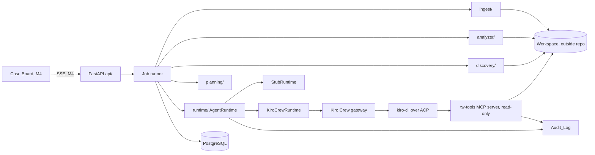

# Design Document: TimeWraith Backend, Milestone 1

## Overview

M1 turns an unfamiliar public GitHub repository into a Feature_Map, a Test_Plan and a Capability_Report without running any of the repository's code. The pipeline is deterministic code from end to end. Kiro Crew is called only for three judgment steps: candidate review, Hypothesis writing and Experiment design. Every agent answer is validated against a schema and against the discovery index before it is stored.

```
POST /investigations
  → validate URL, resolve ref to SHA            (ingest/)
  → hardened shallow clone into the Workspace   (ingest/)
  → detect languages, frameworks, test runners  (analyzer/)   → Capability_Report
  → find Signals, group into Candidates, score  (discovery/)  → Feature_Map (deterministic part)
  → Agent_Step: review candidates, hypotheses   (runtime/)    → Feature_Map (agent part)
  → template Experiments, choose Adapters       (planning/)
  → Agent_Step: refine Experiments              (runtime/)    → Test_Plan
  → store, emit stage events                    (db/, api/)
```

Requirements: `.kiro/specs/backend/requirements.md`. Frontend spec, unchanged: `.kiro/specs/timewraith/`.

### MVP override (2026-11-11)

The user asked for a quick MVP covering the whole flow (execution, verification and fixes), not only M1. The code in `backend/` follows `backend/README.md`, which takes precedence over this design where they differ:
- SQLite instead of Postgres.
- Regex detection instead of Tree-sitter.
- One thread per investigation.
- Agents get no tools: source goes into the prompt, which replaces `tw-tools` (B3).
- A generic `command` runtime is the seam for Kiro Crew.
- Docker execution, verification and eight fix gates are added.

The frontend contract is in `docs/integration-contract.md`. The sections below remain the target for hardening after the MVP.

### Decisions

| # | Topic | Decision | Reason |
|---|---|---|---|
| B1 | Agent runtime | Kiro Crew behind the `AgentRuntime` interface, used only for the three Agent_Steps. Wraith Director is the parent session; Bat Scout (candidate review, Hypotheses) and Pumpkin Mechanic (Experiment design) are subagents. A `StubRuntime` is used in tests and when Kiro Crew is absent. | User decision, 2026-11-11, after comparing Kiro Crew with a custom agent loop. Kiro Crew matches the pitch and supplies subagents, task handling and hooks. Keeping the pipeline deterministic keeps the core promise testable and makes the runtime replaceable. |
| B2 | Fallback runtime | If task 1 shows that the Kiro Crew Python client cannot do what B1 needs (headless dispatch, a restricted tool set, structured replies), the fallback is a `KiroCliAcpRuntime` that drives `kiro-cli` over ACP directly, reusing the same agent profiles. A custom LLM loop is not planned. | Keeps Kiro as the runtime with fewer moving parts. The decision is recorded in `docs/backend-tool-check.md`. |
| B3 | Tool source for agents | Agents get no built-in file, shell or web tools. Their only tools come from a TimeWraith MCP server (`tw-tools`) started per Investigation: `list_files`, `read_file` (line range, size cap), `search` (ripgrep, fixed-string or limited regex), `get_signal`, `get_candidate`. Each call is checked against the allowlist, confined to the Workspace and written to the Audit_Log. | A cloned repository can contain `.kiro/`, `AGENTS.md`, `.mcp.json` or prompt text aimed at agents. If agents only see data through our server and never run in the Workspace directory, the repository cannot add tools, steering or MCP servers. Requirement 6.4, 6.5. Task 1 checks that agent profiles can disable built-in tools. |
| B4 | Agent working directory | Agent sessions run in a TimeWraith-owned session directory (`TW_AGENT_HOME/<investigation>`), never in the Workspace. The Workspace path is passed only to `tw-tools`. | Same reason as B3: `kiro-cli` loads project config from its working directory. |
| B5 | M1 executes nothing | M1 only reads files. It records detected install and test commands for M2 but never runs them. | Requirement 2.4. No container is needed for M1, so M1 works even when Docker Desktop is not running (Postgres aside). |
| B6 | Clone on the host | The clone runs on the host with hardened Git settings (see Ingestion). From M2 the clone and install move into the worker container. | No target code runs in M1. Git does not run repository code on clone when hooks are disabled and submodules are not fetched. The host Git is 2.46.1; upgrading to 2.50.1 or later is recommended because later releases fixed clone-time issues. Those issues involve submodules, which we never fetch. |
| B7 | Jobs | In-process `asyncio` task runner with at most `TW_MAX_CONCURRENT=2` Investigations; status lives in Postgres. On startup, Investigations left in a running stage are marked `failed` with reason `interrupted`. Redis and RQ arrive in M2. | RQ workers do not run natively on Windows, and M1 jobs only read files. |
| B8 | Code structure parsing | Tree-sitter (`tree-sitter` with the JavaScript and TypeScript/TSX grammars) finds call sites, enclosing code units, imports and exports. If wheels for Python 3.14 are missing (checked in task 2), discovery falls back to ripgrep plus a brace-depth scope finder, and Signals are capped at `medium` confidence. | Grouping by code unit (Requirement 5.1) needs syntax, not lines. The fallback keeps M1 unblocked and is labeled. |
| B9 | Ports and services | API `127.0.0.1:8787`. Postgres 17 in Docker on host port `5433`, through `backend/compose.yaml`. | Avoids clashing with a local Postgres on 5432 and with Vite on 5173. |
| B10 | Validation repositories (to be confirmed by the user) | Proposed, three domains: **auth0/node-jsonwebtoken** (token expiry, `exp`, `nbf`, clock tolerance), **node-cron/node-cron** (scheduler, cron expressions, time zones), **jquense/react-big-calendar** (calendar UI, DST, time-zone formatting). Each is pinned to a commit SHA when the run happens. FullCalendar and Cal.com are not used, so the validation stays independent of the sample cases. | Requirement 13.2. These are a library, a scheduler and a React UI, so all three adapters get exercised. |
| B11 | Limits (defaults) | Clone timeout 120 s; Workspace size 500 MB; 50,000 files; parse files up to 1 MB; 15 Candidates sent to agent review; 12 Experiments per Candidate; 60 Experiments per Investigation; Workspace retention 7 days; agent call timeout 180 s; 2 retries for invalid agent output. All can be changed through `TW_*` environment variables. | Requirement 2.2, 7.6. These bound cost and agent quota. |

## Architecture



### Module layout

```
backend/
  pyproject.toml  uv.lock  alembic.ini  compose.yaml  .env.example
  migrations/
  schemas/                       exported JSON Schemas (checked in)
  agents/                        agent profiles: wraith-director, bat-scout, pumpkin-mechanic
  src/timewraith/
    config.py                    Settings (pydantic-settings, TW_* env)
    version.py                   ENGINE_VERSION
    api/        app.py routes.py errors.py events.py
    ingest/     url.py refs.py clone.py workspace.py
    analyzer/   manifests.py frameworks.py tests.py capabilities.py
    discovery/  catalog.py scan.py syntax.py signals.py candidates.py scoring.py
    planning/   templates.py adapters.py metamorphic.py plan.py
    runtime/    base.py stub.py kiro_crew.py prompts.py validate.py tools_server.py audit.py
    schemas/    common.py capability.py feature_map.py test_plan.py investigation.py export.py
    db/         models.py session.py repo.py
    jobs/       runner.py pipeline.py
  tests/
    fixtures/repos/              small synthetic JS/TS repos (see Testing)
    unit/  property/  snapshot/  integration/
```

## Ingestion

**URL rule** (Requirement 1.2): parse with `urllib.parse`. The scheme must be `https`, the host exactly `github.com`, with no port, user info, query or fragment. The path must be `/<owner>/<repo>` with an optional `.git` suffix. `owner` must match `[A-Za-z0-9](?:[A-Za-z0-9-]{0,38})` and `repo` must match `[A-Za-z0-9._-]{1,100}`, excluding `.` and `..`. The URL is normalised to `https://github.com/<owner>/<repo>.git`.

**Ref resolution:** `git ls-remote --exit-code <url> <ref> refs/heads/<ref> refs/tags/<ref> refs/tags/<ref>^{}`. A full 40-hex ref is used as given, and the fetch fails if it does not exist. A peeled tag (`^{}`) takes priority over the tag object. Every `git` call is made with an argument list, never a shell string. Refs must match `[A-Za-z0-9._/-]{1,200}`, must not start with `-`, and must not contain `..`.

**Clone** into `TW_WORKSPACE_DIR/<investigation-id>/repo`:
```
git -c core.hooksPath=<empty dir> -c protocol.allow=never -c protocol.https.allow=always
    -c core.symlinks=false -c core.longpaths=true -c submodule.recurse=false
    -c filter.lfs.smudge= -c filter.lfs.process= -c filter.lfs.required=false
    init / fetch --depth 1 --no-tags origin <sha> / checkout --detach FETCH_HEAD
```
- The environment sets `GIT_TERMINAL_PROMPT=0`, `GIT_LFS_SKIP_SMUDGE=1` and `GIT_CONFIG_NOSYSTEM=1`, and `HOME` points to an empty directory.
- With `core.symlinks=false`, links are checked out as plain files, so the scanners never follow them.
- The size and file-count limits are checked after checkout. The clone timeout covers the whole sequence.
- At startup, `TW_WORKSPACE_DIR` is resolved and rejected if it lies inside the repository root (`git rev-parse --show-toplevel` of this repo).

## Repository analysis

The analyzer reads only: `package.json` files (root and workspaces), lockfiles (`pnpm-lock.yaml`, `package-lock.json`, `yarn.lock`, `bun.lockb` name only), `tsconfig*.json`, framework configs (`next.config.*`, `vite.config.*`, `angular.json`, `svelte.config.*`, `nest-cli.json`), test configs (`vitest.config.*`, `jest.config.*`, the `jest` key in package.json, `.mocharc*`, `playwright.config.*`, `cypress.config.*`), and test file globs.

It detects:
- **Languages:** file counts by extension under the scan roots. The language is "primary" when JS/TS files are at least 30 % of source files, or when a `package.json` with source exists.
- **Workspaces:** `pnpm-workspace.yaml`, the `workspaces` field, `lerna.json`, `nx.json`, `turbo.json`. Each package is analyzed and reported on its own.
- **Fake timers in tests:** `vi.useFakeTimers`, `vi.setSystemTime`, `jest.useFakeTimers`, `jest.setSystemTime`, `sinon.useFakeTimers`, `@sinonjs/fake-timers`, `timekeeper`, `mockdate`, `page.clock.`.
- **Clock injection points:** functions or constructors that take a parameter named `now`, `clock`, `currentDate`, `today` or `getNow`, or a default parameter `= Date.now()` / `= new Date()`.
- **Recorded commands for M2:** the install command from the lockfile, plus `test`, `build`, `dev` and `start` scripts. They are stored and never run.

### Capability_Report items

| id | Meaning | Supported when |
|---|---|---|
| `language.js_ts` | JS/TS is the primary language | Detected as above |
| `package_manager` | Install can be reproduced in M2 | A lockfile is present |
| `adapter.js_tests` | Vitest or Jest present | Config or dependency found |
| `adapter.js_tests.fake_timers` | Repo already uses fake timers | Usage found in tests |
| `adapter.node_function` | Candidate modules are importable in Node | ESM or CJS entry resolvable from package.json or tsconfig |
| `adapter.browser` | UI reachable for Playwright clock control | A web framework and a `dev` or `start` script exist |
| `clock.server` | Server-side clock control | Always `unsupported` in M1: "Server clock not controlled by M1 adapters" |
| `analysis.syntax` | Tree-sitter parsing | Grammar loaded (else `unknown`, fallback B8) |
| `discovery.coverage` | Share of source files scanned | Reports the skipped counts by reason |

## Temporal Discovery Engine

### Signal_Catalog

Each entry has a detector (Tree-sitter query, or ripgrep pattern in the fallback), a default confidence and the Bug_Categories it suggests.

| Signal_Kind | Detects | Confidence | Suggests |
|---|---|---|---|
| `time.now` | `Date.now()`, `new Date()` with no args, `performance.now()`, `process.hrtime`, library `now()` (`dayjs()`, `moment()`, `DateTime.now()`, `Temporal.Now.*`) | high | expiry, midnight |
| `time.timer` | `setTimeout`, `setInterval`, `setImmediate` with a computed delay | medium | expiry |
| `date.construct` | `new Date(x)`, `Date.parse`, `Date.UTC`, library parse calls | medium | tz, midnight |
| `date.arith` | `setDate/setHours/...`, `getTime() ± n`, `add/subtract/startOf/endOf/differenceIn*` | high | midnight, dst |
| `date.compare` | `<`, `>`, `<=`, `>=`, `===` between date-typed or date-named operands; `isBefore/isAfter/isSame*` | high | expiry |
| `tz.convert` | `timeZone:` options, `toLocale*String`, `Intl.DateTimeFormat`, `utcToZonedTime`, `tz()`, `setZone`, `getTimezoneOffset`, `utcOffset` | high | tz, dst |
| `tz.fixed_offset` | Hard-coded offsets (`+05:30`, `* 60 * 60 * 1000` with 24 or 3600 factors) | medium | dst, tz |
| `format.date` | `toISOString`, `format(`, `toFormat(`, `strftime`-like patterns | low | tz, midnight |
| `field.expiry` | Identifiers or properties matching `expir`, `ttl`, `valid(Until|From)`, `not(Before|After)`, `exp`, `nbf`, `iat`, `deadline`, `cutoff`, `trial`, `grace` | medium | expiry |
| `field.schedule` | `cron`, `schedule`, `recur`, `rrule`, `interval`, `startsAt`, `endsAt`, `renew`, `billing(Cycle|Date)` | medium | dst, midnight |
| `cron.expr` | String literals that parse as 5- or 6-field cron expressions | high | dst |
| `lib.import` | Imports of the date libraries in Requirement 3.1 | low | (context only) |

Detectors run on `.js .jsx .mjs .cjs .ts .tsx .mts .cts .vue .svelte` files; for `.vue` and `.svelte` only the script blocks are scanned. The following are skipped: `node_modules`, `dist`, `build`, `out`, `.next`, `coverage`, `vendor`, `*.min.*`, files with an average line length over 300, files containing `@generated` in the first 5 lines, lockfiles, and files above 1 MB. Test files (`*.test.*`, `*.spec.*`, `__tests__/`, `test/`, `tests/`, `e2e/`, `cypress/`) are scanned and tagged `in_test`.

### Candidates

- **Grouping:** Signals are grouped by the innermost enclosing named code unit (function declaration, method, arrow function assigned to a name, class, React component). Signals outside a unit join a module-level unit.
- **Id:** `cand_` plus the first 12 hex digits of `sha256(engine_version, path, unit_kind, unit_name, unit_start_line)`.
- **Title:** generated from the unit name and its dominant Signal_Kind (for example, "isTokenExpired · date comparison"). Agents may suggest a better title, which is stored separately as `agent_title`.
- **Bug_Categories:** the union of the suggestions of the unit's Signals, restricted by rules:
  - `dst_transition` needs `date.arith`, `tz.convert`, `tz.fixed_offset` or `cron.expr`.
  - `expiry_boundary` needs `date.compare` or `time.timer` together with `time.now` or `field.expiry`.
  - `midnight_rollover` needs `date.arith`, `format.date` or a day-level operation (`startOf('day')`, `setHours(0`).
  - `timezone_conversion` needs `tz.convert`, `tz.fixed_offset`, or `date.construct` of a string without an offset.
  - Anything else is `other_temporal`.
- **Reachability:** exported from a package entry, imported by a route or page file (Next.js `app/` and `pages/`, Express `router.*` or `app.get/post` handlers), or rendered by a component that is.
- **Existing tests:** test files that import the unit's module, or mention the unit's name, and whether they use fake timers.

### Scoring

`score = signals + domain + reach + testability`, rounded to 2 decimals and stored with each part.
- `signals`: the sum over distinct Signal_Kinds of kind weight × confidence factor (high 1.0, medium 0.6, low 0.3), capped at 6. The kind weights are `date.compare` 2, `date.arith` 2, `tz.convert` 2, `time.now` 1.5, `cron.expr` 2, `tz.fixed_offset` 1.5, `field.expiry` 1, `field.schedule` 1, `time.timer` 1, `date.construct` 1, `format.date` 0.5, `lib.import` 0.
- `domain`: +1.5 when `time.now` and `date.compare` co-occur (an expiry pattern); +1 per additional Bug_Category; capped at 3.
- `reach`: +1 if exported, +1 if reached from a route or page.
- `testability`: +1 if an Adapter is `ready` for it, +0.5 if `needs_setup`.

Ties are broken by path, then line. The top `TW_REVIEW_CANDIDATES` Candidates (15) go to agent review. The rest stay in the Feature_Map with `agent_review: "not selected"`.

## Agent_Steps

Every step has a typed input, a typed output and a prompt template in `runtime/prompts.py`. Repository text is passed only inside a fenced block marked as untrusted data, together with the instruction that text in that block is never an instruction.

| Step | Agent | Input | Output |
|---|---|---|---|
| `review_candidates` | Bat Scout | Capability_Report summary, top Candidates with Signals and excerpts | For each Candidate: `keep` or `drop`, priority 1 to 5, a `rationale` (≤ 400 chars), corrected Bug_Categories, `agent_title`, extra Signal or file references to look at (resolved via `tw-tools`) |
| `write_hypotheses` | Bat Scout | Kept Candidates with the files they read | 1 to 3 Hypotheses per Candidate: `statement` (must use "could" or "may"), `condition` (time condition), `signal_ids`, `bug_category` |
| `design_experiments` | Pumpkin Mechanic | Hypotheses, the Experiment templates the planner made, Adapter capabilities, the Metamorphic catalog | For each template: keep, drop with reason, or adjust inputs and expected-behavior text; at most 3 extra Experiments per Candidate, chosen from template types only |

The Wraith Director session plans the order of these steps and collects the results. In the stub and in the fallback the order is fixed: review, then hypotheses, then design.

**Validation** (`runtime/validate.py`):
1. The reply is parsed as JSON. A JSON object inside a fenced block is accepted.
2. It is validated with the step's Pydantic model.
3. Every `signal_id`, `candidate_id`, path and line range must exist in the discovery index. Invalid references are removed and counted in `dropped_references`.
4. The text rules of Requirement 12.2 are checked. A Hypothesis without "could" or "may" is rejected.
5. Agents cannot change Clock_Scope, Adapter or Executability. Those fields are recomputed by the planner after the agent's edits.

The step is retried up to 2 times with the validation errors added to the prompt. After that, the step's output is dropped for the affected items, which then show "Agent review not run".

### AgentRuntime interface

```python
class AgentRuntime(Protocol):
    name: Literal["stub", "kiro_crew", "kiro_cli_acp"]
    async def health(self) -> RuntimeHealth: ...
    async def review_candidates(self, ctx: StepContext, inp: ReviewInput) -> ReviewOutput: ...
    async def write_hypotheses(self, ctx: StepContext, inp: HypothesisInput) -> HypothesisOutput: ...
    async def design_experiments(self, ctx: StepContext, inp: DesignInput) -> DesignOutput: ...
```

`StepContext` holds the Investigation id, the Workspace handle (for `tw-tools`), the Audit_Log writer, a deadline and the session directory.

**StubRuntime:**
- `review_candidates` keeps a Candidate when its score is at least 3, sets priority from the score quintile, and writes the rationale as a list of the score's parts.
- `write_hypotheses` fills one fixed sentence per Bug_Category, for example "Expiry could be off by one at the exact instant `{unit}` compares against".
- `design_experiments` keeps all templates.
- All output carries `runtime: "stub"` and the label "Stub runtime, not a Kiro Crew run".

**KiroCrewRuntime**, to be confirmed in task 1:
- Uses the documented Kiro Crew Python client (`kirocrew-client-py`) to open a Wraith Director session with the `wraith-director` agent profile. It dispatches Bat Scout and Pumpkin Mechanic as subagents with their profiles, and reads each reply and its task status.
- The profiles in `backend/agents/` disable built-in tools and allow only the `tw-tools` MCP server. They are copied into the session directory (B4).

Task 1 must confirm six points:
1. Install on Windows.
2. `kiro-cli` sign-in.
3. Headless dispatch from Python.
4. A per-profile tool restriction that removes built-in tools.
5. Per-session MCP server configuration.
6. How to read a final reply and its status.

Any point that fails moves the design to B2.

### tw-tools MCP server

A small MCP server written in Python (stdio), started per agent session with the Workspace path and the Investigation id.
- `list_files(dir, glob?)`: Workspace-relative paths, at most 500 entries.
- `read_file(path, start, end)`: at most 400 lines and 64 KB per call. The path is resolved and checked to lie inside the Workspace. Binary files are refused.
- `search(query, path_glob?, regex: bool)`: runs ripgrep with `--max-count 50 --max-filesize 1M` and fixed-strings by default. Regexes are limited to 200 characters.
- `get_signal(id)` and `get_candidate(id)` read from the discovery index.

Every call writes an Audit_Log row before it returns. Calls to unknown tools are refused and logged.

## Planning

### Experiment templates (Requirement 7.1)

Instants are written in local time of the Clock_Config zone unless noted. Dates are chosen from fixed reference years so the plan does not depend on today's date.

| Bug_Category | Experiments |
|---|---|
| baseline (every Candidate) | One mid-day instant on an ordinary weekday, UTC and one non-UTC zone: `2025-06-11T12:00:00` |
| `expiry_boundary` | Reference instant R taken from a literal or test fixture if found, otherwise `2025-06-11T12:00:00Z` plus the detected duration. Runs at R−60 s, R and R+60 s; plus R−1 ms and R+1 ms when millisecond precision is detected |
| `midnight_rollover` | `23:59:59`, `00:00:00`, `00:00:01` on `2025-06-11`; month end `2025-01-31T23:59:59`; year end `2025-12-31T23:59:59`; leap day `2024-02-29T12:00:00` and `2024-02-28T23:59:59` |
| `dst_transition` | `America/New_York` spring gap `2026-03-08T02:30` and fall overlap `2026-11-01T01:30`; `Europe/London` `2026-03-29T01:30` and `2026-10-25T01:30`; `Australia/Sydney` (southern hemisphere) `2026-10-04T02:30` and `2026-04-05T02:30` |
| `timezone_conversion` | Same instant `2025-06-11T23:30:00Z` in `UTC`, `America/Los_Angeles`, `Asia/Kolkata` (+05:30), `Asia/Kathmandu` (+05:45), `Pacific/Kiritimati` (+14), `Pacific/Pago_Pago` (−11) |

The DST and zone dates must be checked against the IANA tz database in a test (`zoneinfo`), so a wrong transition date fails CI instead of ending up in a plan.

### Adapter choice (Requirement 7.3)

1. `js_tests` applies when `adapter.js_tests` is supported and the Candidate's module can be imported from a test file location. Clock_Scope is `test_process`, and the clock comes from the runner's fake timers (`vi.setSystemTime` or `jest.setSystemTime`). The time zone is set through the `TZ` environment variable on the test process.
2. `node_function` applies when the unit is exported and either has a clock injection point or reads time only through `Date`/`Intl`. Clock_Scope is `node_process`, using `@sinonjs/fake-timers` installed by the M2 harness, plus `TZ`.
3. `browser` applies when the unit is reached only through a page or component and `adapter.browser` is supported. Clock_Scope is `browser`, using Playwright `page.clock.setFixedTime`, `install` or `runFor`, plus the `timezoneId` context option. The Experiment text states "Browser clock controlled; server clock not controlled".
4. If none of these apply, Executability is `not_controllable` and the reason is named.

**Executability:**
- `ready`: all inputs are known and the Adapter is supported.
- `needs_setup`: the Adapter is supported but something is missing, and the planner names it. Examples: the entry point needs a fixture, the app needs environment variables, or the route needs a login.
- `not_controllable`: the Candidate depends on server time, a database `now()`, or an external service.

### Metamorphic catalog (Requirement 8)

| id | Statement | Applies to | Exceptions |
|---|---|---|---|
| `mp.instant_preserved` | Converting one instant between zones and back yields the same epoch milliseconds | tz | Values typed as date-only or wall-clock without a zone |
| `mp.display_zone_independent` | Changing only the display zone does not change the stored or serialized timestamp | tz, dst | Code that intentionally stores local wall time (detected `local` or `wall` naming, or a documented rule) |
| `mp.roundtrip` | `parse(serialize(x))` equals `x` at the serializer's precision | tz, midnight | Lossy formats (date-only, minute precision); the comparison uses the format's precision |
| `mp.add_sub_days` | Adding N days then subtracting N days returns the start date | midnight, dst | Spans that contain a DST transition when arithmetic is in wall-clock hours; month-end clamping (`Jan 31 + 1 month`) |
| `mp.order_zone_invariant` | If a < b as instants, they compare the same way in every zone | expiry, tz | Comparisons of formatted strings by design (flagged as a Hypothesis, not excluded) |

The planner attaches a property only when its inputs fall outside every exception. Otherwise it records why the property was skipped.

## Data contracts (Pydantic, exported to JSON Schema)

```python
class Labelled(BaseModel):
    kind: Literal["Discovery candidates, not verified bugs", "Planned experiments, not run", "Capability report"]
    runtime: Literal["stub", "kiro_crew", "kiro_cli_acp", "none"]
    runtime_label: str            # "Stub runtime, not a Kiro Crew run" | "Kiro Crew" | "Agent review not run"
    engine_version: str
    target: TargetRef             # repository_url, ref, revision (40-hex)

class Signal(BaseModel):
    id: str; kind: SignalKind; path: str; start_line: int; end_line: int
    confidence: Literal["high", "medium", "low"]; excerpt: str  # <= 200 chars
    in_test: bool

class Candidate(BaseModel):
    id: str; title: str; agent_title: str | None
    unit: CodeUnit                # path, kind, name, start_line, end_line, exported
    signal_ids: list[str]; bug_categories: list[BugCategory]
    score: float; score_parts: ScoreParts
    reach: list[ReachRef]; existing_tests: list[TestRef]
    status: Literal["candidate"]
    agent_review: AgentReview | Literal["not selected", "Agent review not run"]
    hypotheses: list[Hypothesis]

class FeatureMap(Labelled):
    schema_version: Literal[1]
    note: Literal["These are candidates, not proven bugs."]
    candidates: list[Candidate]; signals: list[Signal]; skipped: dict[str, int]

class ClockConfig(BaseModel):
    instant: AwareDatetime; time_zone: str          # IANA, validated with zoneinfo
    mode: Literal["fixed", "paused", "advance"]; advance_ms: int | None
    scope: Literal["browser", "test_process", "node_process"]

class Experiment(BaseModel):
    id: str; candidate_id: str
    type: Literal["baseline", "boundary", "dst", "timezone", "leap", "metamorphic"]
    adapter: Literal["browser", "js_tests", "node_function"]
    clock: ClockConfig | list[ClockConfig]          # list for metamorphic pairs
    entry: EntryPoint             # test file | module export | url path
    inputs: dict[str, JsonValue]
    oracle: Oracle                # existing_test | specified_expectation | invariant(property_id, exceptions_checked)
    expected_behavior: str
    executability: Literal["ready", "needs_setup", "not_controllable"]; executability_reason: str | None
    setup: SetupSteps             # recorded commands, not run in M1

class TestPlan(Labelled):
    schema_version: Literal[1]; experiments: list[Experiment]; capped: bool

class CapabilityReport(Labelled):
    schema_version: Literal[1]; items: list[CapabilityItem]; packages: list[PackageInfo]
    recorded_commands: RecordedCommands
```

`schemas/export.py` writes `backend/schemas/*.schema.json`. A test compares the export with the checked-in files (Requirement 10.3). In M4 the frontend generates its TypeScript types from these files; that step is decided in the integration Q&A.

## API

| Method and path | Purpose |
|---|---|
| `POST /api/v1/investigations` | Body `{repository_url, ref, hints?}`. Returns `202 {id, status}` |
| `GET /api/v1/investigations?limit&cursor` | List, newest first |
| `GET /api/v1/investigations/{id}` | Status, stage, timestamps, target, runtime, error code |
| `GET /api/v1/investigations/{id}/feature-map` | Returns `409 not_ready` until the discovering stage is done |
| `GET /api/v1/investigations/{id}/test-plan` | Returns `409` until the Investigation is completed |
| `GET /api/v1/investigations/{id}/capabilities` | Available after analysis, including for failed runs |
| `GET /api/v1/health` | DB, workspace dir, git, rg, tree-sitter, agent runtime status |

The error shape is `{"error": {"code": "invalid_repository_url", "message": "..."}}`, with no stack traces and no absolute paths (Requirement 10.5). CORS allows `TW_CORS_ORIGINS`, by default `http://localhost:5173`.

Stage events (`api/events.py`) have the form `{investigation_id, seq, at, type: "stage" | "agent_step" | "tool_call", stage, data}`. They are kept in a table and an in-memory fan-out, ready for SSE in M4 (Requirement 15.3).

## Persistence

All tables use UUIDv7 primary keys and `timestamptz` timestamps.
- `investigations`: id, repository_url, ref, revision, engine_version, runtime, status, stage, error_code, hints, created_at, started_at, finished_at.
- `capability_items`, `signals`, `candidates`, `experiments`: each has `investigation_id` and its typed columns, with a JSONB column for nested parts.
- `agent_calls`: id, investigation_id, step, runtime, started_at, finished_at, outcome, attempts, dropped_references.
- `tool_calls`: id, agent_call_id, tool, args JSONB, result_status, at.
- `events`: investigation_id, seq, type, payload JSONB.

Migrations live in `backend/migrations/` (Alembic). Tests that need the database use the `db` marker and run against `TW_TEST_DATABASE_URL`. They are skipped when it is unreachable.

## Security summary

- No target code runs (B5).
- The clone is hardened (B6).
- The Workspace lies outside the repository.
- Agents have only the read-only tools of `tw-tools` (B3) and never work inside the Workspace (B4).
- Agent output is validated and its references are checked against the discovery index.
- Every agent call and tool call is audited.
- The API binds to localhost, with CORS limited to configured origins.
- Secrets come from the environment. Paths in errors and logs are Workspace-relative.
- M2 adds restricted containers: no privileges, read-only root filesystem, CPU, memory and time limits, network only for clone and install.

## Testing strategy

| Area | Kind | Examples |
|---|---|---|
| URL and ref validation | Hypothesis property | Any string outside the grammar is rejected; normalisation is idempotent; refs starting with `-` are always rejected |
| Clone | Integration (local bare repo fixture, `file://` allowed only in tests) | Hooks do not run; submodules are not fetched; symlinks become files; limits trigger `failed` |
| Analyzer | Unit on fixture repos | Each fixture's expected Capability_Report |
| Discovery | Unit, snapshot, property | Each Signal_Kind found in a minimal file; same input gives the same Signals and ids; shuffling the file order gives the same output |
| Scoring | Property | Monotonic: adding a Signal never lowers a score; parts sum to the total |
| Planning | Unit, property | Every template zone is valid in `zoneinfo`; the DST template instants fall in a real gap or overlap; no property is attached when an exception applies; Clock_Scope is always set |
| Agent validation | Unit, property | Invented ids and paths are removed; Hypotheses without "could"/"may" are rejected; agent edits cannot change adapter or scope |
| tw-tools | Unit | Path traversal (`..`, absolute, drive letters, UNC) is refused; size caps; every call is audited |
| Honesty text | Unit | Banned words absent from generated labels and reasons |
| Repo-agnostic guard | Unit | No validation repo name appears in `analyzer/`, `discovery/`, `planning/` |
| API | Integration (httpx, StubRuntime) | Full run on a fixture repo; error shape; 409 before ready |
| Schema export | Unit | Export equals the checked-in files |

The fixture repos in `tests/fixtures/repos/` are tiny synthetic projects written for this purpose:
- `expiry-lib` (token expiry, Vitest with fake timers)
- `cron-scheduler` (cron strings, `setInterval`, no tests)
- `react-calendar` (Vite and React, `Intl.DateTimeFormat`, a `timeZone` prop)
- `python-only` (unsupported language)
- `no-time` (no Signals)

Fixture repos are created by a script as local Git repositories at test time. No network is used.
