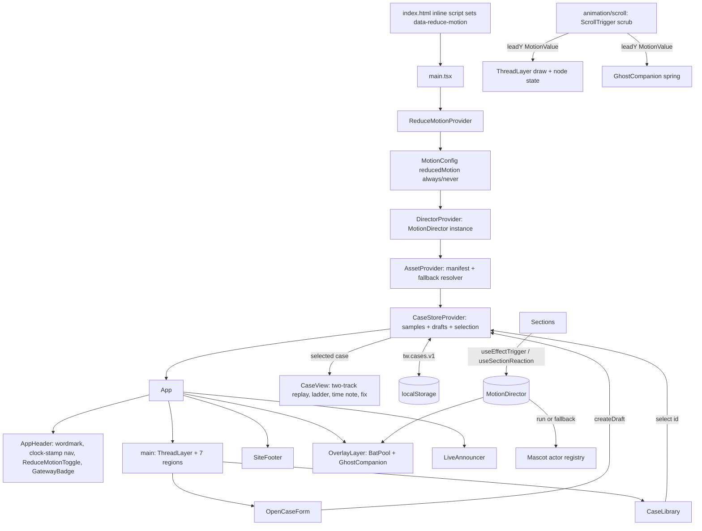
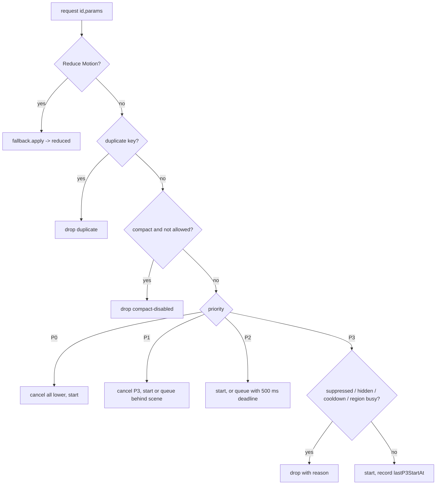

# Design Document

## Overview

TimeWraith is a Kiro Crew agent team for date-sensitive open-source apps: an autonomous regression investigator for date-sensitive apps. A user brings any target (a public Git repository pinned to a tag, branch or commit, or a local app URL); the Crew looks for date and time bugs, known and new, proves them with reproducible evidence on pinned historical versions, and suggests a fix. It does not claim to find arbitrary bugs on arbitrary websites.

The deliverable is one production-level app screen, the TimeWraith home screen called the **Case Board** (decision D14). It replaced the marketing landing page of the first spec version and reuses its sections, styles, content modules, mascots and tests. The board is one vertical scroll that behaves like a case file read through a night. A hand-inked thread runs down the board; each of the seven regions is a dated stamp on that thread. The board stays at clocktower night (tower-950, lamplit walnut-700) and reaches dawn (moon-200) only at the Closing; its 14 mascots react as their region arrives. All data is bundled mock data or drafts in localStorage. There is no backend, no real run and no second route.

Top to bottom: the **app header** (wordmark, clock-stamp nav, Reduce Motion toggle, "Demo mode, simulated status" gateway badge); the **Open-a-case panel** (the Wraith Director beside the Clock, the Open-a-case form, the setup checklist); the **Lost Hour** explainer; the **Case library** (two sample cases plus the user's drafts); the **Case view** of the selected case (Version_Timeline, two-track Replay Lab, Evidence Ladder, "Browser time ≠ server time", Doctor Stitch's suggested fix); **Crew on duty** (14 mascots); **How a case runs** (six steps); and the **Closing** prompt with the footer.

The work is entered in Kiroween as a mixture of three categories (decision D10), with **Costume Contest** as the lead for the UI (hand-inked, cel-painted look and the mascot cast), **Frankenstein** (a Crew of agents, Doctor Stitch the patch-maker among them, stitched to Playwright clock control, a sandbox runner and a version comparator) and **Resurrection** (old date-boundary bugs from public issue trackers, such as FullCalendar #7998 and Cal.com #30021, revived as reproducible evidence on pinned versions) as supporting angles. The design therefore spends effort where a UI judge looks first: the first screen, the signature moments, restraint (no glow, no glass, no card grid), and visible craft (reduced motion that is designed, not bolted on). It also spends effort on what a Kiro judge looks for: specs, steering, hooks and skills that are used during the build and described in the README.

### Signature moments (build these first, polish these most)

Animations are required in this version and must run in a browser (Requirement 27). An end-to-end test checks that the main ones change transforms over time with Reduce Motion off.

1. **The Clock wakes up.** On load the painted Clock's SVG hands sweep in over 580 ms and settle at 23:59.
2. **Opening a case.** Submitting the Open-a-case form plays a Bat Burst from the submit button; the new draft card drops into the Case library and Skeleton Scribe's hand writes its "Draft, not run" label (the label is DOM text). Nothing pretends a run happened.
3. **The Lost Hour.** A sticky, scroll-scrubbed scene. The Clock reads 01:58, then 01:59, an ink crack opens across the thread, and the next reading is 03:00. The 02:xx hour never appears. Mini Bats scatter from the crack when the region enters.
4. **Case library and case opening.** Case cards deal in along the thread when the library enters. Selecting a card unfolds the case-file sheet of the Case view.
5. **Replay Lab.** A Mini Bat flies between event pegs as the user scrubs; the Clock crack appears once at the anomaly event; the Evidence Ladder strip lights the current rung; on a fixed-version check Two-Faced Jack flips from the affected face to the fixed face and the version track turns over to the fixed version; in a Blind hunt the hidden report card turns face up at the reveal and the match stamp lands; each Version_Timeline milestone fills and stamps as the replay reaches it.
6. **Doctor Stitch.** His needle runs down the suggested-fix diff and the added lines are stitched in one by one; his thread continues the scrubber thread and the Timeline_Thread.
7. **Crew roll-call.** All 14 mascots check in one after another, then each Tier 2 mascot answers hover and keyboard focus with its own reaction.
8. **Raven stamp (Closing).** The Raven lands a stamp on the Closing sheet. The stamp text is DOM text, so it stays honest and accessible.

### Cut list (decided now, so the build stays fast)

- No Lenis or smooth-scroll library. Native `scroll-behavior` plus ScrollTrigger scrubbing is enough.
- No GSAP `pin`. Pinned scenes use CSS `position: sticky` and ScrollTrigger only for progress (no pin-spacer, so no layout shift).
- No SVG filters (`feTurbulence`) on the thread. The hand-inked look comes from seeded path wobble and two stacked strokes.
- No scroll-linked background color tween. The night-to-day ramp is static gradient seams between sections that contain no text.
- No per-mascot physics. Tier 1 rigs have at most 6 parts and 5 poses each.
- No autoplay on page load. The Replay has an optional user-started Play button only.
- Ghost squash and stretch poses are CSS transforms on the idle pose, not extra generated images.
- The six Mini Bat flap frames are composed by script from the body and wing parts, not generated one by one.
- No backend call on submit, no target or issue URL fetch, no reachability check. The form validates shape only.
- Case library filters (by mode and status) are optional; the first build ships without them.
- No new route, no URL hash or query for the selected case. Selection is React state.
- No live diff engine. Suggested-fix diffs are hand-authored hunks in the sample case data.

### Decisions that adjust or clarify the requirements

| # | Topic | Decision | Reason |
|---|---|---|---|
| D1 | FullCalendar #7998 | The Mock_Event_Stream is a **time-zone date-boundary** case (local Asia/Kolkata, calendar `Pacific/Honolulu`, `nowIndicator` shows the wrong date). It is not a DST case. The Problem section's 01:59 to 03:00 night is a separate, generic illustration of the failure class, labelled as such. | The issue text (fetched while writing this design) describes a time-zone bug. Requirement 7.3 says "DST and time-zone case"; calling it DST would overstate the source (Requirement 16.5). |
| D2 | Asset location | Assets live in `frontend/assets/{masters,cutouts,frames,scenery,effects,manifests,qa}` (Requirement 13.3). There is no repo-root `assets/`. | 13.3 is the more specific rule and keeps Vite able to import assets. |
| D3 | Source folder name | Motion code lives in `frontend/src/animation/` as named in source §12.2, not `motion/`. Hooks and steering use that path. | Requirement 17.6 requires matching §12.2. |
| D4 | Pinned scenes | CSS sticky wrapper plus ScrollTrigger `scrub`. | Satisfies "scroll-synced pinned scenes with ScrollTrigger" (9.12) with zero pin-spacer layout risk. |
| D5 | Footer landmark | `<footer>` is a page-level sibling after `<main>` so it is the `contentinfo` landmark. It is visually attached to the Closing (was Final_CTA). | A `footer` nested in a `section` is not a page landmark (Requirement 11.3). |
| D6 | UI font | Libre Franklin (variable, `@fontsource-variable/libre-franklin`), a Franklin Gothic revival. Changed in R2 (D13); it replaced Instrument Sans, which had replaced Bricolage Grotesque. | The American gothic of 1900s to 1930s posters and newspapers fits a 1930s clocktower, stays legible at 14 to 17 px, has a real bold for the CTA label (D7), and is one variable family. |
| D7 | Primary CTA label | ink-900 on pumpkin-600 measures 3.60:1, so the label must be large text (at least 18.66 px bold) and the button gets a 2 px ink-900 border. | Requirement 11.8 (3:1 for large text) and 11.9. See Token contrast table. |
| D8 | Background mode | Transparent alpha is the default route (verified in Task 1.1, `docs/tool-check.md`, fallback level 0). Magenta `#FF00FF` chroma key, not green, is the backup route, used only when a transparent request comes back opaque. One request never asks for both. | Codex 0.163.0 returned real RGBA with clean edges. The key route works but needs tolerance and despill. sage-700 (hue near green) is in the palette; magenta appears nowhere in it. |
| D9 | OpenCode | `opencode.cmd --version` works (v2.2.6, Task 1.2). The sprite components, the Cutout_Script, the Asset_QA_Page and the Pilot_Pack rig wiring may be delegated; the primary agent reviews each result and takes the task back if the delegated run fails. | A real `opencode.cmd run` is still unconfirmed, so the first delegated task is the real test. |
| D10 | Hackathon categories | Mixture of three Kiroween categories. Costume Contest leads for the UI (hand-inked, cel-painted UI and the mascot cast). Frankenstein: TimeWraith is a Crew of agents (planner, orchestrator, explorer, experimenter, verifier, and Doctor Stitch the patch-maker) stitched to Playwright's clock control, a sandbox runner and a version comparator. Resurrection: old, forgotten date-boundary bugs from public issue trackers (such as FullCalendar #7998 and Cal.com #30021) brought back as reproducible evidence on pinned versions. The README names Costume Contest as the lead and pitches the other two as supporting angles. The `product.md` steering file, the README (task 22.1) and the Devpost write-up notes record all three angles. | Devpost may require choosing one primary category, so the lead must be explicit. Task 22.1 re-reads the 2026 rules to confirm whether multiple categories are allowed and adjusts the write-up. Requirements 17.7 and 17.8. |
| D11 | Public links | Suggested, to be confirmed by the user: GitHub is a public repository named `timewraith` under the user's account (`https://github.com/<user>/timewraith`). Demo is an unlisted YouTube video of about 3 minutes, which is what Devpost submissions normally use; optionally also a live deploy of the static build on Cloudflare Pages or Vercel. Until the user supplies final values, `config/links.ts` keeps the Placeholder_Links. Task 22.3 swaps them once the repository and video exist. | The user asked for a suggestion. Requirement 5.7 keeps the placeholders visibly marked until then. |
| D12 | License | Not decided. The user chooses an OSI-approved open-source license at task 22.2, and MIT is not assumed. | The hackathon needs an OSI-approved open-source license, visible in the repository About section, so the choice cannot be skipped before submission. Requirement 17.3. |
| D13 | Type and night-heavy layout (R2) | Headings in IM Fell English (400 roman and italic, no bold; hierarchy by size and italics), interface text in Libre Franklin, times, versions, evidence values and diffs in JetBrains Mono. The board stays at night: Open-a-case, Lost Hour, Case view and Flow on tower-950, Case library and Crew on walnut-700, only the Closing and the footer on moon-200. Cream (paper-100, parchment-200) is the color of paper objects (case cards, the case-file sheet, the ladder scroll), not of whole regions. The twelve palette colors are unchanged. See Visual revision R2. | User review after R1: the cream and brown page with a terracotta CTA and a Fraunces-style serif read as the default AI "editorial but friendly" look. The user liked the dark-to-cream scroll as night to daybreak, so the night is kept longer and dawn arrives only at the end. Requirements 12.3, 12.4 and 12.12. Fonts are already installed (`@fontsource/im-fell-english`, `@fontsource-variable/libre-franklin`). |
| D14 | Case Board replaces the landing page | The deliverable is one app screen, the TimeWraith home screen (Case Board), on the same single route. The seven landing sections become seven board regions: Hero → Open-a-case panel, Problem → Lost Hour, new Case library, Replay Lab and Proof → Case view (case-scoped), Crew (14), Flow (six steps), Final_CTA → Closing. Existing section components, styles, content, mascots and tests are reused and renamed where the role changed. | User decision. A working home screen that takes any target shows the product better than marketing copy, and judges can try it. Requirements 1, 3, 19 to 27. |
| D15 | Doctor Stitch | 14th mascot, Tier 1, Crew_Agent "patch-maker": a patchwork ghoul in a stained surgeon's coat with a needle in one hand and a spool of thread in the other. Rig parts: body (with the spool hand), needle arm, eyes. He reads the Raven's verified failure and stitches a suggested fix and its regression test; Skeleton Scribe keeps the report export. He appears in the Case view (fix panel), the Crew and the fix step of the Flow. His needle thread continues Spider Weaver's scrubber thread and the Timeline_Thread, so the fix sheet is visibly sewn onto the same line as the replay. His hero pose is in the Pilot_Pack (D22); his rig parts follow approval. | User decision. A stitched-together figure carries the Frankenstein angle (D10) and gives the fix its own honest owner, separate from the verifier. Requirements 4.1, 4.10, 13.13, 24. |
| D16 | Sample cases and their honesty labels | Two sample cases ship. **FullCalendar #7998**: Known issue mode, browser-side time-zone date boundary, affected version `@fullcalendar/core 6.1.10` from the report, existing stream (D1) plus a Doctor Stitch event. No fixed release was identified while writing this design, so the stream ends at Known-issue match with "Fixed-version check not run", and the suggested fix is "Suggested fix · not verified · Illustrative diff · No upstream fix found". **Cal.com #30021**: Blind hunt mode, server-side DST, labelled "Illustrative replay modelled on the public report, not a real recorded run". The Crew is given only "booking availability around DST"; the reveal comes after Reproduced; then the regression test is rerun on the affected pin plus the fix described in the report (a "patched" version), which passes with 192 tests green as the report states. Pins that are not in the reports are labelled "illustrative pin"; no commit hash is invented. | Requirement 16.5, 16.6, 16.9, 26. The user asked for "affected fails, fixed passes" as the climax; only the Cal.com report gives evidence for a passing fix, so only that case shows the pass. Task 8.1 rechecks FullCalendar's releases; if a release that fixes #7998 is found, its stream gains an illustrative fixed-version event on that release. **To be confirmed by the user.** |
| D17 | Fix step placement | The Flow gets a sixth step, **fix**, after evidence: scope, plan, approve, run, evidence, fix. Doctor Stitch and Skeleton Scribe act in it (the report export bundles the regression test and the suggested fix). | A suggested fix is a proposal, not a measurement. Folding it into "evidence" would blur measured facts with a proposal, which the source design warns against (findings inspector: "clear separation from measured facts"). A separate step also gives Doctor Stitch a stage. Requirement 3.6. |
| D18 | Lost Hour kept | The Problem scene stays as a short explainer region (region 2, between the Open-a-case panel and the Case library), with the desktop scrub shortened from 220vh to 160vh. Its caption uses the same night as the Cal.com sample case without naming the report: "Illustration: the US spring-forward night, 8 March 2026". | The lost-hour scene is a signature moment and explains DST in five seconds. The caption is a fact about the calendar, not a finding, and it does not spoil the Blind hunt reveal. |
| D19 | Final_CTA becomes the Closing | The Closing keeps the dawn colour, the Raven stamp ("Filed 06:58") and Skeleton Scribe. Its one action is "Open a case", which scrolls to the Open-a-case panel and focuses the first field. The demo and GitHub Placeholder_Links move here (and stay in the footer); the old "Enter the Clocktower" CTA and its note are retired. | A home screen needs a way back to its main action after a long scroll; a marketing CTA no longer fits. Requirement 3.10, 5.6, 5.8. |
| D20 | Draft storage | Drafts live in `localStorage["tw.cases.v1"]` as `{ schemaVersion: 1, drafts: DraftCase[] }`, at most 20, validated on read with the same validators as the form; unreadable data is skipped and never throws. No network. | Requirement 20. A versioned key lets a later backend milestone migrate or discard drafts without guessing. |
| D21 | Version_Timeline as the case's spine | Each case gets a Version_Timeline at the top of the Case view, drawn as a branch of the Timeline_Thread: version released, issue reported, reproduced on the affected version, fix suggested, fixed version verified. History milestones carry a real date only from a published release or the issue tracker record (linked); replay milestones point at a replay event, carry the case's sample label and get no calendar date. The milestones light as the scrubber reaches their events (`timeline.milestone`). | User decision (v1 direction): the headline "Bugs are hiding in time" is about project history, and the Version_History_Strip on a card is too small to tell it. Giving replay milestones a calendar date would date a run that never happened (Requirement 16.11). Requirement 28. |
| D22 | Pilot_Pack keeps three poses | The Pilot_Pack stays Mini Bat, Wraith Director and Doctor Stitch, full poses only. All three were generated on 2026-11-10 and passed QA (`docs/tool-check.md`, "Pilot pack generation"); they wait for the user's style approval at checkpoint 18. Rig parts and the other eleven mascots still wait for that approval. **To be confirmed by the user:** the v1 brief said the approval stop "stays Mini Bat + Wraith Director"; if the user wants that, Doctor Stitch's existing pose is shown at checkpoint 18 as an extra and the gate wording changes, with no regeneration. | The user asked for Doctor Stitch in the pack when it was generated, and the image already exists, so a two-pose gate would describe something that did not happen. Requirement 13.8. |
| D23 | v1 scope notes | (a) v1 hunts date and time bugs only; a general-purpose bug hunter in the style of an AI code reviewer (for example CodeRabbit) is a possible later direction, named only as future work. (b) The three-agent pitch maps to the Crew as Explorer = Bat Scout, Time Experimenter = Pumpkin Mechanic, Verification = Raven Archivist, plus Doctor Stitch (fix), Wraith Director (planner) and Watchtower Warden (orchestrator). (c) "Blind benchmark" is the pitch name of the Blind hunt mode; the code and labels keep "Blind hunt". (d) "Recorded investigation replay" is reserved for a replay recorded from a real Crew run; neither sample qualifies. (e) Cal.com #24350 is a backup case only and is not on the board. | User decisions in the v1 direction. Requirements 1.7, 16.10, 16.11 and the Introduction's out-of-scope list. |

### Revision R3: Case Board (v1 direction)

R3 is the pivot from the marketing landing page to the Case Board (D14 to D23). Earlier revisions stay in this document for history: R1 (paper treatment, no uppercase micro-labels, legibility, copy voice, footnote dagger for placeholder links) and pass B (characters perching on and breaking out of containers) under "Visual revision R1"; R2 (IM Fell English and Libre Franklin, night-heavy layout) under "Visual revision R2" and D13. R2 is implemented and logged in `docs/kiro-usage.md` (task 5.1, screenshots in `docs/reports/shots/r2/`); the `verify` gate after phase 2 is checkpoint 6.

**Regions, in order** (ids are stable and used by nodes, nav, tests and screenshots):

| # | Id | Region | Was | Holds |
|---|---|---|---|---|
| 1 | `open` | Open-a-case panel | Hero | Clock, Wraith Director, headline, subhead, positioning line, Open-a-case form (mock), setup checklist |
| 2 | `lost-hour` | Lost Hour | Problem | The 01:59 to 03:00 scene, labelled as an illustration (D18) |
| 3 | `library` | Case library | new | Two sample cases, then the user's drafts |
| 4 | `case` | Case view | Replay Lab + Proof | Case header, Version_Timeline (D21), two-track replay with the Blind hunt reveal, Evidence Ladder, "Browser time ≠ server time", suggested-fix sheet |
| 5 | `crew` | Crew on duty | Crew | 14 mascots, Doctor Stitch included |
| 6 | `flow` | How a case runs | Flow | Six steps, fix last (D17) |
| 7 | `close` | Closing | Final_CTA | "Open a case", demo and GitHub Placeholder_Links, Raven stamp, footer after `<main>` |

**Where each R3 part is designed:** form and drafts in "Open-a-case panel and form" and D20; library and Version_History_Strip in "Case library"; Version_Timeline, two-track replay, reveal and suggested fix in "Case view and two-track Replay Lab"; models in "Case models"; sample data with sources in "Case view and two-track Replay Lab" and Research finding (h); Doctor Stitch in D15, the per-region mascot table and "Sprites and rigs"; new effects in the effect registry; new properties 27 to 35.

**Superseded by R3, kept for history:** the primary CTA "Enter the Clocktower" and its note (D19); the standalone Replay_Lab and Proof sections (now case-scoped in region 4); the five-step Flow (now six); the 13-mascot roster (now 14). Requirement criteria that changed are marked "(Revised; was ...)" or "Superseded by ..." in `requirements.md`.

## Research Findings and What They Changed

Each row names the source used and the design consequence. Content was rephrased for compliance with licensing restrictions.

### (a) React 19 + Motion + GSAP ScrollTrigger scroll-drawn SVG path

- GSAP's own React guide says to use `useGSAP()` from `@gsap/react`: it wraps `gsap.context()`, reverts animations and ScrollTriggers on unmount, and supports a `scope` ref and `revertOnUpdate`. Animations created after the hook runs (click handlers) must be wrapped in `contextSafe()` ([GSAP React guide](https://gsap.com/resources/React/)). **Consequence:** every ScrollTrigger lives in a `useGSAP` call in `animation/scroll/`. React 19 StrictMode double-invoke is safe.
- DrawSVG works by controlling `stroke-dashoffset` and `stroke-dasharray` ([DrawSVGPlugin](https://gsap.com/community/drawsvg/)). A community skill file reports that since GSAP 3.13 every former Club plugin ships free in the public `gsap` package ([genjutsu GSAP skill](https://github.com/AThevon/genjutsu/blob/main/skills/_jutsu/gsap/SKILL.md)); this is secondhand, so Task 2 confirms it on gsap.com before relying on it. **Consequence:** the design does not depend on DrawSVG or MotionPath. It sets `stroke-dasharray` and `stroke-dashoffset` itself (about 6 lines) and positions the ghost from a precomputed lookup table.
- `SVGGeometryElement.getPointAtLength()` is baseline-available since 2020 ([MDN](https://developer.mozilla.org/en-US/docs/Web/API/SVGGeometryElement/getPointAtLength)). **Consequence:** the thread builds a sample table once per layout (about 400 points with cumulative length), so per-frame work is a table lookup, not DOM geometry calls.
- `gsap.matchMedia()` reverts everything created inside a callback when its query stops matching ([docs](https://gsap.com/docs/v3/GSAP/gsap.matchMedia/)). **Consequence:** it only sees the OS media query, not our own Reduce Motion toggle, so ScrollTrigger setup is keyed on the React `reduceMotion` state with `useGSAP({ dependencies: [reduceMotion, compact], revertOnUpdate: true })`.
- Motion docs: `<MotionConfig reducedMotion="user">` turns off transform and layout animations while keeping opacity and color; `"always"` and `"never"` allow a site-level override ([Motion accessibility](https://motion.dev/docs/react-accessibility), [MotionConfig](https://motion.dev/docs/react-motion-config)). **Consequence:** the app wraps everything in `<MotionConfig reducedMotion={reduceMotion ? "always" : "never"}>` driven by our toggle, and the director still owns the real fallbacks.

### (b) CSS `steps()` sprite sheets and layered PNG rigs

- `steps(n)` needs a positive integer; `jump-none` needs at least 2 ([MDN steps()](https://developer.mozilla.org/en-US/docs/Web/CSS/Reference/Values/easing-function/steps)). A sprite loop with default `jump-end` ends one frame past the last image, and the animation restarts there, so the last frame is not duplicated ([sprite-sheet reduced-motion write-up](https://dev.to/liangqi_zhao_b047bd1f3236/a-tiny-css-sprite-sheet-preview-with-a-reduced-motion-fallback-2fhh)). **Consequence:** `steps(6)` over `translateX(-100%)` of a 6-frame strip shows frames 0 to 5, each for 1/12 s.
- The common technique animates `background-position`. That repaints. Requirement 9.14 asks for compositor-friendly transforms. **Consequence:** the strip is an `` inside an `overflow: hidden` frame, and the animation moves it with `transform: translateX`.

### (c) Chroma-key cutout in Python

- A community gist shows **edge-only despill** (adjust only pixels on the alpha edge) ([edge-only despill](https://gist.github.com/tizee/dfc6251050445b084643c89855c72d76)). Chroma-difference keys produce a soft alpha hint that can then be refined ([CorridorKey notes](https://github.com/nikopueringer/CorridorKey)). **Consequence:** the cutout script computes a soft matte from chroma distance, estimates the true foreground color on edge pixels, and despills only a thin band.
- Verified in this environment: Python 3.14.5, Pillow 12.3.0, numpy 2.5.1 are installed. SciPy and OpenCV are **not**. **Consequence:** the script needs only Pillow and numpy and uses a small pure-numpy flood fill; SciPy is an optional speed-up.

### (d) How Codex CLI generates images, and its limits

- Verified here: `codex.cmd --version` prints `codex-cli 0.163.0`; `codex.cmd exec` exists with `-s/--sandbox`, `-C/--cd`, `-i/--image`, `--skip-git-repo-check`, `--json`, `-o/--output-last-message`, `--ephemeral`. `~/.codex` exists. A PATH-alias warning (`os error 183`) is printed on every run and is harmless.
- OpenAI's `imagegen` skill says Codex has a **built-in `image_gen` tool** that needs no `OPENAI_API_KEY`, saves outputs under `$CODEX_HOME/generated_images/...`, and that project assets must be copied into the workspace afterwards. The `scripts/image_gen.py` CLI mode needs `OPENAI_API_KEY` and is for explicit use only ([openai/skills imagegen](https://github.com/openai/skills/blob/main/skills/.system/imagegen/SKILL.md)).
- A Codex issue reports that built-in image generation saves "transparent background" requests as opaque RGB PNGs, with no real alpha ([openai/codex #18905](https://github.com/openai/codex/issues/18905)). Other projects reach the same conclusion and key a flat color out afterwards ([claude-codex-image-gen](https://github.com/leepokai/claude-codex-image-gen)). **Consequence (first version):** the chroma-key plus Cutout_Script route. **Superseded by Task 1.1:** on codex-cli 0.163.0 the `image_gen` tool has a `transparent_background` option that Codex sets from the prompt wording, and Run A returned a real RGBA PNG with clean edges (`docs/tool-check.md`). The transparent route is now the default and the key route is the backup (D8).
- Limits reported by others, not verified here: image generation is not on the Free plan and consumes included limits several times faster than text turns ([GENEXIS notes](https://github.com/GENEXIS-AI/gpt-image-skill)); non-API image output appears capped near 1.5 megapixels ([OpenAI forum thread](https://community.openai.com/t/image-generation-resolution-control-in-codex-chatgpt-app-web-broken-since-mid-june/1407532/1)). **Consequence:** plan about 46 base generations (42 plus Doctor Stitch) and budget about 75 with retries; Task 1 measured one image at about 1% of the 5-hour window or less.
- **Verified in Task 1.1** (`docs/tool-check.md`): `codex.cmd exec` invokes `image_gen` non-interactively; the file lands in `~/.codex/generated_images/<thread_id>/`; copying into the workspace works; one image takes 18 to 28 s in the tool call. Output is **1774 × 887 RGBA**, not the 1024 × 1024 assumed above, and the tool call has no size argument. The subject interior has alpha 251 to 253 and there is a faint alpha 1 to 2 haze, so the Cutout_Script snaps, cleans, trims and places the subject on the 1024 × 1024 master canvas (see Art Pipeline). Untested: whether a prompt can force a square canvas and whether `-i` reference images keep scale; the first Pilot_Pack asset checks both.

### (e) Kiro hooks, steering, skills, and what judges look for

- **Hooks.** JSON files at `.kiro/hooks/<id>.json`, schema `{"version":"v1","hooks":[{name, description?, trigger, matcher?, action:{type:"command"|"agent", command|prompt}, timeout?, enabled?}]}`. Command actions run in the project root and receive session context as JSON on STDIN; exit 0 adds STDOUT to the agent context; any other exit sends STDERR to the agent; on `PreToolUse` a non-zero exit blocks the tool; default timeout 60 s ([Hooks](https://kiro.dev/docs/hooks/), [Hook actions](https://kiro.dev/docs/hooks/actions/)). Triggers include `PostFileSave`, `PostToolUse`, `PreToolUse`, `PostTaskExec`, `PreTaskExec`, `Stop`, `SessionStart`; for tool triggers the matcher can be a category (`read`, `write`, `shell`, `web`, `spec`) or a regex on the tool ID; for file triggers it is a regex on the file path ([Hook triggers](https://kiro.dev/docs/hooks/types/)). Best practice: precise file globs, one task per hook, prefer shell commands for deterministic work because they are faster and cost no credits ([Best practices](https://kiro.dev/docs/hooks/best-practices/)). **Not documented on the pages read:** the exact STDIN JSON field names for file triggers. **Consequence:** all hook commands call small Node helpers that try several field names and fall back to a project-wide check; a disabled debug hook records one real event so Task 2 can pin the schema.
- **Steering.** Markdown in `.kiro/steering/` with YAML front matter `inclusion: always | fileMatch | manual | auto`; `fileMatch` takes `fileMatchPattern` (string or array); `auto` needs `name` and `description`; `manual` files appear as `/` commands; `#[[file:path]]` embeds live workspace files ([Steering](https://kiro.dev/docs/steering/)). Foundation files are `product.md`, `tech.md`, `structure.md`.
- **Skills.** Verified on the Kiro docs: workspace skills live in **`.kiro/skills/<name>/SKILL.md`**; front matter requires `name` (must match the folder name, lowercase letters, digits and hyphens, at most 64 characters) and `description` (at most 1024 characters; Kiro matches requests against it); optional `license`, `compatibility`, `metadata`; optional `scripts/`, `references/`, `assets/` subfolders; skills activate automatically or as `/skill-name` slash commands ([Agent Skills](https://kiro.dev/docs/skills/)). The separate KiroCrew runtime documents extra fields (`always`, `triggers`); those are **not** used here.
- **What judges look for.** The Kiroween Devpost page says entries are judged on potential value, implementation of Kiro, and creativity, and a write-up of how Kiro was used is mandatory; Costume Contest means a polished, "hauntingly beautiful" UI; Frankenstein and Resurrection are the other two categories this entry leans on (decision D10) ([Devpost](https://kiroween-2025.devpost.com/), [Decoding Kiroween](https://dev.to/brian_mk/decoding-kiroween-4nm)). These sources describe the 2025 edition; the README task (22.1) re-reads the 2026 rules before submission to confirm whether multiple categories are allowed, because Devpost may require one primary category. **Consequence:** the Kiro workspace is built early (Task 2), every phase appends to `docs/kiro-usage.md`, and the README write-up cites real files and real hook runs.

### (f) Lighthouse CI and Playwright

- Lighthouse CI reads `lighthouserc.json`; assertions are keyed by audit id or `categories:<id>`, with levels `off|warn|error`, options `minScore`, `maxNumericValue`, and `aggregationMethod` including `median-run`; desktop is selected with `collect.settings.preset: "desktop"` ([LHCI configuration](https://github.com/GoogleChrome/lighthouse-ci/blob/main/docs/configuration.md)). **Consequence:** one `frontend/lighthouserc.json` with `staticDistDir`, 3 runs, desktop preset.
- Playwright `toHaveScreenshot()` compares against stored baselines, warns that rendering differs by OS and browser, and offers `maxDiffPixels`, `threshold`, `stylePath` and `animations` options ([Playwright snapshots](https://playwright.dev/docs/test-snapshots)). **Consequence:** baselines are generated on this Windows machine in Reduce Motion mode (deterministic), and are not a CI gate on other machines.

### (g) Reduced motion

- Motion recommends replacing large transforms with opacity changes, disabling parallax and autoplay, and reading the setting with `useReducedMotion()` ([Motion accessibility](https://motion.dev/docs/react-accessibility), [useReducedMotion](https://motion.dev/docs/react-use-reduced-motion)). **Consequence:** the director's fallback shape is exactly "settle to final state, optionally with an opacity fade of at most 150 ms".
- Our toggle must override the OS setting both ways, so CSS cannot rely on `@media (prefers-reduced-motion)`. **Consequence:** a 10-line inline script in `index.html` sets `<html data-reduce-motion="true|false">` before first paint, and CSS keys on that attribute.
- A Windows machine with "Animation effects" turned off reports `prefers-reduced-motion: reduce`, so the board starts in Reduce Motion and shows no animation at all. **Consequence:** the toggle shows its state as text ("Motion: reduced (system setting)" or "Motion: on"), so a reviewer who sees no animation can tell why and switch it (Requirement 10.10).

### (h) The two public reports behind the sample cases

- **FullCalendar #7998** ([issue](https://github.com/fullcalendar/fullcalendar/issues/7998), re-read while revising this design): with the system zone Asia/Kolkata and the calendar zone Pacific/Honolulu, `nowIndicator` and date headers show the local date instead of the calendar zone's date. The report names `@fullcalendar/core` 6.1.10 and React connector 6.1.11. The issue page shows no linked fix. **Consequence:** the sample case pins 6.1.10 as the affected version and shows "Fixed-version check not run" (D16).
- **Cal.com #30021** ([issue](https://github.com/calcom/cal.com/issues/30021), read while revising this design): on a DST transition date, a schedule whose start is 13:00 or later is shifted one hour late. For America/New_York 1 PM to 6 PM on 2026-03-08 the window is produced as 18:00 to 23:00 UTC instead of 17:00 to 22:00 UTC; the days either side are correct. The report places the cause in the DST correction inside `processWorkingHours` (`packages/features/schedules/lib/date-ranges.ts`): the offset probe is built from a 12-hour-formatted timestamp, so 13:00 is probed as 01:00. Existing DST tests used a 9 AM start, which is why it was not caught. It reproduces with the server in `TZ=UTC` on Node.js 22, at unit level by calling `processWorkingHours` with 13:00 to 18:00 and America/New_York. The reporter added a failing unit test and states that with the fix 192 availability tests pass (53 in `date-ranges.test.ts`, 43 in `slots.test.ts`, 39 in `getSchedule.test.ts`, 62 in the time-zone-mode suite). The report also names a separate defect on non-UTC hosts and keeps it out of scope. **Consequence:** the second sample case is server-side, so its clock track records "Server time zone set: TZ=UTC" and a unit-level test instead of a browser clock; it is a Blind hunt (the Crew is given only "booking availability around DST"); the fixed-version check runs on the affected pin plus the fix described in the report; the non-UTC defect is mentioned as out of scope in the case notes. The source design document lists this report under `calcom/cal.diy`; this spec uses the `calcom/cal.com` URL the user gave, which resolves. Content was rephrased for compliance with licensing restrictions.
- **Dates for the Version_Timeline** (checked during R3 through the GitHub issues API and the npm registry): FullCalendar #7998 was opened on **2025-09-12** and is still open with no linked fix; its body states "September 12, 2024" and uses 2024 in its examples, so the timeline uses the tracker's opening date and the replay keeps the report's 2024 clock values. `@fullcalendar/core` **6.1.10** was published on npm on **2023-11-29**; later releases exist (6.1.11 to 6.1.22, 7.0.0 to 7.1.4) but none is linked to #7998, so "Fixed-version check not run" stays. Cal.com #30021 was opened on **2026-08-21**, is still open (labelled Stale), and the GitHub API now redirects it to `calcom/cal.diy`; the affected and patched pins are illustrative, so the "version released" milestone has no date. **Consequence:** D21 and the sample timelines below.

## Architecture

### Stack

| Layer | Choice |
|---|---|
| Build | Vite, React 19, TypeScript (strict), pnpm |
| Styles | Plain CSS files, tokens in `styles/tokens.css`. No Tailwind, no component kit. |
| Springs, sprite actors, director effects | Motion (`motion/react`) |
| Scroll sync (thread, sticky scenes) | GSAP + ScrollTrigger via `@gsap/react` `useGSAP`, loaded with a dynamic `import()` after first paint |
| Fonts | Self-hosted `@fontsource/im-fell-english` (400 roman and italic), `@fontsource-variable/libre-franklin`, `@fontsource-variable/jetbrains-mono` (`font-display: swap`), with `size-adjust` system fallback faces (since R2, D13) |
| Unit and property tests | Vitest, @testing-library/react, jsdom, fast-check |
| Art tooling tests | pytest, Hypothesis (Python) |
| E2E, screenshots | Playwright (`@playwright/test`, `@axe-core/playwright`) |
| Performance gate | `@lhci/cli` |

### Runtime structure



Case state lives in one `CaseStoreProvider` (`cases/store.tsx`, a `useReducer` with actions `createDraft`, `removeDraft`, `select`). The form, the library and the case view only dispatch actions and read state; the provider writes drafts to localStorage after each change. **State never waits for animation**: a `select` or `createDraft` action updates state, focus and the live region at once, and only then requests the matching effect (Requirement 27.3). If the effect is dropped or Reduce Motion is on, its `settle` or `fallback` leaves the same final picture.

Data flows one way. User and scroll events become **effect requests** to the director. The director decides, then calls the effect's `run` (normal mode) or `fallback` (Reduce Motion, or when a request is dropped or cancelled). Effects find mascots through the actor registry. No component animates narrative content by itself.

### Module layout for `frontend/`

```
frontend/
  index.html                       inline RM bootstrap, font preload, <noscript> headline
  package.json  vite.config.ts  tsconfig*.json  eslint.config.js
  vitest.config.ts  playwright.config.ts  lighthouserc.json
  e2e/                             playwright specs: screens, a11y, nav, cls, requests
  assets/{masters,cutouts,frames,scenery,effects,manifests,qa}/
  public/                          favicon.svg only
  src/
    main.tsx  App.tsx
    config/links.ts                Placeholder_Links (single file, Requirement 5.7), issue links for both cases
    content/                       copy.ts  crew.ts (14)  flow.ts (6 steps)  evidence.ts  nodes.ts  sections.ts
                                   modes.ts (Case_Mode labels and one-line descriptions)
    data/                          setup-checklist.ts  types.ts  replay.stream.ts (re-export of the FullCalendar stream)
    data/cases/                    index.ts (SAMPLE_CASES in board order)
                                   fullcalendar-7998.case.ts  fullcalendar-7998.stream.ts
                                   calcom-30021.case.ts       calcom-30021.stream.ts
    cases/                         model.ts (Case, Target, CaseMode, VersionEntry, SuggestedFix ...)
                                   store.tsx (CaseStoreProvider, useCases)  catalog.ts (samples + drafts, order)
      form/                        OpenCaseForm.tsx  validate.ts  ErrorSummary.tsx  ModeField.tsx  TargetFields.tsx
      drafts/                      storage.ts (load, save, schema tw.cases.v1)  ids.ts
      library/                     CaseLibrary.tsx  CaseCard.tsx  VersionHistoryStrip.tsx  filters.ts (optional)
      view/                        CaseView.tsx  CaseHeader.tsx  TwoTrackReplay.tsx  VersionClockTrack.tsx
                                   RevealPanel.tsx  TimeControlNote.tsx  DraftCaseView.tsx
                                   VersionTimeline.tsx  timeline.ts (pure timelineView, D21)
      fix/                         SuggestedFix.tsx  DiffView.tsx
    styles/                        tokens.css  fonts.css  base.css  layout.css
                                   sprites.css  sections/*.css   (.idle-loop rules live in base.css)
    a11y/                          ReduceMotionProvider.tsx  LiveAnnouncer.tsx
    assets/                        manifest.ts  resolve.ts  AssetProvider.tsx  Art.tsx
    mascots/                       ids.ts  roster.ts  Mascot.tsx  actors.ts
                                   rig/Rig.tsx  rig/specs/*.ts  tier2/PoseMascot.tsx
                                   placeholder/PlaceholderMascot.tsx
    sprites/                       SpriteStrip.tsx  timing.ts
    animation/                     (source §12.2 "animation/")
      director/                    types.ts  director.ts  queue.ts  clock.ts
      effects/                     registry.ts  bats-burst.ts  bat-travel.ts  bat-to-point.ts
                                   hero-clock-entry.ts  problem-scatter.ts  crew-rollcall.ts
                                   section-reaction.ts  mascot-hover.ts  replay-event.ts
                                   clock-crack.ts  raven-stamp.ts  focus-yield.ts
                                   reduce-motion-ack.ts  idle-beat.ts  ghost-look.ts
                                   cases-enter.ts  case-draft-create.ts  case-open.ts  ladder-rung.ts
                                   replay-fixed-pass.ts  replay-reveal.ts  stitch-sew.ts  timeline-milestone.ts
      paths/                       burstPlan.ts  cubic.ts
      scroll/                      loadScroll.ts  setupThread.ts  setupScenes.ts  dstFrame.ts
      react/                       DirectorProvider.tsx  useEffectTrigger.ts  useOnceOnEnter.ts
      constants.ts                 timings, caps, REDUCED_FADE_MS
    thread/                        geometry.ts  ThreadLayer.tsx  SectionNode.tsx
                                   LedgeLayer.tsx  GhostCompanion.tsx
    overlay/                       OverlayLayer.tsx  BatPool.tsx
    replay/                        replayMachine.ts  view.ts  validateStream.ts  tracks.ts
                                   Scrubber.tsx  EventCard.tsx  ClockInspector.tsx  format.ts
                                   (moved from sections/ReplayLab/; used by cases/view/)
    sections/                      OpenCase/ (was Hero/)  LostHour/ (was Problem/)  Library/  CaseView/
                                   Crew/  Flow/  Closing/ (was FinalCta/)   thin region shells only
    components/                    AppHeader (was SiteNav)  GatewayBadge  SiteFooter  Cta  PlaceholderBadge
                                   Clock  EvidenceLadder  LadderStrip  SetupChecklist
    qa/AssetQaPage.tsx             dev only (dynamic import behind import.meta.env.DEV)
    test/                          setup.ts  fakeClock.ts  fixtures/

repo root: .kiro/{specs,steering,hooks,skills}  tools/art/  scripts/{hooks,check-style-guard.mjs}
           tests/art/ (pytest)  docs/  LICENSE  README.md
```

Mapping to source §12.2: `frontend/src/components`, `frontend/src/styles/tokens.css`, `frontend/src/animation` are present under those names. `features/*` describes the full app's screens; the Case Board is one screen, so its regions live in `sections/` and its case logic in `cases/`. `cases/` is a frontend folder for the board's case UI and state; it is not the out-of-scope repo-root `cases/` of the source design. The old `sections/Proof/` content moves into `cases/view/`; `sections/ReplayLab/` components move to `replay/` (the location this design always named). `crew-app/`, `backend/` and `cases/` are out of scope. `tests/` exists for the Python art tests; front-end tests sit next to their code in `__tests__/` folders.

### Page structure and layout

The board is a CSS grid with a **rail** column (the thread), a **content** column, and an optional **aside** column. Each region has a theme class that fixes its background and text colors from the allowed pair table, so text never sits on a gradient. Backgrounds below are the R2 layout (D13): night through most of the board, dawn only at the Closing. Paper objects (notice board, form sheet, case cards, case-file sheet, ladder scroll, Inconclusive slip, Jack panel, hash tag, reveal card, fix sheet, Closing sheet) take the paper theme, so the text inside them is ink-900 and walnut-700 whatever the region behind them.

The **app header** sits above region 1 on tower-950: the wordmark on the left, the clock-stamp nav (one mono stamp per region, the same links as the Section Nodes), the Gateway badge "Demo mode, simulated status" (a flat paper tag with an hourglass shape, never a green "connected" dot) and the Reduce Motion toggle. Below 768 px the nav collapses to a native `<details>` disclosure labelled "Board"; the badge and the toggle stay visible.

| # | Region id (was) | Theme | Background | Text | Node stamp | Mascots | Layout idea (not a card grid) |
|---|---|---|---|---|---|---|---|
| 1 | `open` (hero) | night | tower-950 | paper-100 / moon-200 | 23:59 · 31 Oct | Wraith Director (the one huge figure), Watchtower Warden (small, above the checklist), Mini Bat (roosts on the Clock) | Clock and the Wraith on the left stage; headline, subhead, positioning line and the form sheet (paper-100) on the right; the checklist is a pinned notice board under the form |
| 2 | `lost-hour` (problem) | night | tower-950 | paper-100 | 01:59 → 03:00 | Mini Bat ×5, Mini Ghost | Full-width sticky scene (160vh desktop, D18), Clock centered, thread cut by the crack; caption ties it to 8 March 2026 |
| 3 | `library` (new) | dusk (the lamplit archive) | walnut-700 | paper-100 (ink-900 on cards) | 03:33 | Skeleton Scribe (hand), Mini Bat | Case cards as paper folders pinned along the thread, alternating sides with a small seeded lean; samples first, then drafts |
| 4 | `case` (replay + proof) | night | tower-950 with the paper-100 case-file sheet | paper-100 (ink-900 inside paper) | 04:44 | Spider Weaver, Bat Scout, Pumpkin Mechanic, Raven Archivist, Two-Faced Jack, Mummy Wrapper, Doctor Stitch | One wide case-file sheet with a folder tab: case header, two-track replay (event track over version-and-clock track), then a row with the ladder scroll and the Jack "Browser time ≠ server time" panel, then the fix sheet (suggested fix beside the upstream fix) |
| 5 | `crew` | dusk (the lamplit tower interior) | walnut-700 | paper-100 | 05:15 | all 14 | Three tiers on shelves along the thread: 6 agents (large), 6 system components (medium), 2 companions (small), staggered left and right |
| 6 | `flow` | night (the dark stairwell) | tower-950 | paper-100 / moon-200 | 06:00 | per step (see below) | Six steps as landings down the stairs, alternating sides, mascots attached to their step; walnut signboards with gold-500 trim, paper-100 name tags |
| 7 | `close` (final) | dawn | moon-200 with the paper-100 Closing sheet (footer moon-200 with a parchment-200 slip) | ink-900 | 06:58 | Raven Archivist, Skeleton Scribe | Centered Closing sheet with the "Open a case" button, the demo and GitHub links, the Raven stamp; footer below |

Between regions a **seam** (`--seam-h`, 64 px since Visual revision R1, no text) holds a `linear-gradient` between the two neighbouring flat token colors. The gradients use only the warm palette tokens, so the "night to dawn" shift is visible while no text ever sits on a blended color. Since R2, regions 1 to 6 use light text on the region background and ink text only inside paper objects; region 7 uses ink text.

Breakpoints: `compact` is `max-width: 767.98px` (below 768 px, Requirement 11.7). Tablet (768 to 1099 px) keeps all desktop features but limits Bat flights to 600 px from their origin. Touch targets are at least 44 px.

## Components and Interfaces

### Design tokens, copy, and contrast

`styles/tokens.css` is the single source for color. A test parses it. Required colors (Requirement 12.1) are defined exactly; semantic aliases only reference them.

```css
:root {
  --tower-950:#24251F; --ink-900:#292720; --walnut-700:#4D4336; --paper-100:#F8F0DE;
  --parchment-200:#ECE1CA; --divider-300:#D0C4AE; --pumpkin-600:#B7683C; --gold-500:#B79557;
  --sage-700:#526B50; --brick-700:#913E33; --moon-200:#E8D9BC; --mist-300:#A9B8B8;

  --space-1:4px; --space-2:8px; --space-3:12px; --space-4:16px; --space-5:24px;
  --space-6:32px; --space-7:48px; --space-8:64px; --space-9:96px; --space-10:128px;

  --font-display: "IM Fell English","IM Fell English Fallback",Georgia,"Times New Roman",serif;
  --font-ui: "Libre Franklin Variable","Libre Franklin","Libre Franklin Fallback",Arial,system-ui,sans-serif;
  --font-mono: "JetBrains Mono Variable","JetBrains Mono",ui-monospace,"Cascadia Mono",Consolas,monospace;

  --shadow-ink: 4px 4px 0 var(--ink-900);   /* hard offset only, zero blur */
  --border-ink: 2px solid var(--ink-900);
  --radius: 6px;                              /* one radius; cards never nest */
  --ease-snap: cubic-bezier(.2,.9,.25,1);  --ease-ink: cubic-bezier(.4,0,.2,1);
  --reduced-fade: 120ms;                      /* must stay <= 150ms */
}
```

Section themes set `--bg`, `--fg`, `--fg-muted`, `--rule`, `--focus-color`. Focus ring: `outline: 3px solid var(--focus-color); outline-offset: 3px;` where the color is gold-500 on night sections and ink-900 on light ones.

**Token contrast table** (computed with the WCAG formula in this session). The test file `contrast-pairs.ts` holds exactly these pairs and the roles; the property test reads it.

| Foreground on background | Ratio | Allowed use |
|---|---|---|
| paper-100 on tower-950 | 13.62 | all text (night) |
| moon-200 on tower-950 | 11.09 | muted text (night) |
| mist-300 on tower-950 | 7.53 | captions (night) |
| gold-500 on tower-950 | 5.48 | small accents text and focus ring (night) |
| paper-100 on walnut-700 | 8.52 | all text (Crew) |
| ink-900 on moon-200 | 10.73 | all text (Closing) |
| ink-900 on parchment-200 | 11.52 | all text (day) |
| ink-900 on paper-100 | 13.17 | all text (CTA sheet, checklist) |
| walnut-700 on paper-100 | 8.52 | muted text |
| walnut-700 on parchment-200 | 7.45 | muted text |
| sage-700 on paper-100 | 5.17 | status text |
| sage-700 on parchment-200 | 4.53 | status text (passes 4.5, no margin; do not use below 14 px regular) |
| brick-700 on paper-100 | 6.29 | status text |
| brick-700 on parchment-200 | 5.51 | status text |
| paper-100 on sage-700 / brick-700 | 5.17 / 6.29 | status chip label |
| **ink-900 on pumpkin-600** | **3.60** | **large text only** (CTA label, 18.66 px bold or larger) |
| pumpkin-600 on tower-950 / paper-100 / parchment-200 | 3.72 / 3.66 / 3.20 | shapes, boundaries, decoration only (3:1 for components) |
| gold-500 on walnut-700 | 3.43 | boundary only (R2): trim and the ladder rail tip on walnut-700. Never text, never the focus ring. |
| divider-300 on paper-100 / parchment-200 | 1.52 / 1.33 | decorative rules only. Interactive boundaries (scrubber track, buttons, inputs) use walnut-700 or ink-900. |
| gold-500 on paper-100 / parchment-200 | 2.48 / 2.17 | decoration only. Never text on light backgrounds. |

Copy lives in `content/copy.ts`; strings that other requirements fix are exported constants so tests and components share them: headline, subhead, positioning line "An autonomous regression investigator for date-sensitive apps.", "Demo mode, simulated status", "Not contacted in demo mode", "Draft, not run: cases run in the next milestone", "Draft case created, not run", "Not saved: browser storage unavailable", "Remove draft", "Issue hidden until the reveal", "Same behaviour as the public report", "Did not match", "Suggested fix", "Illustrative diff", "No upstream fix found", "Fixed-version check not run", "illustrative pin", "Sample replay (illustrative data), not a real finding", "Illustrative replay modelled on the public report, not a real recorded run", "Recorded replay", "Illustrative replay", "Browser clock controlled", "Server time zone set", "Browser time ≠ server time", "No anomaly observed in tested cases", "Open a case". The retired constants (`PRIMARY_CTA` "Enter the Clocktower", `CTA_NOTE` "App opens in the next milestone") are deleted with their tests in task 5.5. "≠" is rendered in JetBrains Mono because it is not guaranteed in the display face.

`config/links.ts`:

```ts
export const LINKS = {
  demo:   { label: "Watch the 3-minute demo", href: "https://example.com/TODO-replace-demo-link", placeholder: true },
  github: { label: "View source on GitHub",   href: "https://example.com/TODO-replace-github-link", placeholder: true },
  issue7998: { href: "https://github.com/fullcalendar/fullcalendar/issues/7998", placeholder: false },
  issue30021: { href: "https://github.com/calcom/cal.com/issues/30021", placeholder: false },
  playwrightClock: { href: "https://playwright.dev/docs/clock", placeholder: false },
  kiroween: { href: "https://kiroween.devpost.com/", placeholder: false },
  kiroCrew: { href: "https://github.com/kirodotdev/KiroCrew", placeholder: false /* verify in Task 2 */ },
} as const;
```

A placeholder link renders a footnote dagger "†" after its text and an `aria-describedby` hint, and one shared footnote line ("† Address published with the submission.") sits under the links (Visual revision R1). With `placeholder: false` neither the mark nor the footnote renders.

Suggested final values (decision D11, to be confirmed by the user) are listed after the next subsection.

#### Visual revision R1 (checkpoint 4 review)

The checkpoint 4 review found that the page read as generated: the same hard shadow and thick outline on every card, button and tag, uppercase mono micro-labels, slogan-shaped copy, perfect alignment, dead gaps between sections, small low-contrast body text and visible "placeholder" pills. R1 is the system-level fix. A later pass recomposes each section around characters that perch on and break out of containers; R1 must not block it. The twelve palette colors and the three fonts are unchanged.

| Rule | What it means in code |
|---|---|
| Hard offset shadows only on interactive controls | `--shadow-ink`, `--shadow-card` and the 2px `--border-ink` outline are used by buttons and CTAs, the Reduce Motion toggle, the scrubber and its pegs and buttons, and later the Tier 2 mascot buttons. Static containers (notice board, case-file sheet, CTA sheet, shelves, plates, tags, stamps, ladder rungs, Jack panel, step bodies, event card, clock inspector) have neither. Requirement 12.10. |
| Paper objects are paper | `styles/paper.css`: a deckled edge (seeded `clip-path` polygons printed by `frontend/scripts/deckles.mjs`), the grain texture, a small seeded lean, and at most a flat underlay in a darker palette tone (zero blur). Large sheets (`.paper-sheet`) paint the paper on pseudo-elements under their content, so perched mascots, tabs and stamps are never clipped and only the paper leans. Small pieces use `.paper-piece`. |
| Paper grain | `tools/art/make_grain.py` writes `frontend/src/assets/textures/grain.png` (256 x 256 palette PNG with alpha, about 10 KB, tileable, seeded). Sections carry it as an overlay under their content, `multiply` on light themes and `soft-light` on night and dusk, at 0.6 to 0.7 opacity. Paper objects layer it over their fill. No `background-attachment: fixed`, no SVG filters. `tests/art/test_make_grain.py` checks that the grain at full strength keeps every allowed text pair at 4.5:1 or more, except sage-700 on parchment-200, which has no margin, so sage-700 status text appears on paper-100 only. |
| Mono only for times and evidence values | `--font-mono` and `.mono` are for timestamps, clock readings, evidence values and hashes (Requirement 12.5), and for "Browser time ≠ server time" (the "≠" glyph). Step numbers, counters, tags and headings use the display or UI face. |
| No uppercase micro-labels | No eyebrows, "Step 1 of 5" kickers, tier counts or "Source" prefixes. A label that carries meaning is written in sentence case in the display or UI face. Style-guard rule `uppercase-label` flags `text-transform: uppercase` in CSS and `textTransform: "uppercase"` in TSX unless the line has `/* allow-uppercase */`. Requirement 12.11. |
| Legibility | `--text-base` is 17px (1.0625rem), `--leading-body` 1.6, `--measure` 66ch for intros. 14px (`--text-sm`) only for short captions. On light backgrounds body copy is ink-900; walnut-700 is for captions only; mist-300 is never body copy on cream. |
| Seams and spacing | `--seam-h` is 64px (was 120px). Section padding is `seam + 24px` on top and 48px at the bottom (16px and 48px below 768px), so adjacent sections run on. Seams still hold no text. |
| Seeded imperfection | `components/tilt.ts`: `stampTilt(key)` gives a stamp a lean of 1 to 4 degrees either way and a 1 to 2px double strike (a zero-blur `text-shadow` and, on boxed stamps, a ghost border) in a seeded direction; `paperTilt(key)` gives a static paper object a lean under 1.5 degrees and a small nudge. Values are CSS custom properties read with the individual `rotate` and `translate` properties, so Motion's `transform` keeps working. Never on interactive controls or on long text. Stamps: 01:59, 03:00, "Filed 06:58", ladder rank stamps, the folder tab, the sample label, the "first anomaly" peg tag and the approve-step tag. |
| Ink misregistration on placeholder mascots | `PlaceholderMascot` prints each shape twice: a colour plate shifted 2 to 2.8 viewBox units in a direction seeded by the mascot id (its ink strokes and ink fills dropped by CSS), and the ink plate on top. Stroke widths vary per mascot (0.9 to 1.15) and per stroke (0.85 to 1.15). Accessible names are unchanged. |
| Placeholder links as a footnote | A placeholder link gets a dagger "†" after its text, in the link's own color, plus the `aria-describedby` hint; one footnote line "† Address published with the submission." sits under the CTA links. With `placeholder: false` no mark, hint or footnote renders (tested), so task 22.3 removes every trace. Requirement 5.7. |
| Copy voice | Section prose in `content/sections.ts` is the Wraith Director showing a visitor round the clocktower at night: plain, specific, a little dry, varied sentence length. No slogans, no "from X to Y", no "Every X ...", no lists of three, no rhetorical questions, no em-dashes. Headings say what is on the page. Fixed strings in `content/copy.ts` are requirements and do not change. |

#### Visual revision R2 (after the R1 review, approved, implemented in task 5.1)

R2 changes type and the night-to-dawn ramp; the twelve palette colors are unchanged (D13).

| Rule | What it means in code |
|---|---|
| Display face | IM Fell English 400 roman and italic (`@fontsource/im-fell-english`), no bold and no synthetic bold (`font-synthesis: none` on headings). Hierarchy by size and italics only: h1 at `clamp(2.75rem, 6vw, 4.5rem)` roman, h2 at `clamp(2rem, 4vw, 3rem)` roman, h3 at 1.5rem italic, case titles italic. Requirement 12.3. |
| UI face | Libre Franklin variable for body, labels, inputs, buttons, errors and nav; the CTA and submit labels use weight 700 (D7). Requirement 12.4. |
| Mono | JetBrains Mono for times, clock readings, Target_Versions, evidence values, hashes, URLs inside evidence and diffs. Requirement 12.5. |
| Night-heavy ramp | Region backgrounds as in the page structure table: tower-950 and walnut-700 through region 6, moon-200 only in the Closing. Cream appears only as paper objects until dawn. Requirement 12.12. |
| Form sheet | The Open-a-case form is a paper-100 sheet on the night stage. Inputs are paper-100 with a 2 px ink-900 border and the hard offset shadow (they are interactive controls, Requirement 12.10); the error text is brick-700 on paper-100 (6.29:1) with a "!" mark before it. |
| Case cards | Paper-100 folders with a deckled edge and no outline or shadow (static containers). Only the card's select button and "Remove draft" button carry the ink border and shadow. A card never contains another rounded card; the Version_History_Strip is a flat row of stamps. |

Suggested final values (decision D11, continued): `github.href` becomes `https://github.com/<user>/timewraith` (public repository `timewraith`), and `demo.href` becomes the unlisted YouTube URL of a video of about 3 minutes. A live deploy of the static build on Cloudflare Pages or Vercel is optional. Both entries keep `placeholder: true` until the user supplies the real URLs; task 22.3 swaps them and sets `placeholder: false`.

### Per-region mascot assignment and reactions

Reactions are one-time on region enter (a latch per region, Requirement 2.4). Every reaction is an effect in the registry with a fallback that leaves the mascot in its final pose. Region names below: Open (Open-a-case panel), Lost Hour, Library, Case (Case view), Crew, Flow, Closing.

| Region | Mascot (tier) | Enter reaction (once) | Hover / focus / click | Ambient (P3 or CSS idle) |
|---|---|---|---|---|
| Open | Wraith Director (1), the one huge figure | Glides in from the left to the Clock (x −48 to 0, 520 ms), lantern glance at the form | Eyes follow the pointer (±4 px, rAF throttled), never over form controls; no click action | Slow float; rare lantern swing (P3 beat) |
| Open | Watchtower Warden (1), small, perched above the checklist | Searchlight eye sweeps once across the setup checklist. The wedge is a flat moon-200 shape at 14% opacity, hard edge, drawn **behind** the text | none | Eye lid blink every 6 to 9 s (P3) |
| Open | Mini Bat (1) | Roosts on the Clock ring | Source of the submit Bat Burst (`bats.burst` from the submit button) | none |
| Lost Hour | Mini Bat ×5 (1) | **Scatter** from the 01:59 to 03:00 gap (`problem.scatter`, P2) | none | none |
| Lost Hour | Mini Ghost (1) | Looks at the gap and tilts toward it | none | Idle look when scroll stops (P3) |
| Library | Case cards | **Deal in** (`cases.enter`, P2 scene): cards slide 24 px along the thread and settle with their seeded lean, 70 ms stagger, at most 900 ms | Select button raises the card 4 px on hover/focus (CSS, interactive control) | none |
| Library | Skeleton Scribe (2, hand) | On a new draft (`case.draft-create`, P2 scene): the card drops in from the top of the library (y −32 to 0, scaleY .96 to 1), the hand slides in and an SVG underline draws under the DOM label "Draft, not run" | Writes | none |
| Case | Case-file sheet | **Opens** on selection (`case.open`, P2 scene, 480 ms): the folder tab slides 12 px, the sheet unfolds (scaleY .94 to 1 from the top, opacity .6 to 1); content is already swapped | none | none |
| Case | Spider Weaver (2), Bat Scout (1), Pumpkin Mechanic (1), Raven (1) | The actor named by the current event plays its pose (`replay.event`, P1). Events by Wraith Director and Watchtower Warden, who are not on the Case stage, show that actor's name and a small decorative pose thumbnail on the event card. Spider draws the scrubber thread; Bat Scout perches at exploration events; Pumpkin Mechanic pulls his clock lever at clock events; Raven nods at reproduced and known-issue events. The rung reached lights on the ladder strip (`ladder.rung`, P1). | Mini Bat travels peg to peg on step (`bat.travel`, P2) | none |
| Case | Two-Faced Jack (2) | At a passed fixed-version check (`replay.fixed-pass`, P1): flips from the affected face to the fixed face while the version track turns over to the fixed version and its result stamp lands | Flip to the "server" face beside "Browser time ≠ server time"; the caption text swaps in the DOM | none |
| Case | Raven (1) | At a Blind hunt reveal (`replay.reveal`, P1 scene): the face-down report card turns face up (scaleX 1 to 0 to 1, card content swapped at the midpoint), then the match stamp lands | none | Head tilt (P3) |
| Case | Version_Timeline (no mascot; the thread itself) | When the current event becomes a replay milestone's event (`timeline.milestone`, P1, 500 ms): the milestone's ring fills, its "reached" stamp lands (rotate −6° to 0°, scale 1.15 to 1) and the thread segment up to it inks in. History milestones are drawn reached from the start. | none | none |
| Case | Mummy Wrapper (2) | Wraps the "artifact hash" tag | Wobble | none |
| Case | Doctor Stitch (1) | When the fix sheet enters view or the selected case changes (`stitch.sew`, P2 scene, at most 1400 ms): his needle arm runs down the diff and each added line appears behind it (clip reveal by `scaleX` on a line mask, 60 ms per line, at most 12 lines animated); an SVG stitch line draws along the left margin, starting where Spider Weaver's scrubber thread leaves the replay and ending on the Timeline_Thread below the sheet (Requirement 4.10) | Needle arm wiggle | Spool turn (P3) |
| Crew | all 14 | **Roll-call** (`crew.rollcall`, P2 scene): 80 ms stagger, each does its pose "wave" once; total at most 1.5 s | Tier 2 hover/focus plays its own reaction (below) | Tier 1 breathe loop (CSS `.idle-loop`, paused by the director) |
| Crew | Doctor Stitch (1) | Bows, needle raised | Hover only (Tier 1, not a tab stop): spool spin | Tier 1 breathe loop |
| Crew | Gargoyle Gatekeeper (2) | Settles with a 6 px drop | **Denies**: arms tighten (scaleX .97), eyes narrow (rotate), 380 ms | none |
| Crew | Cauldron Cat (2) | Peeks over the rim | **Hiss**: arches (scaleY 1.06, rotate −3°) while three SVG bubbles pop | none |
| Crew | Spider Weaver (2) | Drops on a thread (y −40 to 0) | **Bounce**: damped spring on the thread | none |
| Crew | Mummy Wrapper (2) | Wraps in (scaleY 0 to 1 from the bottom) | **Wobble** ±4° with a bandage tip flick | none |
| Crew | Two-Faced Jack (2) | One slow turn | **Flip** between the affected-face pose and the fixed-face pose (two generated poses) | none |
| Crew | Skeleton Scribe (2, hand only) | Slides up holding a pen | **Writes**: hand wiggle, SVG underline draws | none |
| Flow | Wraith, Gargoyle (scope) · Bat Scout, Jack (plan) · Warden (approve) · Pumpkin Mechanic, Cauldron Cat, Spider Weaver (run) · Mummy Wrapper, Raven (evidence) · Doctor Stitch, Skeleton Scribe (fix, D17) | Each step's mascots play their "act" pose when that step becomes active (center line crossing). **Approve** also plays the Bat Burst. | Tier 2 hover as above | none |
| Closing | Raven (1) | **Stamp** "Filed 06:58" lands on the Closing sheet (`raven.stamp`, P1) | none | Preen (P3) |
| Closing | Skeleton Scribe (2) | Hand slides in and underlines the "Open a case" prompt | Writes | Wave (P3) |
| All | Mini Bat (1) | none | Background click: flies to the click point (`bat.to-point`, P2). Node or clock-stamp click: travels to the node, or flutters locally if the target is off screen (`bat.travel`). | Rare fly-by of the top beam (P3) |
| All | Mini Ghost (1) | none | none | Scroll companion (see Thread) |

The 14 Crew roster entries are `<button>`s only for the six Tier 2 mascots (hover and focus reactions; Enter or Space replays). Tier 1 roster figures, Doctor Stitch included, react to hover only and are not tab stops, which keeps the Crew region to six extra tab stops.

### MotionDirector

The director is a framework-free class in `animation/director/director.ts` with an injectable clock so tests can run without timers.

```ts
export type Priority = 0 | 1 | 2 | 3;               // P0 user-critical .. P3 ambient
export type EffectKind = "scene" | "burst" | "micro" | "ambient";
export type RegionId = string;                       // section id, or "overlay"

export interface DirectorClock {
  now(): number;
  setTimeout(fn: () => void, ms: number): number;
  clearTimeout(id: number): void;
}

export interface EffectHandle {
  cancel(): void;                                    // must leave the settled state
  pause(): void;  resume(): void;
  finished: Promise<"completed" | "cancelled">;
}

export interface ReducedFallback<P> {
  kind: "static" | "fade";
  fadeMs?: number;                                   // required if "fade", must be <= 150
  apply(ctx: EffectContext, params: P): void;        // idempotent; ends in the final state
}

export interface EffectDef<P = void> {
  id: EffectId;
  priority: Priority;
  kind: EffectKind;
  maxDurationMs: number;                             // watchdog: cancelled after this
  allowCompact: boolean;                             // false: dropped below 768 px
  region?: (p: P) => RegionId;                       // ambient only
  run(ctx: EffectContext, params: P): EffectHandle;
  settle(ctx: EffectContext, params: P): void;       // final static state, used on drop/cancel
  fallback: ReducedFallback<P>;                      // REQUIRED for every effect
}

export type DropReason =
  | "duplicate" | "suppressed" | "hidden" | "cooldown" | "region-busy"
  | "queue-timeout" | "compact-disabled" | "preempted";

export type RequestResult =
  | { status: "started" | "queued" | "reduced"; ticket: number }
  | { status: "dropped"; reason: DropReason };

export class MotionDirector {
  constructor(registry: EffectRegistry, clock: DirectorClock, cfg?: Partial<DirectorConfig>);
  request<K extends EffectId>(id: K, params: ParamsOf<K>, opts?: { key?: string }): RequestResult;
  setEnv(patch: Partial<{
    reducedMotion: boolean; hidden: boolean; compact: boolean;
    suppressed: Partial<Record<"input" | "scrubber", boolean>>;
  }>): void;
  snapshot(): { running: RunInfo[]; queued: QueueInfo[]; lastP3StartAt: number };
  subscribe(fn: () => void): () => void;
  dispose(): void;
}

export const DEFAULT_CONFIG = {
  p2QueueTimeoutMs: 500,      // Requirement 9.7
  p3CooldownMs: 4000,         // Requirement 9.10 (value chosen here)
  maxBats: { regular: 14, compact: 6 },
  burstSize: { regular: [5, 7], compact: [3, 3] },
  maxMicro: 6,
} as const;
```

**Admission rules** (evaluated in this order for each `request`):

1. **Reduce Motion on:** call `fallback.apply` and return `reduced`. Ambient effects return `reduced` without doing anything. No caps apply.
2. **Duplicate:** if a running or queued request has the same `key` (default `id`), drop with `duplicate`.
3. **Compact:** if `compact` and `!allowCompact`, drop with `compact-disabled`.
4. **P3 gates:** drop if `suppressed.input || suppressed.scrubber` (`suppressed`), if `hidden` (`hidden`), if `now - lastP3StartAt < p3CooldownMs` (`cooldown`), or if another ambient effect is running in the same region (`region-busy`).
5. **P0:** cancel every running effect with priority > 0 (each runs its `settle`), drop queued P3, start immediately.
6. **P1:** cancel running P3. If a scene is running, queue (no timeout; scenes have a `maxDurationMs` of at most 1500 ms, so waits are bounded).
7. **P2:**
   - `scene`: if a scene or a P0 is running, queue with deadline `now + p2QueueTimeoutMs`.
   - `burst`: if a burst is running, queue with the same deadline. A running **scene does not block a burst**: a click must feel instant.
   - `micro`: start immediately unless `maxMicro` are running.
8. **Queue drain:** on every finish or cancel, pick the highest-priority non-expired entry, FIFO among equal. Expired entries are dropped with `queue-timeout` and their `settle` runs, so a skipped section reaction leaves the mascot in its final pose instead of frozen.
9. **Env changes:** `hidden: true` pauses running P3 handles and sets `html[data-ambient="paused"]`; `suppressed` cancels running P3. Both keep CSS idle loops paused through the same attribute.
10. **Failure containment:** `run` is wrapped in try/catch. A throw calls `settle`, logs in dev, and never reaches the UI.



**Effect registry** (`effects/registry.ts`). `EffectId` is a string-literal union, so a component can only request a registered effect, and a missing entry is a compile error.

| Effect id | Pri | Kind | Max ms | Compact | Reduce Motion fallback |
|---|---|---|---|---|---|
| `ui.reduce-motion-ack` | P0 | micro | 300 | yes | static: toggle shows a check mark immediately |
| `focus.yield` | P0 | micro | 150 | yes | static: overlay mascot hides at once |
| `hero.clock-entry` | P1 | scene | 650 | yes | static: hands at 23:59, 120 ms fade |
| `replay.event` | P1 | micro | 600 | yes | static: actor in its final pose |
| `clock.crack` | P1 | micro | 700 | yes | static: crack drawn |
| `raven.stamp` | P1 | scene | 900 | yes | static: stamp visible, 120 ms fade |
| `ladder.rung` | P1 | micro | 400 | yes | static: current rung marked (text + shape) |
| `replay.fixed-pass` | P1 | micro | 900 | yes | static: fixed version and "passes" stamp shown, Jack on the fixed face |
| `replay.reveal` | P1 | scene | 1200 | yes | static: report card face up and match stamp shown, 120 ms fade |
| `timeline.milestone` | P1 | micro | 500 | yes | static: milestone marked reached (text + shape), 120 ms fade |
| `bats.burst` | P2 | burst | 950 | yes (3 bats) | static: 120 ms ink-mark fade at the origin |
| `problem.scatter` | P2 | burst | 950 | yes (3 bats) | static: crack mark visible |
| `bat.travel` | P2 | burst | 900 | yes | static: marker fades in at the target |
| `bat.to-point` | P2 | burst | 800 | yes | static: 120 ms ink dot at the point |
| `section.reaction` | P2 | scene | 1200 | yes | static: mascots in final pose |
| `crew.rollcall` | P2 | scene | 1500 | yes (no stagger) | static: all visible |
| `cases.enter` | P2 | scene | 900 | yes (no stagger) | static: all cards in place |
| `case.draft-create` | P2 | scene | 900 | yes | static: new card and its label visible, 120 ms fade |
| `case.open` | P2 | scene | 600 | yes | static: case sheet shown, 120 ms fade |
| `stitch.sew` | P2 | scene | 1400 | yes (lines appear at once, needle only) | static: full diff visible |
| `flow.step` | P2 | scene | 900 | yes | static: step marked active (text + shape) |
| `mascot.hover` | P2 | micro | 450 | yes | static: pose swap only |
| `scroll.to` | P2 | micro | 1200 | yes | `behavior: "auto"` jump |
| `idle.beat` | P3 | ambient | 1800 | no | reduced (nothing) |
| `ghost.look` | P3 | ambient | 1200 | no | reduced (nothing) |
| `bat.flyby` | P3 | ambient | 2400 | no | reduced (nothing) |

`useEffectTrigger()` returns `request`. `useOnceOnEnter(sectionId, effectId, params)` uses one `IntersectionObserver` with a `threshold` of 0.35 and a per-section latch.

Case effects use keys so repeats behave: `case.open` is keyed `case.open` (a second selection while the first opening runs is dropped as `duplicate`, and the state is already correct); `case.draft-create` is keyed by draft id; `stitch.sew` is keyed by case id and requested once per case selection; `replay.fixed-pass` and `replay.reveal` are requested when the current event becomes that event, keyed by case id and event id, so scrubbing back and forth replays them at most once per arrival; `timeline.milestone` follows the same rule, keyed by case id and milestone kind. The submit flow requests `bats.burst` (origin: the submit button) and `case.draft-create` together; the scroll to the new card (`scroll.to`) does not wait for them.

CSS idle loops (breathing, blinking) are allowed only under the class `.idle-loop`, are paused by `html[data-ambient="paused"]` and removed by `html[data-reduce-motion="true"]`. The director owns both attributes, so CSS loops obey the same rules as P3 effects.

**Lint boundary.** ESLint `no-restricted-imports` forbids importing `gsap`, `gsap/*` and `animate` from `motion` outside `src/animation/**`. Components use `motion.div` (declarative springs) and `useEffectTrigger()` only. This is the enforcement of Requirements 9.1 and 9.12.

### Reduce Motion

`ReduceMotionProvider` holds `{ reduceMotion, toggle }`. Initial value: stored user choice (`localStorage["tw.reduceMotion"]`, `"on"` or `"off"`) if present, else `matchMedia("(prefers-reduced-motion: reduce)")`. It updates `html[data-reduce-motion]`, calls `director.setEnv`, sets the Motion config, and announces "Reduced motion on" or "Reduced motion off" in the polite live region.

What changes when it is on:

| Effect (Requirement) | Reduce Motion result |
|---|---|
| Bat Burst, scatter (10.4) | Static ink mark at the origin, fade of 120 ms |
| Mini Ghost (10.5) | Fixed at the Open-a-case node. Progress is conveyed by the active node's filled-ring marker and `aria-current`. |
| Ambient loops (10.6) | None. `.idle-loop` animations off, P3 returns `reduced`. |
| Clock entry, thread draw, Raven stamp (10.7) | Final state, or a 120 ms fade. The thread is fully drawn. |
| Lost Hour scene | Not sticky; shows 01:59 and 03:00 stamps side by side with the crack drawn |
| Programmatic scrolls (10.8): to the new draft card, to the Case view, to the Open-a-case panel | `scrollIntoView({ behavior: "auto" })` |
| Case cards entering, draft card created, case opening (10.7) | Final layout at once; the new card and the opened sheet fade in over 120 ms |
| Fixed-version pass, Blind hunt reveal (10.7) | Final state of the event: fixed version and stamp shown, report card face up, match stamp shown |
| Doctor Stitch stitch-in (10.7) | Full diff visible; needle arm in its rest pose |
| Toggle label (10.10) | Visible text "Motion: reduced (system setting)", "Motion: reduced" or "Motion: on" |
| Sprite flap | `animation: none`, shows frame 0 |

### Timeline Thread, Section Nodes, Mini Ghost, ledge occlusion

**Geometry (`thread/geometry.ts`, pure).**

```ts
export interface Anchor { x: number; y: number }          // page coordinates, y strictly increasing
export interface ThreadSample { x: number; y: number; len: number; angle: number }
export interface ThreadModel {
  d: string;                         // SVG path data for the ink path
  totalLength: number;
  samples: ThreadSample[];           // ~400, y non-decreasing
  atY(y: number): ThreadSample;      // clamped, interpolated
}
export function buildThread(anchors: Anchor[], seed: number): ThreadModel;
export function drawnLength(model: ThreadModel, leadY: number): number;   // 0..totalLength, monotone in leadY
```

`buildThread` converts anchors to a smooth cubic path (Catmull-Rom to Bézier) and adds seeded wobble (mulberry32) of at most 6 px **in x only**, so the path stays y-monotonic. Anchors come from the DOM: each section renders a `data-thread-anchor` element and the layer measures them after layout, after fonts load (`document.fonts.ready`), and on `ResizeObserver` and ScrollTrigger `refresh` events.

**Draw and progress.** One scrubbed value drives everything:

```ts
// animation/scroll/setupThread.ts (inside useGSAP, deps [reduceMotion, compact], revertOnUpdate)
const proxy = { y: 0 };
gsap.to(proxy, {
  y: 1, ease: "none",
  scrollTrigger: { trigger: pageEl, start: "top top", end: "bottom bottom", scrub: 0.5 },
  onUpdate: () => leadY.set(proxy.y * (pageH - vh) + vh * 0.6),  // lead line at 60% of the viewport
});
```

`leadY` is a Motion `MotionValue`. The ink path's `stroke-dashoffset = totalLength − drawnLength(model, leadY)` is written directly to the DOM on `leadY` change (no React re-render). Section Nodes light up when `leadY ≥ node.y`. Layout never changes because the SVG is `position: absolute`, `pointer-events: none`, `contain: layout paint`.

If scrolling shows dropped frames in the FPS check, switch the draw from dash offset to a `clip` wrapper whose height follows `leadY`. Both are cheap enough on a path about 400 px wide, because only the visible tiles repaint.

**Section Nodes.** `<a class="node" href="#problem">` elements, one per section, with a mono stamp ("01:59 → 03:00") and `aria-label="Section 2 of 7: The lost hour, 01:59 to 03:00"`. They are native anchors, so keyboard, scroll and focus come for free (`html { scroll-behavior: smooth }`, set to `auto` when Reduce Motion is on). A click also requests `bat.travel` (the Mini Bat flies to the node if both are on screen, else flutters locally). Targets have `tabindex="-1"` headings so focus moves with the scroll.

**Mini Ghost.** Rendered in the Overlay_Layer (fixed, `pointer-events: none`). Position is `x = model.atY(smoothY).x`, `y = smoothY − scrollY`, where `smoothY = useSpring(leadY, { stiffness: 120, damping: 22 })`. Because the lead line sits at 60% of the viewport, the ghost trails slightly behind it while scrolling and settles when scrolling stops. Direction changes tilt it. In Reduce Motion it is fixed at the Open-a-case node and `leadY` is ignored.

**Ledge occlusion.** Each Section Node sits on a wooden ledge. `LedgeLayer` places the `scenery/ledge-foreground` image (transparent beam, no baked character) at each node's page position at z-index 45, above the Overlay_Layer (40) and below the nav (50) and the node anchors (46). The ledge layer is `pointer-events: none` and `aria-hidden`. As the page scrolls, ledges pass over the fixed-position ghost, so the ghost visibly goes behind each beam. `<main>` has `position: relative` and **no** `z-index`/`transform`, so it creates no stacking context and the z-order comparison works. A unit test asserts that order from the CSS tokens. A screenshot test captures one crossing.

**Focus yield (P0).** On `focusin` for any element whose bounding rect overlaps the Overlay_Layer's visible mascots, the director gets `focus.yield`, which fades overlay mascots out within 150 ms so a focused control is never covered.

### Clock (Open-a-case panel)

`Clock` is a painted face image (`scenery/clock-face`) with `width`/`height` set, plus an inline SVG overlay (`viewBox="0 0 200 200"`) for the two hands, each a `<g>` with `transform-box: view-box; transform-origin: 100px 100px`. The entry effect animates `rotate` with Motion from (hour 180°, minute 180°) to (hour 359.5°, minute 354°), 580 ms, with an 8° minute-hand overshoot. It runs once on load. (The first version replayed it from the "Enter the Clocktower" CTA; that CTA is retired, D19.) Submitting the form does not replay the clock; it plays the Bat Burst from the submit button (see Open-a-case form). URL pathname never changes.

### The Lost Hour scene

`dstFrame(p)` is a pure function of scroll progress `p ∈ [0,1]` through the sticky wrapper:

| p range | Clock label | Thread | Notes |
|---|---|---|---|
| 0 to 0.35 | 01:58 to 01:59 (minute steps) | intact | hands advance |
| 0.35 to 0.50 | 01:59 | intact | held beat |
| 0.50 to 0.62 | 01:59 | ink crack draws across the thread | `clock.crack` |
| 0.62 to 1 | 03:00 | crack open, seam visible | label never shows 02:xx |

Desktop wrapper height is `160vh` (was 220vh; the region is now a short explainer, D18) with a `position: sticky; top: 0; height: 100vh` child. Compact screens use a `120vh` wrapper and a shorter scrub. The Mini Bat scatter fires on region enter, not on scrub. The caption reads "Illustration: the US spring-forward night, 8 March 2026. Clocks in New York jump from 01:59 to 03:00." It does not name Cal.com #30021, because that case is a Blind hunt whose report stays hidden until its reveal.

### Sprites and rigs

**`SpriteStrip`** (Requirement 4.4). Frames are laid out in one horizontal strip image.

```tsx
<span className="sprite" style={{ "--fw": `${fw}px`, "--fh": `${fh}px`, "--frames": n, "--fps": fps } as CSSProperties}>
  
</span>
```

```css
.sprite { display:inline-block; overflow:hidden; width:var(--fw); height:var(--fh); contain:strict; }
.sprite__strip { display:block; max-width:none;
  animation: sprite-steps calc(var(--frames) / var(--fps) * 1s) steps(var(--frames)) infinite;
  will-change: transform; }
@keyframes sprite-steps { to { transform: translate3d(-100%, 0, 0); } }   /* -100% of the strip width */
html[data-reduce-motion="true"] .sprite__strip { animation: none; }
html[data-ambient="paused"]    .sprite__strip { animation-play-state: paused; }
```

`spriteTiming(frames, fps)` returns `{ steps: frames, durationMs: frames / fps * 1000 }`, so the Mini Bat flap (6 frames, 12 fps) loops in 500 ms. Each bat gets a random negative `animation-delay` so flocks do not flap in unison. The body moves along its path by Motion transforms; only the flap is stepped.

**Bat pool.** `BatPool` mounts 14 `BatActor`s once (6 on compact). Idle actors are `display: none`, which also stops their animation. A burst takes free actors, so DOM nodes are never created or leaked during play, which meets the "no unbounded sprite nodes" test.

**Burst plan (`paths/burstPlan.ts`, pure and seeded).**

```ts
export interface Flight { delayMs: number; durationMs: number; p0: Pt; p1: Pt; p2: Pt; p3: Pt; rotate: number }
export function burstPlan(origin: Rect, bounds: Rect, seed: number, compact: boolean): Flight[];
```

5 to 7 flights (3 on compact). `p0` lies inside `origin`. Delay is staggered by 0 to 130 ms. Duration 500 to 900 ms. `p1` to `p3` are sampled from a cone that opens upward and outward, then clamped to `bounds`; on tablet width the end point is within 600 px of `p0`. The effect samples each cubic at 16 points into Motion keyframes. The SVG path for each flight is built only for the dev debug overlay (Requirement 13.9: SVG is for flight paths, not characters).

**`Rig`** (Tier 1). A rig is declarative data plus one component.

```ts
export type Channel = "x" | "y" | "rotate" | "scaleX" | "scaleY" | "opacity";   // transforms and opacity only
export interface RigPart  { id: string; asset: AssetId; z: number; origin: Pt; pivot: Pt; swap?: Record<string, AssetId> }
export interface RigSpec  {
  id: MascotId; canvas: { w: number; h: number }; displayW: number;
  parts: RigPart[];
  poses: Record<PoseName, Partial<Record<string /*partId*/, Partial<Record<Channel, number>>>>>;
}
```

`origin` is the part's trimmed-image offset in the master canvas (written by the Cutout_Script into the manifest), so parts generated on the same canvas reassemble without hand placement. `Rig` renders each part as an absolutely positioned `` inside a `motion.div` with `transform-origin` at the pivot, and exposes a controller `{ play(pose, opts), settle(), look(x, y) }` through the actor registry. Poses animate only the six listed channels (GPU transforms and opacity, Requirement 9.14).

**Tier 2** uses `PoseMascot`: one hero pose image (Jack has two), a CSS `.idle-loop` and a `hover` micro effect defined per mascot in `mascots/tier2/config.ts`.

**Fallback chain** (Requirement 4.8). `resolveMascotArt(id, manifest)` returns `"rig"` if every rig part is `pass`, else `"pose"` if the pose asset is `pass`, else `"placeholder"`. Placeholder is a small inline-SVG `PlaceholderMascot` (ink-outlined silhouette from a per-mascot shape table, palette fills). With zero images on disk the whole page still builds, lays out and animates (transforms apply to the placeholder as a pose). This is also the skeleton art for Requirement 15.1 and the Codex-failure fallback for Requirement 14.2.

**Rig depth is a dial.** Level 0 placeholder, level 1 pose-only whole-body transforms, level 2 layered rig. Ship each Tier 1 mascot at the highest level reached. Priority order for level 2: Mini Bat, Wraith Director, Doctor Stitch, Mini Ghost, Raven Archivist, Bat Scout, Watchtower Warden, Pumpkin Mechanic. The Pilot_Pack ships its three mascots at level 1 (full pose with whole-body transforms) until the user approves the style; their rig parts are generated after approval (Requirement 13.8).

Minimum assets per mascot (about 46 base generations):

| Mascot | Generated images |
|---|---|
| Mini Bat | pose-rest, body, wing-l, wing-r. The 6-frame strip is composed by script from body and wings at angles −50, −25, 0, +25, +50, 0. |
| Mini Ghost | pose, body, eyes-curious, eyes-narrow, mouth-neutral, mouth-open, pose-peek |
| Wraith Director | pose, body, arm-lantern, eyes, mouth-smile |
| Watchtower Warden | pose, body, eye-lamp |
| Bat Scout | pose, body, wing-l, wing-r |
| Pumpkin Mechanic | pose, body, arm-lever, eyes |
| Raven Archivist | pose, body, wing-stamp, head |
| Doctor Stitch | pose (Pilot_Pack, D22), body (coat, patchwork head, spool hand), arm-needle, eyes. Poses: rest, read (looks at the failure), stitch (needle arm sweeps), bow, wiggle. |
| Tier 2 ×6 | one pose each; Jack has two |
| Scenery | clock-face, ledge-foreground, beam-back, wordmark |

### Open-a-case panel and form

The panel keeps the Hero's stage (Clock, Wraith Director, Mini Bat) and replaces its CTA column with the headline, subhead, positioning line and a paper form sheet. The setup checklist sits under the form as before, with the Watchtower Warden perched above it. A short line under the form reads "Not contacted in demo mode: TimeWraith checks the shape of what you enter and stores a draft in this browser."

`<form aria-labelledby="open-case-title" noValidate>` (native browser validation bubbles are off so all errors share one accessible pattern):

| Field | Control | Shown when | Rule (`cases/form/validate.ts`) |
|---|---|---|---|
| Target type | radio group "Git repository" / "Local app" (`<fieldset><legend>`) | always | required, default Git repository |
| Repository URL | `<input type="url" inputmode="url" autocomplete="off">` | Git repository | `https:` only; host present; path has at least `/<owner>/<repo>` (an optional `.git` suffix is allowed); no username or password, no query, no fragment; at most 300 characters |
| Version, tag or commit | `<input type="text" spellcheck="false">`, hint "Tag (v6.1.10), branch or commit hash" | Git repository | commit: `^[0-9a-f]{7,40}$` (case-insensitive); else a ref name: `^[A-Za-z0-9._/-]{1,100}$`, no `..`, no `//`, no `@{`, does not start with `-` or `/`, does not end with `/`, `.` or `.lock` |
| Local app URL | `<input type="url">`, hint "For example http://localhost:3000" | Local app | `http:` or `https:`; host is `localhost`, ends in `.localhost`, `127.0.0.1` or `[::1]`; port optional; no username or password; at most 300 characters |
| Date-sensitive area | `<textarea maxlength=200 rows=2>`, optional | always | trimmed, at most 200 characters, control characters removed |
| Case mode | radio group with a one-line description under each option | always | required, default Known issue |
| Public issue URL | `<input type="url">` | Known issue, Blind hunt | `https:`; path ends in `/issues/<digits>` or `/-/issues/<digits>`; no username or password |

Mode descriptions (`content/modes.ts`): Known issue "You give the Crew a public issue; it reproduces it on your pinned version." Blind hunt "You give an issue, but the Crew only sees the target and area until the reveal." Open hunt "No issue. The Crew explores the area you name."

`validate(values) → { ok: true; draft: DraftInput } | { ok: false; errors: Partial<Record<FieldId, string>> }` is a pure function. Hidden fields are not validated and not stored (an Open hunt never stores an issue URL; a local app target never stores a repository URL). Values are trimmed first. The function never throws; input of any length or content returns a result. Field errors are written as plain sentences ("Enter an https address of a repository, such as https://github.com/owner/repo.").

Behaviour: a field validates on blur when its value changed, and every visible field validates on submit. On a failed submit an error summary (`role="alert"` region with `tabindex="-1"`, heading "Check these fields") lists each error as a link to its field and receives focus; invalid inputs get `aria-invalid="true"` and `aria-describedby` pointing at their hint and error. Entered values are kept. User text is only ever rendered as React text children, never as HTML. While any text input has focus the director receives `suppressed.input = true`.

On a valid submit: the store creates the draft (D20), the live region announces "Draft case created, not run", the form resets to its defaults, the new card is scrolled into view and focused, and `bats.burst` (origin: the submit button) plus `case.draft-create` are requested. The submit button reads "Open the case"; under it a note repeats "Draft, not run: cases run in the next milestone". No `fetch`, no image ping, no link prefetch of the entered URLs.

### Case library

`CaseLibrary` renders an `<ol>` of cases from `catalog.ts`: the two sample cases in a fixed order, then drafts newest first. Each `<li>` holds one paper folder (`CaseCard`):

- Title in IM Fell English italic; for the Blind hunt sample the title is target-based ("cal.com: booking availability around DST") and the card shows "Issue hidden until the reveal" instead of the issue.
- Mode tag (text plus a shape: Known issue = open book, Blind hunt = blindfold band, Open hunt = lantern), Target in mono (`fullcalendar/fullcalendar @ v6.1.10`, or the local URL), status on the Evidence Ladder (label plus the ladder shape) or "Draft, not run: cases run in the next milestone" with the dashed draft shape, and the sample label ("Sample case, illustrative data").
- The Version_History_Strip (below).
- One select button "Open case" whose accessible name includes the title. The current card's button has `aria-current="true"` and the folder shows a pinned tab. Exactly one card is current.
- Drafts add a "Remove draft" button; removing the current draft selects FullCalendar #7998 again. If storage failed, the card shows "Not saved: browser storage unavailable".

Selecting a card dispatches `select(id)`: the Case view swaps content at once, focus moves to the Case view heading (`tabindex="-1"`), the board scrolls it into view, the live region says "Case opened: <title>", and `case.open` is requested. The URL never changes. Optional filters (`filters.ts`, two native `<select>` elements for mode and status) only hide cards; they never change the selected case.

**Version_History_Strip.** A flat row of up to four small stamps, one per version in check order, each a mono version label plus a result word and shape: fails = cross in a square, passes = check in a hexagon, not run = dashed circle, inconclusive = dotted octagon with "?". It reads from the same `case.versions` list as the Version and clock track, so the two cannot disagree (Property 30). Illustrative pins carry the suffix "illustrative pin". A draft shows the user's version (or the local URL) with "not run".

### Case view and two-track Replay Lab

**Mock_Event_Stream schema** (`data/cases/*.stream.ts`, validated by `validateStream`). The existing FullCalendar stream gains `versionId` and the widened `serverClock`; the Cal.com stream is new.

```ts
export type EvidenceStatus =
  | "planned" | "observed-anomaly" | "reproduced" | "known-issue-match"
  | "fixed-version-verified" | "inconclusive";

export interface ServerClockReading {
  tz: string;                  // server process time zone, e.g. "UTC"
  method: "server-tz" | "unit-test";   // TZ env of the server, or a unit-level call with a fixed date
  dateUnderTest: string;       // ISO date the code was asked about, e.g. "2026-03-08"
  label: string;               // "Server time zone set: TZ=UTC; unit-level test of processWorkingHours"
}

export interface ReplayEvent {
  id: string;                  // "e01".."e20"
  seq: number;                 // equals array index
  tOffsetMs: number;           // ms since replay start, strictly increasing
  actor: "wraith-director" | "watchtower-warden" | "bat-scout" | "pumpkin-mechanic"
       | "spider-weaver" | "raven-archivist" | "two-faced-jack" | "doctor-stitch";
  kind: "plan" | "dispatch" | "explore" | "clock" | "step" | "observe" | "repeat" | "verify"
      | "note" | "reveal" | "fix" | "compare";
  text: string;                // announced through the live region
  status: EvidenceStatus;      // ladder state after this event; rank never decreases
  versionId: string;           // id of an entry in the case's versions list (version and clock track)
  browserClock: {              // unchanged for browser-side cases
    instant: string;           // ISO-8601 UTC, e.g. "2024-09-12T09:00:00.000Z"
    tz: string;                // IANA zone of the calendar under test
    local: string;             // "2024-09-11 23:00:00 UTC-10", checked against Intl
    controlled: boolean;       // true => text says "Browser clock controlled"
  } | null;                    // null when the event does not use a browser
  serverClock: "not controlled" | ServerClockReading;
  evidence?: { label: string; expected?: string; observed?: string };
  check?: { versionId: string; result: "fails" | "passes" | "inconclusive" }; // kind "verify" or "compare"
}
```

`validateStream(stream, case)` adds three rules to the existing ones: every `versionId` (and `check.versionId`) is in `case.versions`; events whose text says "Browser clock controlled" have `browserClock.controlled === true`, and events with a `ServerClockReading` never say it; a `fixed-version-verified` status appears only at or after an event whose `check.result` is `"passes"` on a version with role `fixed` or `patched`, preceded by a `"fails"` check on a version with role `affected`. For a Blind hunt case exactly one `kind: "reveal"` event exists, after the first `reproduced` status. Since R3 it also checks the case's `timeline` (Property 34): five milestones in `MILESTONE_ORDER`, every `versionId` and `eventId` exists, dates only on history milestones and never on an illustrative pin, dated milestones in chronological order.

**FullCalendar #7998 sample** (Known issue). The existing 13 events (illustrative, recomputed; the issue text states 22:00 for Honolulu, which does not match UTC−10 for 14:30 IST, so this sample uses 23:00) all get `versionId: "fc-6.1.10"`, plus one Doctor Stitch event, 14 in total:

| # | Actor | Event text (short) | Status |
|---|---|---|---|
| e01 | Wraith Director | Plan: compare the calendar's current date in `Pacific/Honolulu` with the expected date | planned |
| e02 | Watchtower Warden | Dispatch: 1 experiment, Browser clock controlled, server clock not controlled | planned |
| e03 | Bat Scout | Route found: `timeGridWeek` with `nowIndicator` | planned |
| e04 | Pumpkin Mechanic | Browser clock controlled: 2024-09-12T09:00:00Z | planned |
| e05 | Pumpkin Mechanic | System zone Asia/Kolkata (UTC+5:30), calendar zone Pacific/Honolulu (UTC−10) | planned |
| e06 | Pumpkin Mechanic | Read header date: observed 2024-09-12, expected 2024-09-11 | observed-anomaly |
| e07 | Bat Scout | Observed anomaly: header date is one day ahead | observed-anomaly |
| e08 | Spider Weaver | Trace recorded (14 steps) | observed-anomaly |
| e09 | Pumpkin Mechanic | Repeat 2 of 3: same mismatch | observed-anomaly |
| e10 | Pumpkin Mechanic | Repeat 3 of 3: same mismatch | observed-anomaly |
| e11 | Raven Archivist | Reproduced in 3 of 3 attempts | reproduced |
| e12 | Raven Archivist | Matches published issue #7998 (source of this sample scenario) | known-issue-match |
| e13 | Raven Archivist | Fixed-version check not run in this sample: no fixed release identified | known-issue-match |
| e14 | Doctor Stitch | Suggested fix drafted with a regression test; not verified | known-issue-match |

Versions: `fc-6.1.10` = `@fullcalendar/core 6.1.10` (role `affected`, source: the public report, result `fails`). No fixed version entry (D16). Labels: "Sample replay (illustrative data), not a real finding", mode label "Recorded replay", link to the issue, never a new finding.

**Cal.com #30021 sample** (Blind hunt, illustrative, server-side). Labels: "Illustrative replay modelled on the public report, not a real recorded run", mode label "Illustrative replay". The Crew's brief is only "Target: calcom/cal.com, area: booking availability around DST". Versions: `cal-affected` = "commit before the fix, illustrative pin" (role `affected`, result `fails`); `cal-patched` = "affected pin + fix described in the report, illustrative pin" (role `patched`, result `passes`). No commit hash is shown. Server clock on every experiment event: `{ tz: "UTC", method: "unit-test", dateUnderTest: <date>, label: "Server time zone set: TZ=UTC; unit-level test of processWorkingHours" }`; `browserClock` is `null` throughout. 17 events:

| # | Actor | Event text (short) | Version | Status |
|---|---|---|---|---|
| e01 | Wraith Director | Plan: check booking availability for schedules in a DST-observing zone across the 2026 US transitions | cal-affected | planned |
| e02 | Watchtower Warden | Dispatch: 3 experiments. Availability is computed on the server, so the browser clock is not used; server time zone set to UTC, dates passed to a unit-level test | cal-affected | planned |
| e03 | Bat Scout | Route found: availability windows come from `processWorkingHours` in `packages/features/schedules/lib/date-ranges.ts` | cal-affected | planned |
| e04 | Bat Scout | Existing DST tests in `date-ranges.test.ts` use a 9 AM start only | cal-affected | planned |
| e05 | Pumpkin Mechanic | Server time zone set: TZ=UTC. America/New_York 9:00 to 17:00 on 2026-03-08 gives 13:00 to 21:00 UTC, as expected | cal-affected | planned |
| e06 | Pumpkin Mechanic | 1 PM to 6 PM on 2026-03-07 gives 18:00 to 23:00 UTC, as expected | cal-affected | planned |
| e07 | Pumpkin Mechanic | 1 PM to 6 PM on 2026-03-08: observed 18:00 to 23:00 UTC, expected 17:00 to 22:00 UTC | cal-affected | observed-anomaly |
| e08 | Bat Scout | The start time is probed as a 12-hour value: 13:00 is read as 01:00, on the other side of the transition | cal-affected | observed-anomaly |
| e09 | Spider Weaver | Trace recorded (inputs, offsets, produced window) | cal-affected | observed-anomaly |
| e10 | Pumpkin Mechanic | Repeat on 2026-11-01, the autumn transition: the window is off by one hour again | cal-affected | observed-anomaly |
| e11 | Raven Archivist | Reproduced: failing unit test with a 13:00 start (expected 17:00 to 22:00 UTC, received 18:00 to 23:00 UTC) | cal-affected | reproduced |
| e12 | Raven Archivist | **Reveal**: the hidden report is Cal.com #30021, a public third-party report. Same behaviour as the public report | cal-affected | known-issue-match |
| e13 | Doctor Stitch | Suggested fix: build the offset probe from a 24-hour time; regression test with a 13:00 start added | cal-affected | known-issue-match |
| e14 | Two-Faced Jack | Compare: the regression test fails on the affected pin | cal-affected (check: fails) | known-issue-match |
| e15 | Two-Faced Jack | Compare: the same test passes on the affected pin plus the fix described in the report | cal-patched (check: passes) | fixed-version-verified |
| e16 | Raven Archivist | Availability suite green on the patched pin: 192 tests, as stated in the report | cal-patched | fixed-version-verified |
| e17 | Raven Archivist | Note: the report names a second defect on non-UTC hosts; out of scope for this case | cal-patched | fixed-version-verified |

Every e05 to e11 value comes from the report. e10 states only "off by one hour" because the report gives no autumn numbers. e13 describes the fix in the report's own terms (the probe used a 12-hour timestamp) and does not quote Cal.com source code.

**Version_Timeline (D21, Requirement 28).** `cases/view/VersionTimeline.tsx` sits at the top of the case-file sheet, under the case header and above the replay. The Timeline_Thread branches off at the region's node and runs across the sheet (desktop) or down its left edge (compact) through five milestone rings in fixed order. Each ring has a mono version label, a result word and a shape: reached = filled ring with a check, not yet reached = open ring, not run = dashed ring, hidden = folded corner. It is an `<ol>` with one `<li>` per milestone, so order and state are DOM text. History milestones (released, reported) are facts about the project and are drawn reached from the start; a real date is a link to its source (npm release page or issue). Replay milestones (reproduced, fix suggested, fixed version verified) show "Sample replay, event e11" (or "Illustrative replay, event e11") and never a calendar date. `timelineView(case, index)` in `cases/view/timeline.ts` is pure and returns each milestone's state from the case data and the scrubber index, so the timeline, the ladder and the reveal cannot disagree.

FullCalendar #7998:

| Milestone | Version | Date or event | Source | State |
|---|---|---|---|---|
| Version released | `fc-6.1.10` (`@fullcalendar/core 6.1.10`) | 2023-11-29 | npm release, linked | reached |
| Issue reported | `fc-6.1.10` | 2025-09-12 | issue tracker record of #7998, linked | reached |
| Reproduced on the affected version | `fc-6.1.10` | event e11 | sample replay | reached from e11 |
| Fix suggested | `fc-6.1.10` | event e14 | sample replay, "Suggested fix · not verified" | reached from e14 |
| Fixed version verified | none | "Fixed-version check not run" | none | not run |

Cal.com #30021 (Blind hunt):

| Milestone | Version | Date or event | Source | State |
|---|---|---|---|---|
| Version released | `cal-affected` | no date, "illustrative pin" | none | reached |
| Issue reported | `cal-affected` | 2026-08-21, shown only from e12 | issue tracker record of #30021, linked from e12 | "Public report hidden until the reveal" before e12, reached from e12 |
| Reproduced on the affected version | `cal-affected` | event e11 | illustrative replay | reached from e11 |
| Fix suggested | `cal-affected` | event e13 | illustrative replay, "Suggested fix · not verified" | reached from e13 |
| Fixed version verified | `cal-patched` | event e15, "report's fix passes on the patched pin (illustrative replay)" | illustrative replay | reached from e15 |

The Cal.com fixed-version milestone names the fix described in the report, not Doctor Stitch's patch, for the same reason as the fix panel (`includesSuggestedFix: false`). A draft shows one milestone row with the user's version or URL and "Draft, not run: cases run in the next milestone".

**Two tracks, one timeline.** `replay/tracks.ts` builds both tracks from the stream and the case:

```ts
export interface TrackModel {
  events: { index: number; actor: ReplayActor; kind: ReplayEventKind; status: EvidenceStatus }[];
  versions: { versionId: string; from: number; to: number; label: string; role: VersionRole }[]; // contiguous runs
  clocks: { index: number; scope: "browser" | "server"; value: string; label: string }[];
}
export function buildTracks(c: SampleCase): TrackModel;
```

The **event track** is the existing peg row (one peg per event, actor pose thumbnail, the anomaly crack once). The **version and clock track** sits directly under it on the same x positions: a band per version run (affected in brick-700 with a cross, patched or fixed in sage-700 with a check, labels in mono on paper) and one clock chip per event ("2024-09-12T09:00Z, Pacific/Honolulu" for a browser reading; "TZ=UTC · 2026-03-08" for a server reading). Both tracks are drawn from the same index space, so peg i and chip i are vertically aligned. The scrubber thumb spans both tracks; the current peg and chip get the same "current" marker (a filled ring and bold text, never color only). `ClockInspector` shows Target version, Browser clock (controlled or not used), Calendar or schedule time zone, and Server clock (not controlled, or the server reading label).

**Climax.** Where a stream has a `passes` check on a `fixed` or `patched` version after a `fails` check on the `affected` version, arriving at the passing event requests `replay.fixed-pass`: the version band turns over to the patched version, Jack flips to his fixed face, and the "passes" stamp lands. Where there is none, the ladder stops below Fixed-version verified and the case header reads "Fixed-version check not run" (FullCalendar).

**Reveal.** For a Blind hunt case, `RevealPanel` shows a face-down paper card "Hidden public report: shown at the reveal" while `index < revealIndex`. The issue number, title and URL are not in the DOM before the reveal: the component renders them only when `index >= revealIndex`, and the case header, page title, link list and `aria-valuetext` use the target-based title until then. At the reveal the card turns face up (`replay.reveal`), shows the issue as "Public report by a third party: Cal.com #30021" with its link, and the stamp "Same behaviour as the public report" or "Did not match" from `case.reveal.outcome`. The live region announces the outcome. Scrubbing back before the reveal turns the card face down again (no animation on the way back).

**Time control statement.** "Browser time ≠ server time" stays a mono statement with Jack's two faces. Under it, `TimeControlNote` states the selected case's method: FullCalendar "Browser clock controlled with the Playwright clock; the server clock was not involved." Cal.com "The browser clock cannot reach this bug: availability is computed on the server. Server time zone set to UTC, and the dates were passed to a unit-level test of `processWorkingHours`."

**Suggested fix.** `SuggestedFix` is a paper sheet with Doctor Stitch at its left edge. Left column: "Suggested fix" (always that heading), the proposed change as a diff, and the regression test as a diff. Right column: the upstream fix where one exists (Cal.com: "Fix described in the public report", linked to #30021, with the reported result "192 tests green"); otherwise "No upstream fix found" (FullCalendar). Status line, derived by `fixLabel(case)` and never stored as free text: "Verified on <version label>" only when the stream contains a `passes` check on a version whose role is `patched` or `fixed` and that version is marked `includesSuggestedFix: true`; otherwise "Not verified". The word "merged" is never produced. In the Cal.com sample the passing check runs on the fix described in the report (`cal-patched`, `includesSuggestedFix: false`), so the upstream column shows "Passes on the patched pin (illustrative replay)" and Doctor Stitch's column reads "Not verified · same approach as the fix in the public report". Showing Stitch's own patch as verified would borrow the reporter's 192-test result for code nobody ran (Requirement 16.9, 24.4). Both sample diffs are labelled "Illustrative diff" because they are written from the reports' descriptions, not copied from the projects' source. `DiffView` renders `<pre><code>` lines in JetBrains Mono with a leading "+" or "−" plus visually hidden "added line" or "removed line" text, sage-700 or brick-700 left rule, paper-100 background (status text pairs from the contrast table).

**State machine.** The scrubber works in **event-index space** (equal spacing, tick labels show the timestamps), not time space, because the events are unevenly spaced and a time-proportional track would make clustered events hard to hit. Changing the selected case resets the index to 0 (Requirement 22.9).

```ts
export interface ReplayState { index: number; playing: boolean }
export type ReplayAction =
  | { type: "seek"; value: number }          // any number, including NaN and ±Infinity
  | { type: "fraction"; f: number }          // pointer position 0..1 along the track
  | { type: "step"; dir: 1 | -1 }
  | { type: "first" } | { type: "last" }
  | { type: "play" } | { type: "pause" } | { type: "tick" };

export const clampIndex = (v: number, n: number) =>
  Number.isNaN(v) ? 0 : Math.min(Math.max(Math.round(v), 0), n - 1);
```

Key map: ArrowRight/ArrowUp = step +1, ArrowLeft/ArrowDown = step −1, Home = first, End = last, other keys ignored. The prev/next buttons dispatch the same `step` actions. `view(state, case)` returns `{ event, timestamp, version, clock, ladderRung, revealed, ariaValueText }` and is a pure function of `index` and the case (`revealed` is `index >= revealIndex` for a Blind hunt, else `true`). The scrubber is `role="slider"` with `aria-valuemin=0`, `aria-valuemax=n−1`, `aria-valuenow`, and `aria-valuetext="Event 6 of 13: Observed anomaly, 23:00 UTC-10"`. A separate `aria-live="polite" aria-atomic="true"` region receives the event text; during a drag it updates after 150 ms of no movement to avoid flooding screen readers. Play (optional, user-started) steps every 1400 ms and stops at the last event. While the scrubber has focus the director receives `suppressed.scrubber = true`. Timestamps, clock values and evidence values use `.mono` (JetBrains Mono, tabular numbers). The inspector shows four fields: Target version, Browser clock (controlled, or not used), Calendar or schedule time zone, and Server clock (not controlled, or the server reading label).

**Draft case view.** For a draft, `DraftCaseView` replaces the tracks with the target, mode, area and (for Known issue only) the issue link, the label "Draft, not run: cases run in the next milestone", an empty dashed peg row, and the ladder with no rung lit. For a Blind hunt draft the issue URL is shown as "Issue hidden until the reveal". No suggested fix, no version result other than "not run".

### Case-scoped proof, Flow, Closing

- **Evidence Ladder** renders five ordered rungs plus a separate `Inconclusive` block outside the `<ol>`. Each status has a text label, a one-line definition (from source §2.3) and a unique shape: Planned = dashed circle, Observed anomaly = triangle, Reproduced = square with a crack, Known-issue match = diamond, Fixed-version verified = hexagon with a check, Inconclusive = dotted octagon with "?". Fills use sage-700 and brick-700 only with paper-100 labels. It now lives in the Case view and marks the rung of the current event of the selected case (`LadderStrip` and the full ladder share `view().ladderRung`); `ladder.rung` stamps the newly reached rung.
- **"Browser time ≠ server time"** is a mono statement with the explanation that the Playwright Clock controls browser-side time only, followed by the selected case's `TimeControlNote`. Two-Faced Jack's browser face and server face give the statement a visual anchor.
- **Flow** steps are `<li>` items in an `<ol>`: scope, plan, approve, run, evidence, fix (D17). Step activation uses one `IntersectionObserver` (center line); approve triggers `bats.burst`. The fix step reads "Doctor Stitch drafts a suggested fix and the regression test that proves it. A fix is called verified only after it passes on a fixed version." Skeleton Scribe exports the report in the same step.
- **Setup_Checklist** items and their status strings come from `data/setup-checklist.ts`. Every status string includes "simulated" and uses a shape plus text ("✓ Ready (simulated)"). The label "Demo mode, simulated status" is the `<h2>` of the same notice board, so it cannot be separated from the list at any width. The Gateway badge in the header uses the same text and the hourglass shape.
- **Closing** shows a paper sheet with the heading "Open a case", one button "Open a case" that scrolls to the Open-a-case panel and focuses its first field (`behavior: "auto"` in Reduce Motion), the demo and GitHub Placeholder_Links with the shared footnote, and the Raven stamp. The `<footer>` credits Kiro Crew, the Playwright Clock documentation and Kiroween 2026.

## Data Models

### Asset_Manifest (`frontend/assets/manifests/manifest.json`)

Written by the Cutout_Script, read at runtime and by the QA page. Keys are sorted and the file is written atomically so diffs stay small.

```jsonc
{
  "schemaVersion": 1,
  "keyColor": "#FF00FF",                      // used only by entries whose route is "key"
  "assets": {
    "mini-bat/body": {
      "id": "mini-bat/body",
      "mascot": "mini-bat",
      "kind": "part",                         // part | frame | strip | pose | scenery | effect | wordmark
      "status": "pass",                       // pass | fail | placeholder
      "source": "codex",                      // codex | api | manual | derived
      "route": "alpha",                       // alpha (transparent, default) | key (magenta backup)
      "master": "masters/mini-bat/body-v02.png",
      "files": { "png": "cutouts/mini-bat/body.png", "webp": "cutouts/mini-bat/body.webp" },
      "size": { "w": 320, "h": 288 },         // delivered pixels (2x display)
      "display": { "w": 40, "h": 36 },        // CSS px; used for  (CLS)
      "canvas": { "w": 1024, "h": 1024 },     // master canvas
      "origin": { "x": 352, "y": 380 },       // trimmed bbox offset in the master canvas (px)
      "pivot": { "x": 0.50, "y": 0.56 },      // normalised in the trimmed image
      "group": "mini-bat/rig",                // assets sharing one registration
      "frame": null,                          // or { "index": 2, "of": 6, "fps": 12 }
      "bytes": { "png": 98214, "webp": 31840 },
      "alpha": { "opaqueRatio": 0.41, "cornersTransparent": true, "fringeRatio": 0.0002 },
      "qa": { "ok": true, "reasons": [], "attempts": 1 },
      "alt": null,                            // null = decorative (alt="")
      "fallback": "mini-bat/pose-rest"
    }
  }
}
```

A catalogue `tools/art/assets.spec.json` lists what should exist (id, kind, display width, pivot, group, subject description, `allowMulti`, `fallback`). It drives `codex_gen.py`, `cutout.py --all`, and the QA page's "missing" badges. TypeScript types mirror the schema in `assets/manifest.ts`, with a hand-written `assertManifest()` used in tests.

### Other models

- `Section`: `{ id, title, theme, nodeStamp, nodeLabel, mascots: MascotId[] }` (in `content/nodes.ts`). Ids: `open`, `lost-hour`, `library`, `case`, `crew`, `flow`, `close`.
- `Mascot`: `{ id, name, job, tier: 1 | 2, group: "agent" | "component" | "companion", sectionIds }`. 14 entries; `doctor-stitch` is tier 1, group `agent`, job "Patch-maker: stitches a suggested fix and the regression test that proves it."
- `ContrastPair`: `{ fg: TokenName, bg: TokenName, role: "text" | "ui" | "decor", size: "normal" | "large" }`.

### Case models (`cases/model.ts`)

```ts
export type CaseMode = "known-issue" | "blind-hunt" | "open-hunt";

export type Target =
  | { kind: "repository"; repoUrl: string; version: { kind: "commit" | "ref"; value: string } }
  | { kind: "local-app"; appUrl: string };

export type VersionRole = "affected" | "fixed" | "patched" | "under-test";
export interface VersionEntry {
  id: string;                    // "fc-6.1.10", "cal-affected", "draft"
  label: string;                 // shown in mono: "@fullcalendar/core 6.1.10"
  role: VersionRole;
  source: "public-report" | "published-release" | "illustrative-pin" | "user-input";
  result: "fails" | "passes" | "not-run" | "inconclusive";
  includesSuggestedFix: boolean;
}

export interface DiffLine { type: "add" | "remove" | "context"; text: string }
export interface SuggestedFix {
  author: "doctor-stitch";
  summary: string;               // one sentence
  change: { file: string; lines: DiffLine[] };          // at most 12 lines
  regressionTest: { file: string; lines: DiffLine[] };  // at most 16 lines
  illustrative: boolean;         // true => "Illustrative diff"
  upstream: { kind: "merged-change" | "described-in-report"; label: string; href: string; reportedResult?: string } | null;
}

interface CaseBase { id: string; mode: CaseMode; target: Target; area?: string }

export interface SampleCase extends CaseBase {
  kind: "sample";
  title: string;                 // shown after the reveal for Blind hunt
  hiddenTitle?: string;          // Blind hunt title before the reveal (target-based)
  issue: { href: string; label: string; source: "third-party-report" };
  sampleLabel: string;           // "Sample replay (illustrative data), not a real finding" | "Illustrative replay modelled on ..."
  replayModeLabel: "Recorded replay" | "Illustrative replay";
  versions: VersionEntry[];      // check order; also feeds the Version_History_Strip
  stream: readonly ReplayEvent[];
  reveal?: { eventId: string; outcome: "match" | "no-match" };   // required when mode is blind-hunt
  timeControl: string;           // TimeControlNote text
  fix: SuggestedFix;
  timeline: VersionMilestone[];  // exactly five, in MILESTONE_ORDER (D21)
}

export const MILESTONE_ORDER = ["released", "reported", "reproduced", "fix-suggested", "fixed-verified"] as const;
export type MilestoneKind = (typeof MILESTONE_ORDER)[number];
export interface VersionMilestone {
  kind: MilestoneKind;
  label: string;                 // "@fullcalendar/core 6.1.10 released"
  versionId: string | null;      // entry in versions; null only for an unrun fixed-version milestone
  date: { value: string; source: "published-release" | "issue-tracker"; href: string } | null; // history kinds only
  eventId: string | null;        // replay kinds only: the event that reaches the milestone
  illustrativePin: boolean;      // true => "illustrative pin", and date must be null
  notRunText?: "Fixed-version check not run";
}
export type MilestoneState = "reached" | "ahead" | "not-run" | "hidden";

export interface DraftCase extends CaseBase {
  kind: "draft";
  createdAt: string;             // ISO-8601
  issueUrl?: string;             // absent for open-hunt
  saved: boolean;                // false when localStorage failed (not persisted)
}

export type Case = SampleCase | DraftCase;
export const caseStatus = (c: Case) => c.kind === "draft" ? "draft-not-run" : c.stream.at(-1)!.status;
```

### Draft storage (`cases/drafts/storage.ts`, D20)

```ts
export const DRAFTS_KEY = "tw.cases.v1";
export interface DraftStoreV1 { schemaVersion: 1; drafts: StoredDraft[] }   // newest first, at most 20
export interface StoredDraft {
  id: string;                    // "draft-" + base36 time + "-" + 4 random base36 chars
  createdAt: string; mode: CaseMode; target: Target; area?: string; issueUrl?: string;
}
export function loadDrafts(storage: Storage | null): { drafts: DraftCase[]; skipped: number };
export function saveDrafts(storage: Storage | null, drafts: DraftCase[]): { ok: boolean };
export const MAX_DRAFTS = 20;
```

`loadDrafts` never throws: a missing key, invalid JSON, a non-object, an unknown `schemaVersion`, or a non-array `drafts` gives `[]`; each entry is re-validated with the form's `validate()` and the id and date rules, and invalid entries are skipped and counted. Reading never writes: data of an unknown schema version stays in storage until the user creates or removes a draft, which replaces it with a v1 store. `saveDrafts` wraps `setItem` in try/catch; on failure the new draft stays in memory with `saved: false`. The store reads `window.localStorage` inside a try/catch, because some browsers throw on access in private mode. Sample cases are never written to storage.

## Art Pipeline

### Generation (Codex CLI)

`tools/art/codex_gen.py --id mini-bat/body` does one asset per run:

1. Compose the prompt: Style_Bible (`tools/art/style_bible.txt`) + the background sentence for the route (D8) + the catalogue's single-subject line + a registration note. Default route `alpha`: "Isolated cutout on a genuinely transparent background, PNG with a real alpha channel; all space outside the subject is transparent; no checkerboard, paper, backdrop, shadow or ground." Backup route `key` (only after a transparent request came back opaque): "on a perfectly flat solid #FF00FF background; the background color must not appear in the subject." One request never contains both sentences (Requirement 13.1). For parts after the first pose, attach the approved full-character pose with `-i` so the part keeps the same scale and position.
2. Run `codex.cmd exec --skip-git-repo-check -s workspace-write -C <repo> --json "<prompt>"`, read `thread_id` from the `thread.started` event, and take the PNG from `~/.codex/generated_images/<thread_id>/` (Task 1.1 found this; no folder diff needed). Judge success by the file appearing, not by the final message. Copy it to `frontend/assets/masters/<mascot>/<part>-vNN.png` (never overwrite a master) and append a record to `masters/_runs.jsonl` (prompt hash, route, timestamp, source path, size).
3. Run `cutout.py` and QA. On failure retry with the failure reason added to the prompt, at most **2 regenerations** (Requirement 13.12), then record `status: "fail"` with `fallback` pointing to the pose, and continue. If a transparent result has an opaque border (`no-transparency` or `corners-opaque`), the one retry switches to the `key` route.

Style_Bible text (v2, stored in `tools/art/style_bible.txt`, embedded into steering with `#[[file:...]]`; the background sentence moved out of it into the route sentence above):

> Vintage 1930s Halloween cartoon, hand-inked and cel-painted. Irregular warm-charcoal ink outlines (#292720) of uneven weight, flat painted fills with one restrained second shadow tone. Crooked Cartoon Mischief silhouettes: asymmetric ears, wings and hems, tilted expressions, rubber-hose limbs. Palette: warm near-black, ivory and parchment, burnt pumpkin (#B7683C), antique gold (#B79557), muted sage (#526B50), brick red (#913E33), mist grey-blue (#A9B8B8). No gradients, no neon glow, no halos, no photorealism, no 3D render, no drop shadow, no ground. One isolated subject only, centered with generous margin. No text, letters, labels, collage, turnaround sheet, character sheet or extra objects.

Doctor Stitch subject line (catalogue): "Doctor Stitch, a patchwork ghoul surgeon: a lanky figure sewn together from mismatched patches of sage and parchment skin with visible stitch seams, a stained ivory surgeon's coat with a brick-red smear, a large curved needle held up in his right hand trailing a thread, a wooden spool of thread in his left hand, a crooked friendly grin, one eye larger than the other, full body, three-quarter view."

**Pilot_Pack gate (Requirement 13.8, D22).** Mini Bat, Wraith Director and Doctor Stitch are generated first, as **full poses only** (three images, one per request), cut out, shown in the QA page and in the board (level 1, pose-only), and shown to the user. The task stops there and asks for approval. Layered rig parts (including the Mini Bat wings for the flap strip and Doctor Stitch's body, needle arm and eyes) and the other eleven mascots are generated only after approval. The three poses were generated on 2026-11-10 and passed QA (`docs/tool-check.md`); the approval is still open. The first pilot image also checks the two open questions from Task 1.1: whether a prompt can force a square canvas, and whether `-i` keeps scale.

### Cutout_Script algorithm (`tools/art/cutout.py`, Pillow + numpy)

On the default **alpha route** the script is a trimmer and cleaner, not a background remover (Task 1.1 findings). Thresholds are named constants so tests can import them.

```
cutout_alpha(master, spec):
 1. Load RGBA. No alpha channel, or any 3×3 corner block with α > 8 -> fail "no-transparency" /
    "corners-opaque" (codex_gen.py then retries once on the key route).
 2. Snap: α >= 240 -> 255. (The subject interior arrives at 251 to 253.)
 3. Clean: α <= 8 -> 0 everywhere. (Removes the alpha 1 to 2 haze up to hundreds of px away.)
    Then drop connected components of α > 0 smaller than 0.05% of the largest one (stray specks).
 4. Trim to the bbox of α > 0 plus a 2 px margin. For a --group, use the UNION bbox of all members.
 5. Place on the master canvas: 1024 × 1024 transparent, uniform scale s = min(1, (1024 − 2·64) / max(w, h)),
    centered; a --group shares one s and one offset. Record origin and s in the manifest so rig parts
    re-register. (Codex returns 1774 × 887, so most subjects scale down here.)
 6. Resize to 2 × display width (never upscale) with LANCZOS on premultiplied alpha (RGBa), then convert
    back. RGB under α = 0 is black in Codex output, so straight-alpha resizing would darken edges.
 7. Export PNG (optimize) and WebP (lossless first, then lossy q=90 with alpha_quality=100).
    If webp > 300 KB, shrink by 0.85 and retry up to 3 times, else fail "too-large".
 8. QA checks as in step 8 below, except "fringe" (no key colour exists on this route).
 9. Write the manifest entry atomically with route "alpha".
```

The **key route** (backup, `route: "key"`) keeps the original algorithm:

```
cutout(master, spec):
 1. Load RGB. Estimate key K = median color of the 1-px border. If fewer than 90% of border pixels
    are within tolerance of K -> fail "background-not-flat". If K is within ΔE 20 of any palette
    token -> warn "key-near-palette".
 2. Chroma distance d(x,y) = ‖(Cb,Cr)(x,y) − (Cb,Cr)(K)‖ in YCbCr (BT.601, 0..255 units).
    Soft matte  α0 = clamp((d − lo) / (hi − lo), 0, 1)  with lo=12, hi=48 (tunable).
 3. Connectivity. keyLike = d < hi. Remove only keyLike regions that touch the border,
    or enclosed pockets larger than 400 px whose mean d < lo ("enclosed background").
    Flood fill is a numpy scanline fill (SciPy label if installed). Interior magenta-ish
    details of the subject are kept.
 4. Edge band E = pixels with 0 < α < 1, plus opaque pixels within 2 px of α = 0.
    Foreground estimate on E:  F = clamp((C − (1 − α)·K) / α)        (undo the key mixed into the edge)
    Edge-only despill:  magenta key: s = max(0, min(R,B) − G);  R −= s;  B −= s
                        green key:   s = max(0, G − max(R,B));  G −= s
    Palette colors (orange, gold, sage, brick, ivory, mist, charcoal) give s = 0, so they are untouched.
 5. Trim to bbox of α > 8/255 plus a 2 px margin. For a --group, trim every member to the UNION
    bbox so animation frames register. Record origin = bbox offset in the master canvas.
 6. Resize to 2 × display width (never upscale) with LANCZOS on premultiplied alpha (RGBa), then convert back.
 7. Export PNG (optimize) and WebP (lossless first, then lossy q=90 with alpha_quality=100).
    If webp > 300 KB, shrink by 0.85 and retry up to 3 times, else fail "too-large".
 8. QA checks -> reasons[]:
      corners-opaque     any 3×3 corner block has α > 0
      no-transparency    α == 0 on fewer than 0.5% of pixels
      empty              opaque pixels fewer than 2%
      fringe             among edge-band pixels with α ≥ 0.5, key-like fraction > 2% and count ≥ 20
      alpha-flat         fewer than 3 distinct alpha levels (hard cut, no antialiasing)
      multi-component    two components of α > 32 each ≥ 0.5% of the largest (warn unless allowMulti)
      too-large          webp > 300 KB
 9. Write the manifest entry atomically. status = "fail" if any non-warn reason exists.
```

`tools/art/qa_check.py` re-checks files on disk, writes contact sheets (light, dark, checker; 32/40/56/80 px rows) to `frontend/assets/qa/`, and prints a one-line summary per asset. `make_flap_strip.py` builds the Mini Bat strip from body and wings (after Pilot_Pack approval, when the wing parts exist). The key-route thresholds `lo`, `hi` are starting values to tune if that route is ever used; the alpha-route constants (240, 8, 0.05%, 64 px margin) are tuned on the Pilot_Pack.

### Asset_QA_Page (`src/qa/AssetQaPage.tsx`)

Dev only: `if (import.meta.env.DEV && new URLSearchParams(location.search).has("qa"))` then a dynamic import, so it is absent from the production bundle and the site still has one route. It lists every manifest and catalogue entry on light, dark and checker backgrounds; shows size, bytes, pivot, status and reasons; plays the flap strip at 12 fps; assembles each rig at wing angles 0, ±25, ±60; and has a manual checklist ("no baked text", "ink weight matches Pilot_Pack").

### If Codex CLI cannot generate images

| Level | Condition | Action |
|---|---|---|
| 0 | Codex works | Normal pipeline |
| 1 | `image_gen` not invoked or no file appears | Record in `docs/tool-check.md`. Try the documented explicit CLI fallback (`scripts/image_gen.py` from the imagegen skill) **only if the user sets `OPENAI_API_KEY` and agrees**; per that skill it is never switched to automatically. |
| 2 | Still blocked, or quota exhausted mid-run | Ship `PlaceholderMascot` art everywhere (Level 0 rigs). All motion, layout and tests still work. The README states which mascots are placeholders. |
| 3 | User supplies hand-drawn or other-source masters | Drop them into `masters/` as transparent PNGs or on a magenta background; the same cutout and QA path processes them (`source: "manual"`, route detected from the alpha channel). |

Task 1.1 recorded **level 0** with the transparent route.

The Frontend build never depends on a particular image existing.

## Error Handling

| Failure | Behavior |
|---|---|
| Image fails to load or manifest entry is `fail`/missing | `Art` falls back along rig → pose → placeholder; layout box is already reserved by `width`/`height`, so no shift |
| Manifest missing | Treated as empty: all placeholders |
| GSAP or ScrollTrigger import fails or throws | Caught in `loadScroll`; thread renders fully drawn, ghost fixed, scenes static (the Reduce Motion presentation) |
| Effect `run` throws | Director catches, runs `settle`, logs in dev; UI continues |
| Effect never finishes | `maxDurationMs` watchdog cancels it and runs `settle` |
| Dropped or expired queue entry | `settle` runs so mascots show their final pose |
| Fonts fail | System fallback stacks with `size-adjust`; layout stays within the reserved space |
| Anchor measurement before fonts or images settle | Re-measured after `document.fonts.ready`, `ResizeObserver`, and ScrollTrigger `refresh` |
| Tab hidden / input focused / scrubber focused | P3 paused or cancelled; CSS idle loops paused through `data-ambient` |
| Scrubber gets NaN or out-of-range input | `clampIndex` returns a valid index |
| JavaScript disabled | `<noscript>` shows headline, subhead, the positioning line and the sample-data note, and says the form needs JavaScript |
| Invalid form input | Field errors and the error summary; values kept; nothing stored |
| localStorage throws on access, is full, or is disabled | Draft kept in memory with `saved: false`; card shows "Not saved: browser storage unavailable"; no dialog |
| Stored drafts unreadable, wrong schema version, or partly invalid | Skipped (counted in dev log); samples always shown; storage not rewritten by the read |
| 20 drafts already stored | Submit shows "Draft limit reached: remove a draft to open another"; nothing created |
| Selected draft removed | Selection falls back to FullCalendar #7998; focus moves to the library heading |
| A sample stream fails `validateStream` in dev | Thrown in tests and logged in dev; production renders the case without the replay tracks and with "Replay data unavailable" rather than a broken timeline |
| Case effect dropped or cancelled while a case opens | State already applied; `settle` leaves the opened sheet in place |
| Reduce Motion toggled mid-animation | Running effects are cancelled and settled, then the mode flips |

## Thresholds Confirmed or Adjusted

| Item | Requirement value | Decision |
|---|---|---|
| Lighthouse accessibility | ≥ 95 | Confirmed. `error` assertion, desktop, median of 3 runs. |
| Lighthouse performance | ≥ 80 | Confirmed. `error` assertion, desktop. Mobile run is informational (warn at < 60). |
| CLS | ≤ 0.1 | Confirmed. Also measured by a Playwright layout-shift observer across a full scroll, because Lighthouse only sees the load window. Target ≤ 0.02. |
| Single asset size | ≤ 300 KB | Confirmed as a hard fail in the Cutout_Script. Added: soft warning above 150 KB for parts; initial JS target ≤ 200 KB gzip; hero art loads with `fetchpriority="low"` so the headline is the LCP element. |
| P2 queue timeout | 500 ms | Confirmed. Bursts and micro effects are not blocked by scenes, so the timeout rarely fires on user input. |
| Reduce Motion fade | ≤ 150 ms | Confirmed. Implemented as 120 ms (`--reduced-fade`) so there is margin. |
| Mobile breakpoint | 768 px | Confirmed as `max-width: 767.98px`. Added a tablet rule (768 to 1099 px: flights limited to 600 px). |
| Hand-entry duration | 500 to 650 ms | 580 ms. |
| P3 cooldown | unspecified | 4000 ms. |
| Frame rate | ≥ 50 fps | Kept as a target with a local `pnpm perf:fps` script that warns. It is not a CI gate because CI hardware varies. |
| Headline within 2 s | ≤ 2 s | LHCI `first-contentful-paint` warn at 1800 ms, `largest-contentful-paint` warn at 2500 ms. |

`frontend/lighthouserc.json`:

```json
{
  "ci": {
    "collect": { "staticDistDir": "./dist", "numberOfRuns": 3, "settings": { "preset": "desktop" } },
    "assert": {
      "assertions": {
        "categories:accessibility": ["error", { "minScore": 0.95, "aggregationMethod": "median-run" }],
        "categories:performance":   ["error", { "minScore": 0.80, "aggregationMethod": "median-run" }],
        "cumulative-layout-shift":  ["error", { "maxNumericValue": 0.1 }],
        "first-contentful-paint":   ["warn",  { "maxNumericValue": 1800 }],
        "largest-contentful-paint": ["warn",  { "maxNumericValue": 2500 }]
      }
    },
    "upload": { "target": "filesystem", "outputDir": "../docs/reports/lighthouse" }
  }
}
```

LHCI needs a Chrome binary. If none is found, point `CHROME_PATH` at the Playwright Chromium. The QA-phase task confirms this on this machine.

## Kiro Workspace Configuration

All of this is created by implementation tasks (see the task map below), early in the build, so the Kiro usage in the README is backed by real history. Commands are shell-agnostic (`node …`, `pnpm --dir frontend …`) and run in the project root; the Node helpers exit 0 with a message when `frontend/` is not scaffolded yet.

### Hooks (`.kiro/hooks/*.json`)

Format verified from the Kiro docs (see research (e)). The STDIN event schema for file triggers is not documented on the pages read, so helpers read it defensively.

`scripts/hooks/read-event.mjs` (shared):

```js
export async function readEvent() {
  let raw = ""; for await (const c of process.stdin) raw += c;
  let json = {}; try { json = JSON.parse(raw); } catch { /* keep {} */ }
  return { raw, json };
}
export const eventPath = (j) =>
  [j.file_path, j.filePath, j.path, j.tool_input?.path, j.tool_input?.file_path, j.tool_input?.filePath]
    .find((v) => typeof v === "string");
export const eventCommand = (j) => j.tool_input?.command ?? j.tool_input?.cmd ?? "";
```

**1. `.kiro/hooks/lint-typecheck-on-save.json`**

```json
{
  "version": "v1",
  "hooks": [{
    "name": "Lint and typecheck on save",
    "description": "ESLint the saved file, then tsc --noEmit. Skips until frontend/ exists.",
    "trigger": "PostFileSave",
    "matcher": "frontend[\\\\/]src[\\\\/].*\\.(ts|tsx)$",
    "action": { "type": "command", "command": "node scripts/hooks/web-check.mjs" },
    "timeout": 120
  }]
}
```

**2. `.kiro/hooks/style-guard-on-save.json`** (rejects banned style patterns as soon as they are written)

```json
{
  "version": "v1",
  "hooks": [{
    "name": "Banned style guard",
    "description": "Fails on glow, backdrop-filter, blurred shadows, purple/cyan gradients, hex colors outside tokens.css, pumpkin-600 as text.",
    "trigger": "PostFileSave",
    "matcher": "frontend[\\\\/]src[\\\\/].*\\.(css|tsx)$",
    "action": { "type": "command", "command": "node scripts/check-style-guard.mjs --from-hook" },
    "timeout": 20
  }]
}
```

`check-style-guard.mjs` rules (also run by `pnpm guard:style` and the commit guard): `backdrop-filter` anywhere; `box-shadow`/`text-shadow`/`drop-shadow` with a blur radius above 0; `radial-gradient` or `conic-gradient`; any gradient containing a hue between 250° and 330° (purple/magenta) or 165° and 200° (cyan), or the words purple, violet, indigo, cyan, aqua, magenta, fuchsia, neon; hex or `rgb()/hsl()/oklch()` color literals outside `tokens.css`; `color: var(--pumpkin-600)` on text unless the line carries `/* allow-pumpkin-large */`; `border-radius` on an element selector nested two levels deep inside another carded class (nested rounded cards). Exit 1 with `file:line rule` lines on stderr.

**3. `.kiro/hooks/asset-pipeline-on-master-save.json`**

```json
{
  "version": "v1",
  "hooks": [{
    "name": "Cutout and QA on master save",
    "description": "Runs the cutout script on a saved master, then the asset QA check. Fails with the QA reasons.",
    "trigger": "PostFileSave",
    "matcher": "frontend[\\\\/]assets[\\\\/]masters[\\\\/].*\\.png$",
    "action": { "type": "command", "command": "node scripts/hooks/asset-pipeline.mjs" },
    "timeout": 180
  }]
}
```

The helper derives the asset id from the path, runs `python tools/art/cutout.py --input <file>` then `python tools/art/qa_check.py --id <id>`, and exits 1 with the reasons on `fail`. Files copied by a shell command may not fire `PostFileSave` (it fires for agent file saves), so `codex_gen.py` also calls cutout and QA itself and the hook is a safety net.

**4. `.kiro/hooks/reduce-motion-coverage.json`**

```json
{
  "version": "v1",
  "hooks": [{
    "name": "Reduce Motion coverage check",
    "description": "After editing animation code, run the registry/fallback tests and remind about fallbacks.",
    "trigger": "PostFileSave",
    "matcher": "frontend[\\\\/]src[\\\\/]animation[\\\\/].*\\.(ts|tsx)$",
    "action": { "type": "command", "command": "node scripts/hooks/motion-coverage.mjs" },
    "timeout": 90
  }]
}
```

The helper prints "Every effect needs a fallback: settle() plus fallback {kind, apply}; fades are at most 150 ms; register new ids in effects/registry.ts" and runs `pnpm --dir frontend exec vitest run src/animation --reporter=dot`. A failing coverage test returns its message to the agent through STDERR.

**5. `.kiro/hooks/tests-after-task.json`**

```json
{
  "version": "v1",
  "hooks": [{
    "name": "Unit tests after task",
    "description": "Run the front-end unit and property tests when a spec task finishes.",
    "trigger": "PostTaskExec",
    "action": { "type": "command", "command": "node scripts/hooks/run-tests.mjs" },
    "timeout": 300
  }]
}
```

`run-tests.mjs` runs `pnpm --dir frontend test:run`, then `python -m pytest tests/art -q` when that folder exists.

**6. `.kiro/hooks/guard-shell.json`** (two `PreToolUse` guards on shell commands; exit 2 blocks the command)

```json
{
  "version": "v1",
  "hooks": [
    {
      "name": "Block .ps1 shims for codex and opencode",
      "description": "Windows PowerShell policy blocks the .ps1 shims. Use codex.cmd and opencode.cmd.",
      "trigger": "PreToolUse",
      "matcher": "shell",
      "action": { "type": "command", "command": "node scripts/hooks/guard-shell.mjs shims" },
      "timeout": 10
    },
    {
      "name": "Style guard before git commit",
      "description": "Runs the banned-style guard and lint before a git commit command; blocks the commit on failure.",
      "trigger": "PreToolUse",
      "matcher": "shell",
      "action": { "type": "command", "command": "node scripts/hooks/guard-shell.mjs commit" },
      "timeout": 90
    }
  ]
}
```

`guard-shell.mjs shims` blocks a command when it calls `codex`, `codex.ps1`, `opencode` or `opencode.ps1` without `.cmd`, using `/(?:^|[\s;&|(`'"])(?:codex|opencode)(?:\.ps1)?(?=[\s;&|)`'"]|$)/i` (so `codex.cmd` and `codex_gen.py` pass). `commit` mode acts only when the command matches `/\bgit\s+commit\b/`, then runs `node scripts/check-style-guard.mjs --all` and `pnpm --dir frontend lint`, exiting 2 with the output if either fails.

**7. `.kiro/hooks/asset-qa-refresh.json`**

```json
{
  "version": "v1",
  "hooks": [{
    "name": "Refresh asset QA after Codex runs",
    "description": "After a shell command that ran codex.cmd, codex_gen.py or cutout.py, print the asset QA summary into the agent context.",
    "trigger": "PostToolUse",
    "matcher": "shell",
    "action": { "type": "command", "command": "node scripts/hooks/post-shell-qa.mjs" },
    "timeout": 60
  }]
}
```

**8. `.kiro/hooks/debug-hook-event.json`** (disabled; enable once in Task 2 to record one real STDIN event for `PostFileSave` and `PreToolUse`, then pin the field names in `read-event.mjs`)

```json
{
  "version": "v1",
  "hooks": [{
    "name": "Debug: dump hook event",
    "trigger": "PostFileSave",
    "enabled": false,
    "action": { "type": "command", "command": "node scripts/hooks/dump-event.mjs" },
    "timeout": 10
  }]
}
```

### Steering (`.kiro/steering/*.md`)

Four inclusion modes are used on purpose. Always-on files stay under about 40 lines.

| File | Mode | Content |
|---|---|---|
| `product.md` | `always` | What TimeWraith is (an autonomous regression investigator for date-sensitive apps), scope (one Case Board screen, seven regions, 14 mascots, mock data and local drafts, no backend), honesty rules (sample labels, both public reports as third-party reports, drafts not run, suggested fix never merged or verified without a passing check), and the three hackathon angles of decision D10 (Costume Contest as the lead for the UI, Frankenstein, Resurrection). It names the spec paths but does not embed `requirements.md`, which is too large for an always-on file. Updated for the Case Board in task 5.2 |
| `tech.md` | `always` | Vite, React 19, TS strict, pnpm, plain CSS, Motion + GSAP, no Tailwind/Rive/Lottie, test tools, `pnpm verify` |
| `structure.md` | `always` | Folder layout above and the `animation/` import boundary |
| `tool-usage.md` | `always` | Tool rules (below) |
| `art-style-bible.md` | `fileMatch` `["tools/art/**", "frontend/assets/**", "frontend/src/mascots/**"]` | Embeds `#[[file:tools/art/style_bible.txt]]`; background route rules (alpha default, key backup, never both, D8); one subject per request; no baked text; QA gates |
| `design-tokens-copy.md` | `fileMatch` `["frontend/src/**/*.css", "frontend/src/**/*.tsx", "frontend/src/content/**"]` | Embeds `#[[file:frontend/src/styles/tokens.css]]`; contrast table; pumpkin-600 rule; required and banned phrases; no nested rounded cards |
| `motion-rules.md` | `fileMatch` `["frontend/src/animation/**", "frontend/src/mascots/**", "frontend/src/thread/**", "frontend/src/overlay/**"]` | MotionDirector priorities and caps, registry rule, Reduce Motion fallback rule, import boundary, transform/opacity only |
| `asset-pipeline.md` | `auto` (`name: asset-pipeline`, `description: Use when generating, cutting out, reviewing or regenerating mascot art, running codex.cmd for images, or editing the Asset_Manifest.`) | Commands, retry limit, Pilot_Pack gate, fallback ladder |
| `kiro-usage-log.md` | `manual` (slash command `/kiro-usage-log`) | How to append an entry to `docs/kiro-usage.md` |

`tool-usage.md` (always):

```markdown
---
inclusion: always
---
# Tool usage (Windows, PowerShell)

- Run the image generator as `codex.cmd` and the coding agent as `opencode.cmd`. Never call the `.ps1` shims (execution policy blocks them; a PreToolUse hook rejects them).
- `opencode.cmd` is unconfirmed: check `opencode.cmd --version` before delegating; otherwise do the work directly.
- Windows PowerShell 5.1 has no `&&`. Chain with `;` or make separate calls. Use `pnpm --dir frontend <script>` from the repo root.
- Do not start dev servers or watchers from the agent. Tell the user to run `pnpm --dir frontend dev`.
- Use `pnpm`, never `npm` or `yarn`. Use `python` (3.14) for tools/art; Pillow and numpy are installed.
- Codex saves images under `$CODEX_HOME/generated_images`. Always copy into `frontend/assets/masters/` and never leave an asset only there. Never overwrite a master; write `-vNN`.
- One image generation per request. The background mode (transparent alpha, or flat `#FF00FF` chroma key) is decided by `docs/tool-check.md`; never mix both in one request.
- Quota is limited: generate the Pilot_Pack first and stop for user approval.
```

(The first version of this block said "never ask for transparent". It was changed after Task 1.1 showed the transparent route works; the line above matches the current `.kiro/steering/tool-usage.md`.)

`motion-rules.md` (fileMatch) carries the priority table (P0 user-critical, P1 state-critical, P2 direct interaction, P3 ambient), the caps (one scene, one ambient per region, 14 bats, P2 queue 500 ms, P3 cooldown 4000 ms, suppress on input/scrubber focus, pause when hidden), and the rule "every effect has `settle` and `fallback`; fades ≤ 150 ms".

### Skills (`.kiro/skills/<name>/SKILL.md`)

Layout verified on the Kiro docs: a folder per skill, `SKILL.md` with `name` equal to the folder name and a keyword-rich `description`, optional `scripts/`, `references/`, `assets/`. If a Kiro version in use did not discover `.kiro/skills/`, the closest documented alternative is a `manual` steering file per workflow (`/generate-mascot-asset`), which works as a slash command; Task 2 checks discovery in the Kiro panel and records the result.

`.kiro/skills/generate-mascot-asset/SKILL.md`:

```markdown
---
name: generate-mascot-asset
description: Generate one TimeWraith mascot part, pose or scenery image with codex.cmd using the Style_Bible (transparent PNG preferred, magenta key as backup), trim and clean it with the cutout script, run asset QA, and record the result. Use when creating, regenerating or fixing a mascot or scenery asset.
metadata:
  project: timewraith
---
# Generate a mascot asset

1. Read `tools/art/style_bible.txt` and the entry for the asset id in `tools/art/assets.spec.json`.
2. Confirm the Pilot_Pack is approved (see `docs/asset-log.md`). If this asset is in the Pilot_Pack, generate it and then stop and ask the user to review.
3. Run `python tools/art/codex_gen.py --id <mascot>/<part>` (it calls `codex.cmd exec`, copies the result to `frontend/assets/masters/`, runs `cutout.py` and `qa_check.py`).
4. If QA fails, read the reasons in the output. `codex_gen.py` retries up to 2 times with the reason added to the prompt. After that, keep the `fail` status, make sure `fallback` points to the pose, and continue with the next asset.
5. Open `http://localhost:5173/?qa` (ask the user to run `pnpm --dir frontend dev`) or the contact sheet in `frontend/assets/qa/` to check ink weight and style against the Pilot_Pack.
6. Append one line to `docs/asset-log.md`: id, version, attempts, status.
See `references/prompt-template.md` for the prompt skeleton and `references/part-specs.md` for per-part wording.
```

`.kiro/skills/add-motion-effect/SKILL.md`:

```markdown
---
name: add-motion-effect
description: Add a new narrative animation effect to the TimeWraith MotionDirector registry with a priority, a settle state and a Reduce Motion fallback, wire it to a component, and test it. Use when adding any mascot reaction, burst, scene or ambient beat.
metadata:
  project: timewraith
---
# Add a motion effect

1. Choose `priority` (P0 user-critical, P1 state-critical, P2 direct interaction or scroll, P3 ambient) and `kind` (scene, burst, micro, ambient). Ambient effects need a region and `allowCompact: false`.
2. Create `frontend/src/animation/effects/<id>.ts` exporting an `EffectDef` with `run`, `settle`, `maxDurationMs` and a **required** `fallback` (`static`, or `fade` with `fadeMs` of at most 150).
3. Add the id to the `EffectId` union and the entry to `effects/registry.ts`.
4. Trigger it with `useEffectTrigger()` or `useOnceOnEnter()` from the component. Do not import `gsap` or `animate` outside `src/animation/`.
5. Animate only x, y, rotate, scale and opacity.
6. If the effect shows a state change, add a text or ARIA announcement.
7. Run `pnpm --dir frontend exec vitest run src/animation` and then `pnpm --dir frontend verify`.
8. Add a line to `docs/kiro-usage.md` if the effect shows a new hook or steering benefit.
```

Two more skills follow the same pattern: **`run-landing-qa`** (build, unit tests, `lhci autorun`, Playwright screenshots at 360/768/1440, compare to the thresholds table, write `docs/reports/summary.md`) and **`write-kiro-usage-readme`** (collect specs, steering, hooks, skills and dated evidence from `docs/kiro-usage.md` into the README write-up and record the three categories of decision D10: Costume Contest as the lead, with Frankenstein and Resurrection as supporting angles).

### Which tasks create these (for tasks.md)

| Created item | Task |
|---|---|
| Tool check: one Codex test generation, `opencode.cmd`, `pnpm`, Python libs; `docs/tool-check.md` | Task 1 (first task, Requirement 14.1) |
| `.kiro/steering/*` (all 9 files) | Task 2 |
| `scripts/hooks/*.mjs`, `scripts/check-style-guard.mjs`, `.kiro/hooks/*.json` (8 files), debug-event pin | Task 2 |
| `.kiro/skills/*` (4 skills), skill discovery check, `docs/kiro-usage.md` seed | Task 2 |
| `tools/art/style_bible.txt`, `assets.spec.json`, `cutout.py`, `qa_check.py`, `codex_gen.py`, `make_flap_strip.py`, pytest suite | Art pipeline phase (after the skeleton) |
| `AssetQaPage`, `PlaceholderMascot` | Skeleton phase and art pipeline phase |
| `product.md` and `structure.md` updated for the Case Board (D14) | Task 5.2 |
| README Kiro-usage write-up, three-category lines (D10), Devpost write-up notes | Final phase, task 22.1 (uses `write-kiro-usage-readme`) |
| LICENSE chosen by the user (D12) | Final phase, task 22.2 |
| Real GitHub and demo URLs in `config/links.ts` (D11) | Final phase, task 22.3 |

Every phase also appends one entry to `docs/kiro-usage.md` (what Kiro feature was used, what it caught). Examples to capture: a style-guard block on a banned gradient, a PreToolUse block of `codex.ps1`, a failed Reduce Motion coverage test that found a missing fallback, and a spec task completed with the PostTaskExec test run.

## Testing Strategy

Dual approach: example tests for fixed content and wiring, property tests for rules that must hold for all inputs. Property tests use fast-check (front end) and Hypothesis (Python), each with at least 100 runs, tagged `Feature: timewraith, Property N: <title>`.

| Layer | Tool | What |
|---|---|---|
| Director | Vitest + fast-check + fake clock | Random request/finish/tick sequences against fake effects; invariants after every step |
| Replay, DST frame, burst plan, thread geometry, sprite timing | Vitest + fast-check | Pure functions |
| Tokens, copy, style guard | Vitest + fast-check | Parse `tokens.css`; mutate CSS to check detection |
| Components | Testing Library | Fixed content, labels, landmarks, alt text, tab stops |
| Cutout and QA | pytest + Hypothesis | Synthetic subjects on a flat key |
| E2E | Playwright | One route, no backend requests, nav, keyboard, scrubber, label placement, no horizontal scroll at 360/768/1024/1440/1920, CLS across a full scroll, axe |
| Visual | Playwright screenshots in Reduce Motion at 360, 768, 1440 | Saved to `docs/screenshots/`; baselines are machine-local |
| Performance | `lhci autorun` on `pnpm build` output | Thresholds table |

Scripts (in `frontend/package.json`): `dev`, `build`, `preview`, `typecheck`, `lint`, `test`, `test:run`, `guard:style`, `art:cutout`, `art:qa`, `lh`, `shots`, `e2e`, `perf:fps`, and **`verify`** = typecheck + lint + guard:style + test:run + build. `pnpm verify` is the gate after each phase (Requirement 15.2), run by the `PostTaskExec` hook for tests and by the agent for the whole gate.

Phase order for tasks.md (Requirement 15.1), revised for the Case Board: 0 tool check and Kiro workspace (done); 1 scaffold, tokens, copy, static sections with placeholder art (done); 2 R2 finish, Case Board regions, Doctor Stitch content and placeholder; 3 Open-a-case form and drafts; 4 case library and sample case data; 5 case view with the Version_Timeline, two-track replay, reveal and suggested fix; 6 thread, nodes, ghost, ledge; 7 director, registry with all effects, clock entry, Bat Burst; 8 interactive regions and every signature moment; 9 art pipeline tools and QA page, Pilot_Pack of three full poses (generated 2026-11-10, D22), approval; 10 rig parts, remaining mascots, wiring art; 11 polish, end-to-end checks including the animation check, Lighthouse, screenshots; 12 README, license, links. Art tooling (phase 9) can start in parallel with phases 3 to 8.

Added test rows for the Case Board: the form validator and draft storage are pure functions tested with fast-check (Vitest, a fake `Storage`); case selection, two-track alignment, reveal honesty and fix labelling are tested by rendering the Case view for generated indices; the end-to-end suite adds a submit-to-draft flow (no network request is made, the draft card appears and survives a reload) and the animation check of Requirement 27.4 (sample `getComputedStyle(el).transform` of the clock hand, a burst bat and the case sheet at two times about 120 ms apart with Reduce Motion off and expect a change; with Reduce Motion on expect the final value at once).

## Correctness Properties

*A property is a characteristic or behavior that should hold true across all valid executions of a system-essentially, a formal statement about what the system should do. Properties serve as the bridge between human-readable specifications and machine-verifiable correctness guarantees.*

**Property reflection.** The prework listed about 25 testable criteria. These were merged: director admission rules 9.3 to 9.6 became separate invariants because each has a different trigger (scene cap, per-region cap, preemption, P3 gates); "button equals key" (7.8) joined stepping (7.6, 7.7); every banned or required phrase rule (7.9, 7.10, 8.5, 16.1 to 16.4, 6.3) became one copy-honesty property; contrast, pumpkin rule, exact token values and spacing (11.8, 11.9, 12.1, 12.2) became two properties (palette and pairs); Reduce Motion criteria 10.4, 10.6, 10.7, 10.9, 15.5 became one fallback-coverage property; ghost placement and thread geometry stay separate because one tests path math and the other tests placement and Reduce Motion. Rig-channel and prompt-composition checks are enforced by TypeScript types and unit tests instead of properties. The Case Board revision added Properties 27 to 33: validation and storage stay separate because one is an input boundary and the other a persistence boundary; reveal honesty and fix labelling stay separate because they guard different false claims; "drafts never look run" is kept apart from copy honesty because it needs generated drafts rather than fixed copy. Property 11 absorbed the new stream rules (versions, clock scope, fixed-version order, reveal position) instead of adding a new property. R3 added Property 34 (the Version_Timeline is a function of the case and the index, like the replay view, but it carries dates and its own reveal rule, so it gets its own property) and Property 35 (source and sample label of every sample case, which Property 12 checks only as phrases, not as links tied to each case).

### Property 1: Director preemption by priority

For any sequence of effect requests, finishes and clock ticks, immediately after a P0 request is admitted no running effect has priority greater than 0, no effect of priority greater than 0 starts while a P0 effect is running, and immediately after a P1 request is admitted no P3 effect is running.

**Validates: Requirements 9.5, 9.6, 15.3**

### Property 2: Director concurrency caps

For any sequence of requests, finishes and environment changes, after every step at most one effect of kind `scene` is running, at most one ambient effect is running per region, and the number of concurrently active bat sprites never exceeds the cap (14 regular, 6 compact).

**Validates: Requirements 9.3, 9.4, 11.7, 15.3**

### Property 3: P2 queue timeout

For any sequence of P2 requests and clock ticks, no queued P2 request is ever older than 500 ms after the director processes the tick, and every request dropped with `queue-timeout` never starts and has its `settle` called exactly once.

**Validates: Requirements 9.7, 15.3**

### Property 4: P3 gating and cooldown

For any sequence of P3 requests, suppression toggles (text input, scrubber), visibility changes and clock ticks, no P3 effect runs while input or the scrubber is suppressed, no P3 effect is unpaused while the tab is hidden, requests made in those states are dropped, and the gap between any two consecutive P3 starts is at least the cooldown.

**Validates: Requirements 9.8, 9.9, 9.10, 15.3**

### Property 5: Duplicate requests do not double-run

For any effect request repeated with the same key while the first is running or queued, the repeat is dropped as `duplicate` and the effect runs once.

**Validates: Requirements 3.7, 20.1, 9.3**

### Property 6: Every effect has a bounded Reduce Motion fallback

For all effects in the registry, a priority in {0,1,2,3}, a kind, a `settle`, and a `fallback` of kind `static` or `fade` exist, `fadeMs` is at most 150, and requesting the effect with Reduce Motion on calls only the fallback (never `run`) and returns `reduced`.

**Validates: Requirements 9.2, 10.4, 10.6, 10.7, 10.9, 15.5**

### Property 7: Section reactions play once

For any sequence of enter and leave events for a section, the section's reaction is requested at most once.

**Validates: Requirements 2.4, 3.11**

### Property 8: Replay index clamping

For any real number, including NaN, positive and negative infinity, and any event count n ≥ 1, `clampIndex` returns an integer in [0, n−1], and maps NaN to 0.

**Validates: Requirements 7.13**

### Property 9: Replay stepping and keyboard mapping

For any event count n and index i, `step(+1)` gives `min(i+1, n−1)`, `step(−1)` gives `max(i−1, 0)`, `prev(next(i)) = i` for every interior i, `first` gives 0, `last` gives n−1, the ArrowRight, ArrowLeft, Home and End key actions equal the corresponding button actions, ArrowUp and ArrowDown map to the same step actions as ArrowRight and ArrowLeft, and any key outside the mapped set leaves the state unchanged.

**Validates: Requirements 7.6, 7.7, 7.8, 15.4**

### Property 10: Replay view is a function of the index

For any index i in range and any pointer fraction f in [0,1], the displayed event, timestamp and browser-clock value equal those of event i; the index produced from f is monotone non-decreasing in f; and after any change of index the polite live region text equals the new event's text.

**Validates: Requirements 7.1, 7.5, 7.12**

### Property 11: Mock stream validity

For any stream accepted by `validateStream` against its case, and for both bundled sample streams, it has between 8 and 20 events, `seq` equals the array index, ids are unique, `tOffsetMs` is strictly increasing, evidence status rank never decreases, every non-null `browserClock.local` equals the instant formatted in its IANA zone, every `versionId` exists in the case's versions, no event with a server clock reading says "Browser clock controlled", `fixed-version-verified` appears only after a `fails` check on an affected version followed by a `passes` check on a fixed or patched version, a Blind hunt stream has exactly one reveal event after the first `reproduced` status, and any single random mutation that breaks one of these rules is rejected.

**Validates: Requirements 7.3, 16.5, 22.6, 22.7, 23.1, 26.6**

### Property 12: Copy honesty

For all copy constants, for both sample cases at every replay index, and for any set of drafts, with Reduce Motion on or off, the rendered text never contains "No bugs found", never contains "time travel enabled", never uses "Live" as a replay label, contains the case's mode label ("Recorded replay" or "Illustrative replay") inside the Replay_Lab, never contains "merged", never presents either public report as a TimeWraith finding (no "new finding", "discovered by TimeWraith"), and every Setup_Checklist status, the Gateway badge, every sample case card and every mock-data region contains one of "simulated", "sample" or "illustrative".

**Validates: Requirements 6.3, 6.5, 7.9, 7.10, 8.5, 16.1, 16.2, 16.3, 16.4, 16.5, 16.6, 16.8**

### Property 13: Palette and spacing tokens

For all twelve required color names, the value parsed from `tokens.css` equals the required hex, and for all `--space-*` tokens the pixel value is a multiple of 4.

**Validates: Requirements 12.1, 12.2**

### Property 14: Contrast of text pairs

For all declared text and UI color pairs, the WCAG contrast ratio is at least 4.5 for normal text and at least 3 for large text and interface boundaries, and any pair that includes pumpkin-600 with role `text` has size `large`.

**Validates: Requirements 11.8, 11.9, 15.6**

### Property 15: Banned styles are detected and absent

For all CSS and TSX source files, the style guard reports no violation, and for any file mutated by inserting one banned pattern (backdrop-filter, blurred shadow, purple or cyan gradient, stray hex color, pumpkin-600 text color), the guard reports a violation.

**Validates: Requirements 12.7, 11.9**

### Property 16: Thread geometry

For any list of anchors with strictly increasing y, the built path samples have non-decreasing y, the first and last samples equal the first and last anchors, `drawnLength(leadY)` is monotone non-decreasing in `leadY`, equals 0 at or above the first anchor and equals the total length at or below the last anchor.

**Validates: Requirements 2.1, 2.3**

### Property 17: Ghost placement

For any lead Y, the Mini Ghost's x equals the thread's x at its smoothed y within a small tolerance, and with Reduce Motion on its position equals the fixed Open-a-case anchor regardless of lead Y.

**Validates: Requirements 2.6, 10.5**

### Property 18: Lost Hour never shows 02:xx

For any scroll progress p in [0,1], `dstFrame(p)` returns a clock label that is never in 02:00 to 02:59, is non-decreasing in p, equals 01:59 before the cut point and equals 03:00 after it.

**Validates: Requirements 3.3**

### Property 19: Burst plan invariants

For any origin rectangle inside the viewport, any seed, and either size class, `burstPlan` returns 5 to 7 flights (3 when compact), every start point lies inside the origin rectangle, every duration is between 500 and 900 ms, staggers are at most 130 ms, and no two flights share the same control points.

**Validates: Requirements 3.4, 3.7, 20.1**

### Property 20: Sprite timing

For any frame count n ≥ 2 and fps > 0, `spriteTiming(n, fps)` returns `steps = n` and `durationMs = n / fps × 1000`, so six frames at 12 fps give 500 ms, and the generated CSS uses `steps(var(--frames))`.

**Validates: Requirements 4.4**

### Property 21: Mascot art resolution is total

For any manifest in which each asset is independently `pass`, `fail` or missing, `resolveMascotArt` returns `rig`, `pose` or `placeholder` for every mascot, never throws, and returns `rig` only when every rig part is `pass`.

**Validates: Requirements 4.8, 14.2**

### Property 22: Cutout produces clean alpha

For any synthetic subject (random shape and palette colors, anti-aliased edges) placed on a flat key background, the cutout has alpha 0 in all four corners, a tight bounding box (at most 2 px margin), no key-like fringe, and compositing the cutout back over the key color reproduces the original within a small color tolerance in fully opaque pixels.

**Validates: Requirements 13.5**

### Property 23: Cutout rejects defective results

For any image with an injected defect (key-colored fringe ring, opaque corner, or no transparent pixels), the Cutout_Script marks the asset `fail` and the reason list contains the matching code (`fringe`, `corners-opaque`, `no-transparency`), and clean images are not marked failed.

**Validates: Requirements 13.6**

### Property 24: Manifest validity

For all manifest entries with status `pass`, the master file exists, the PNG or WebP file exists with the recorded pixel size, each served file is at most 300 KB (307200 bytes), the pivot lies in [0,1] on both axes, and entries with status `fail` carry at least one reason.

**Validates: Requirements 13.4, 13.5, 18.1**

### Property 25: Images are accessible and reserve space

For all `img` elements rendered in any section or state, an `alt` attribute is present (non-empty only for the wordmark and explicitly informative images), `width` and `height` are positive integers, and images outside the Open-a-case panel have `loading="lazy"`.

**Validates: Requirements 11.4, 12.6, 18.2, 18.3**

### Property 26: Status is never color-only

For all Evidence_Ladder statuses plus the draft status, Setup_Checklist states, Case_Modes, version results and diff line types, a non-empty text label and a distinct shape or text marker exist within each group, and no two members of a group share a shape.

**Validates: Requirements 8.6, 11.10, 24.7, 25.2**

### Property 27: Open-a-case validation

For any form values, `validate` never throws; it accepts exactly the values that satisfy the field rules for the chosen target type and mode (generated valid repository URLs, refs and 7 to 40 character hex commits, loopback app URLs and issue URLs are accepted; generated values with credentials, a query or fragment, a non-`https` repository or issue scheme, a non-loopback app host, an invalid ref, or an over-long area are rejected with an error on that field only); hidden fields never produce errors and never appear in the returned draft; an Open hunt draft never carries an issue URL; and validating the trimmed values gives the same result as validating the untrimmed ones.

**Validates: Requirements 19.2, 19.3, 19.5, 19.6, 19.7, 19.8, 19.9, 19.10, 19.11, 19.16, 15.10**

### Property 28: Draft storage round-trip

For any list of at most 20 valid drafts, `saveDrafts` then `loadDrafts` on the same fake storage returns the same drafts in the same order; for any stored string (random bytes, invalid JSON, wrong schema version, arrays with invalid entries mixed in), `loadDrafts` never throws, returns only valid drafts and never writes to storage; and when `setItem` throws, `saveDrafts` returns `ok: false` without throwing.

**Validates: Requirements 20.4, 20.5, 20.6, 20.7, 15.10**

### Property 29: Case selection

For any sequence of select, create-draft and remove-draft actions over the sample cases and generated drafts, after each step exactly one case is current, the Case_View shows that case's title (the target-based title for a Blind hunt before its reveal), the current card has `aria-current="true"`, the replay index is 0 after a selection change, removing the current draft selects FullCalendar #7998, the draft count never exceeds 20, and `location.pathname` and `location.search` never change.

**Validates: Requirements 21.4, 21.5, 21.6, 22.9, 20.8, 5.5**

### Property 30: Two-track alignment

For both sample cases, `buildTracks` returns as many event entries and clock entries as stream events, the version runs are contiguous, non-overlapping and cover indices 0 to n−1 exactly, the run containing index i has the version of event i, and for every index i the rendered current peg and current clock chip belong to event i; the Version_History_Strip of the same case lists the same version ids in the same order.

**Validates: Requirements 22.2, 22.3, 22.4, 25.4**

### Property 31: Reveal honesty

For the Blind hunt sample and for any generated Blind hunt case, at every index before the reveal event the rendered Case_View and Case_Card contain neither the issue number, nor the issue title, nor the issue URL in text, `href` or accessible names; at the reveal index and after, the Case_View contains the issue link and exactly one of "Same behaviour as the public report" and "Did not match", and that phrase equals the case's recorded outcome.

**Validates: Requirements 21.7, 23.2, 23.3, 23.4, 15.10**

### Property 32: Suggested-fix labelling

For any case (including generated cases whose streams have or lack a passing fixed-version check and whose versions do or do not include the suggested fix), the fix panel heading is "Suggested fix", the status reads "Verified on <version>" only when the stream contains a `passes` check on a fixed or patched version with `includesSuggestedFix: true` after a `fails` check on an affected version and reads "Not verified" otherwise, the word "merged" never appears, an illustrative diff carries "Illustrative diff", and a case without an upstream fix shows "No upstream fix found".

**Validates: Requirements 24.2, 24.3, 24.4, 24.5, 24.6, 16.8**

### Property 33: Drafts never look run

For any valid draft, its Case_Card and Case_View contain "Draft, not run: cases run in the next milestone", show no replay event, no lit ladder rung and no suggested fix, and every Version_History_Strip entry reads "not run".

**Validates: Requirements 20.2, 20.3, 22.8, 25.3, 16.7**

### Property 34: Version timeline order and honesty

For both sample cases and for any generated sample case, and for every scrubber index: the Version_Timeline has exactly five milestones in `MILESTONE_ORDER`; every named version is in the case's versions; only history milestones carry a date, each date has a source link, no illustrative pin carries a date, and dated milestones are in non-decreasing date order; a replay milestone is "reached" exactly when the index is at or after its event; the fixed-version milestone is "reached" only when the stream holds a `passes` check on a fixed or patched version after a `fails` check on an affected version, and otherwise reads "Fixed-version check not run"; for a Blind hunt case before the reveal index, the issue-reported milestone contains no issue number, title, URL or date in text, `href` or accessible names.

**Validates: Requirements 28.1, 28.2, 28.3, 28.4, 28.5, 28.6, 28.7, 28.8, 28.9, 16.12**

### Property 35: Every sample case cites its source and carries its label

For every sample case, the case has an issue link that equals the matching entry in `config/links.ts`, a sample label from the allowed set, and a replay mode label other than "Recorded investigation replay" and "Live"; its rendered Case_Card shows the sample label, and its rendered Case_View (at the last index, after any reveal) shows the sample label and the issue link presented as a third-party report.

**Validates: Requirements 16.4, 16.5, 16.10, 16.11, 26.7, 7.4**

## Sources

Content was rephrased for compliance with licensing restrictions. Links: [Kiro hooks](https://kiro.dev/docs/hooks/) · [hook triggers](https://kiro.dev/docs/hooks/types/) · [hook actions](https://kiro.dev/docs/hooks/actions/) · [hook best practices](https://kiro.dev/docs/hooks/best-practices/) · [Kiro steering](https://kiro.dev/docs/steering/) · [Kiro skills](https://kiro.dev/docs/skills/) · [Motion accessibility](https://motion.dev/docs/react-accessibility) · [Motion MotionConfig](https://motion.dev/docs/react-motion-config) · [GSAP React guide](https://gsap.com/resources/React/) · [GSAP matchMedia](https://gsap.com/docs/v3/GSAP/gsap.matchMedia/) · [DrawSVGPlugin](https://gsap.com/community/drawsvg/) · [MDN getPointAtLength](https://developer.mozilla.org/en-US/docs/Web/API/SVGGeometryElement/getPointAtLength) · [MDN steps()](https://developer.mozilla.org/en-US/docs/Web/CSS/Reference/Values/easing-function/steps) · [sprite reduced-motion note](https://dev.to/liangqi_zhao_b047bd1f3236/a-tiny-css-sprite-sheet-preview-with-a-reduced-motion-fallback-2fhh) · [edge-only despill](https://gist.github.com/tizee/dfc6251050445b084643c89855c72d76) · [openai/skills imagegen](https://github.com/openai/skills/blob/main/skills/.system/imagegen/SKILL.md) · [openai/codex #18905](https://github.com/openai/codex/issues/18905) · [OpenAI forum: image resolution budget](https://community.openai.com/t/image-generation-resolution-control-in-codex-chatgpt-app-web-broken-since-mid-june/1407532/1) · [Lighthouse CI configuration](https://github.com/GoogleChrome/lighthouse-ci/blob/main/docs/configuration.md) · [Playwright snapshots](https://playwright.dev/docs/test-snapshots) · [Kiroween Devpost](https://kiroween-2025.devpost.com/) · [Decoding Kiroween](https://dev.to/brian_mk/decoding-kiroween-4nm) · [FullCalendar #7998](https://github.com/fullcalendar/fullcalendar/issues/7998) · [Cal.com #30021](https://github.com/calcom/cal.com/issues/30021) · [GitHub API, FullCalendar #7998](https://api.github.com/repos/fullcalendar/fullcalendar/issues/7998) · [GitHub API, Cal.com #30021](https://api.github.com/repos/calcom/cal.com/issues/30021) · [npm registry, @fullcalendar/core](https://registry.npmjs.org/@fullcalendar/core).
