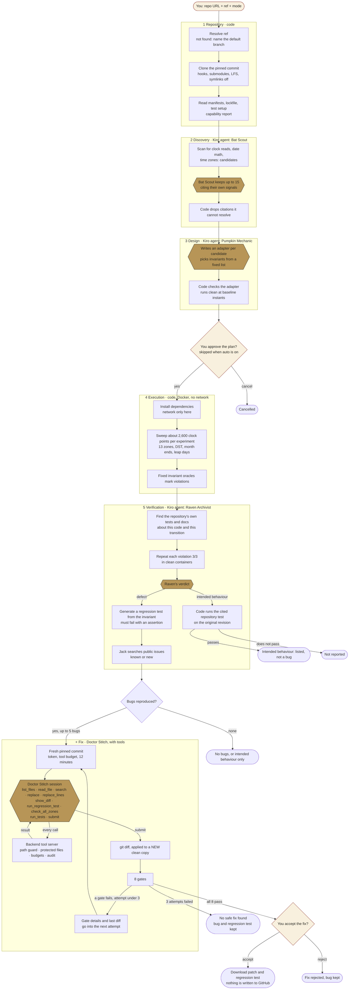

# TimeWraith agent flow

TimeWraith investigates date and time bugs in a public GitHub repository. Kiro agents **propose**. Plain code **decides**: it checks every claim against real data, runs every experiment in a Docker sandbox with no network, and gates every fix. This file describes the flow as the backend runs it (`backend/src/timewraith/pipeline.py`).

## The flow

Gold boxes with hexagons are Kiro agent steps. Plain boxes are code. Cream boxes are your decisions.

## The agents

| Agent | Mascot | Step | Gets | Returns | Cannot |
|---|---|---|---|---|---|
| Bat Scout | Bat Scout | 2 Discovery | Scan candidates and quoted source | Keep or drop per candidate, with cited signals | Invent candidates or lines |
| Pumpkin Mechanic | Pumpkin Mechanic | 3 Design | Candidate source, invariant catalog | An adapter, output fields, invariants, anchor instants | Choose pass or fail, or write assertions |
| Raven Archivist | Raven Archivist | 5 Verification | Violation, outputs at its clock points, adapter, source, the repository's own tests and docs | Verdict: defect, intended behaviour, allowed exception or adapter error, with cited evidence | Declare a bug without a failing regression test |
| Doctor Stitch | Doctor Stitch | + Fix | Finding, failing test output, and in a session only TimeWraith's tools | A patch through `submit`, with root cause and source citations | Touch tests, config, manifests, lockfiles, CI or generated files |
| Raven Archivist (review) | Raven Archivist | Fix gate 8 | The diff and the regression test only, never Doctor Stitch's reasoning | Approve or reject, with a reason | See the author's reasoning |
| Jack (issue match) | Two-Faced Jack | 5 Verification | Finding and public issues | An issue number only if it describes the same behaviour | Match loosely |

Agents in steps 2, 3 and 5 have no tools. Their source and evidence arrive as quoted data in the prompt, and every reply must match a Pydantic schema. Doctor Stitch is the only agent with tools, and only TimeWraith's (see below).

## Evidence rule

Every claim cites evidence: a signal, a source line, an invariant, a clock point, an issue, a repository test, or a repository doc. Code resolves each citation against real data before the claim counts. Unresolved citations are dropped and counted in the decision record. A verdict left without resolvable evidence is rejected.

Each agent decision is written as a `DecisionRecord`: the claim, the evidence kept, how many were dropped, the checks, the decision and the code rule that decided. `GET /api/v1/investigations/{id}/decisions` lists them.

## Verification in detail

1. **Repeat.** A violation counts only if it repeats 3/3 in clean containers. Otherwise it is recorded as rejected.
2. **Find intent.** Before the verdict, code searches the repository's own tests and docs (`intent.py`). It finds passages about the code under test, its local imports and the time transition at the clock point. Passages about the same kind of transition rank first.
3. **Verdict.** Raven rules. The four options are:
   - `intended_behavior`: the repository says this is deliberate. It must cite a test or doc line.
   - `defect`: a wrong behaviour nothing in the repository mentions. It must cite the invariant, the failing point, and where possible the source lines.
   - `allowed_exception`: one of the invariant's listed exceptions applies in general.
   - `adapter_error`: the adapter calls or reads the code wrongly.
4. **Code confirms `intended_behavior`.** A cited test file must pass on the original revision in the sandbox, or a cited doc line must exist. If that fails, nothing is reported. If it passes, the finding goes to `intended` and no bug is created.
5. **Code confirms `defect`.** A generated regression test is written from the invariant and must fail with an assertion on the original. Only then is a bug created.
6. **Jack** searches public issues (for example, `Known issue: #2624` or `No matching public issue found`).

## The fix step in detail

Each bug gets up to 3 attempts. Each attempt is one Kiro CLI session in the Kiro Crew container, using the profile `tw-doctor-stitch`. Its only tool server is TimeWraith's, reached through `backend/agents/tw_mcp_proxy.py`, which forwards each call to `/api/v1/internal/fix-tools/call` with a token that works only while that attempt runs.

| Tool | Does | Limit per attempt |
|---|---|---|
| `list_files`, `search`, `read_file` | Read git-tracked files, the regression test and the adapter | 200 files, 100 hits, 400 lines per call |
| `replace`, `replace_lines` | Edit one source file: exact text, or line numbers. Keeps line endings | Tests, config, manifests, lockfiles, CI and generated files refused |
| `show_diff` | `git diff` of the working copy | |
| `run_regression_test` | Runs the generated test at the failing clock point in the sandbox | 8 runs |
| `check_all_zones` | Runs the bug's experiment in all 13 zones | 3 runs |
| `run_tests` | Runs one repository test file | 4 runs |
| `submit` | Ends the session. Refused once if the regression test has not passed since the last edit | Summary 300 characters, root cause 1,200 |

The session has 40 tool calls and 12 minutes. When the budget is spent, every tool except `submit` refuses.

After `submit`:

1. The backend takes `git diff`, resets the working copy, and applies the diff to a **new clean copy** (`git apply`).
2. The 8 gates run in order, cheapest first. The first failing gate ends the attempt.
3. A failed attempt sends the failing gate's detail and the last diff to the next attempt.

## The 8 gates

| # | Gate | Passes when |
|---|---|---|
| 1 | `test_first` | The violation repeated 3/3, and the regression test failed on the original |
| 2 | `diff_limits` | At most 3 files and 60 changed lines, with no protected file touched |
| 3 | `fixed` | The regression test passes 3/3, and all 13 zones show the invariant holds |
| 4 | `mutation_check` | Undoing the source change makes the regression test fail again |
| 5 | `no_regressions` | The full repository test suite has no new failures |
| 6 | `no_new_anomalies` | No experiment shows a violation it did not show before |
| 7 | `static_checks` | The repository's typecheck and lint do not newly fail |
| 8 | `independent_review` | Raven approves the diff, without seeing Doctor Stitch's reasoning |

A fix counts as verified only when all 8 pass. You then accept it or reject it. Accepting lets you download the patch and its regression test. Nothing is written to GitHub.

## Outcomes

| Outcome | Shown as | Meaning |
|---|---|---|
| Done, bugs reproduced | `N bugs reproduced · M fixes verified` | Reproduced bugs, with any verified fixes |
| Done, intended only | `No bugs: N findings are intended behaviour the repository documents` | The repository deliberately behaves this way; cited in Findings |
| Done, no anomaly | `No anomaly observed in tested cases` | Nothing broke a rule |
| Waiting for you | `Waiting for you` | Plan to approve, or a verified fix to accept or reject |
| No safe fix | `No safe fix found` | Three attempts failed a gate. The bug and its regression test are kept |
| Agents stopped | `Agents stopped`, with the reason | Kiro usage limit reached. Findings that were not judged are not claimed as clean |
| Failed | The reason in plain words, with a retry | A stop code such as `ref_not_found` (the default branch is named), `sandbox_unavailable` or `install_failed` |

## Limits per investigation

| Limit | Value | Setting |
|---|---|---|
| Active time | 30 minutes | `TW_INVESTIGATION_BUDGET_S` |
| Agent calls | 40 | `TW_MAX_AGENT_CALLS` |
| Bugs to fix | 5 | `TW_MAX_BUGS_TO_FIX` |
| Fix attempts per bug | 3 | `TW_MAX_FIX_ATTEMPTS` |
| Patch size | 3 files, 60 lines | `TW_MAX_PATCH_FILES`, `TW_MAX_PATCH_LINES` |
| Fix session | 12 minutes, 40 tool calls | `TW_FIX_SESSION_S`, `TW_MAX_TOOL_CALLS` |

If the time budget runs out during the fix step, the case keeps its bugs and their regression tests.

## Runtime choice

`TW_AGENT_RUNTIME=auto` (the default) uses the Kiro Crew container once it is signed in. Otherwise it uses the stub, which never invents an output: judgment steps report "not run". `stub` and `command` are also available. Every case shows its runtime in its status.

## Where the code lives

| Piece | File |
|---|---|
| Flow orchestration, gates, verification | `backend/src/timewraith/pipeline.py` |
| Agent runtimes, prompts, reply schemas | `backend/src/timewraith/agents.py` |
| Agent profiles (role text) | `backend/agents/*.md` |
| Fix session tools and budgets | `backend/src/timewraith/fixsession.py` |
| MCP proxy inside the Crew container | `backend/agents/tw_mcp_proxy.py` |
| Repository intent search | `backend/src/timewraith/intent.py` |
| Time sweep and fixed invariants | `backend/src/timewraith/sweep.py` |
| Docker sandbox | `backend/src/timewraith/sandbox.py` |
| Kiro Crew container and sign-in | `backend/src/timewraith/crew.py` |
