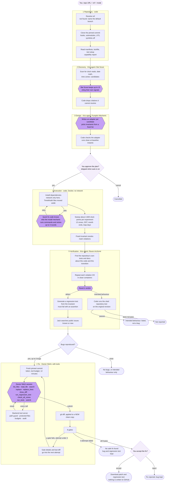

# TimeWraith agent flow

TimeWraith investigates date and time bugs in a public GitHub repository. Kiro agents **propose**. Plain code **decides**: it checks every claim against real data, runs every experiment in a Docker sandbox with no network, and gates every fix. This file describes the flow as the backend runs it (`backend/src/timewraith/pipeline.py`).

## The flow

Violet boxes are Kiro agent steps. Plain boxes are code. Light boxes are your decisions. The colours are the Violet Midnight tokens in [design-system.md](design-system.md).

## The agents

| Agent | Mascot | Step | Gets | Returns | Cannot |
|---|---|---|---|---|---|
| Bat Scout | Bat Scout | 2 Discovery | Scan candidates and quoted source | Keep or drop per candidate, with cited signals | Invent candidates or lines |
| Pumpkin Mechanic | Pumpkin Mechanic | 3 Design | Candidate source, invariant catalog | An adapter, output fields, invariants, anchor instants | Choose pass or fail, or write assertions |
| Pumpkin Mechanic (install repair) | Pumpkin Mechanic | 4 Execution | The failed install log, what was tried, and tools: read, run any command in the install sandbox, switch Node, check the install | Fixes it, or reports what it found; code checks that the test runner starts offline | Skip the check, or change files git tracks (code undoes that) |
| Raven Archivist | Raven Archivist | 5 Verification | Violation, outputs at its clock points, adapter, source, the repository's own tests and docs | Verdict: defect, intended behaviour, allowed exception or adapter error, with cited evidence | Declare a bug without a failing regression test |
| Doctor Stitch | Doctor Stitch | + Fix | Finding, failing test output, and in a session only TimeWraith's tools | A patch through `submit`, with root cause and source citations | Touch tests, config, manifests, lockfiles, CI or generated files |
| Raven Archivist (review) | Raven Archivist | Fix gate 8 | The diff and the regression test only, never Doctor Stitch's reasoning | Approve or reject, with a reason | See the author's reasoning |
| Jack (issue match) | Two-Faced Jack | 5 Verification | Finding and public issues | An issue number only if it describes the same behaviour | Match loosely |

Agents in steps 2, 3 and 5 have no tools. Their source and evidence arrive as quoted data in the prompt, and every reply must match a Pydantic schema. Doctor Stitch is the only agent with tools, and only TimeWraith's (see below).

## Evidence rule

Every claim cites evidence: a signal, a source line, an invariant, a clock point, an issue, a repository test, or a repository doc. Code resolves each citation against real data before the claim counts. Unresolved citations are dropped and counted in the decision record. A verdict left without resolvable evidence is rejected.

Each agent decision is written as a `DecisionRecord`: the claim, the evidence kept, how many were dropped, the checks, the decision and the code rule that decided. `GET /api/v1/investigations/{id}/decisions` lists them.

## The planner loop and the coverage ledger

After the first sweep and verification, the hunt does not end. Code builds a **coverage ledger**: for each reviewed candidate, whether it was tested, which rules its experiments checked, which clock situations broke a rule (fall-back, spring-forward, month end, other), and what verification concluded. Wraith Director (profile `wraith-director.md`, no tools) reads it and proposes up to 3 **intents**, each a candidate plus a focus such as "next() with currentDate = now at 30-minute DST gaps". Code rejects unknown candidates and repeated directions, Pumpkin Mechanic designs an experiment for each accepted intent, and the new experiments go through the baseline check, the sweep and Raven's verification. The loop runs up to 2 rounds (`TW_MAX_PLAN_ROUNDS`), and ends earlier when the planner finds no new direction, the agent budget is short, or the time left cannot cover another round plus the fix step. The ledger and the intents are saved on the case (`coverage`, `intents`).

## Time budget: preflight and wrap-up

Before each long step (an adapter repair, a verification session, a planning round, a fix attempt with its gates) code checks that the time left covers it. If not, the step is skipped, the case notes "Wrap-up: … not started", and the run continues to its end instead of failing halfway. Findings and regression tests are kept.

## The fix as a branch

When you accept a fix that passed all 8 gates, code makes a local git branch in `TW_DATA_DIR/branches/<case id>/<repo>`: a clone of the pinned revision, with `origin` set to the upstream repository, and one commit on a branch named `timewraith/<bug id>-<title words>`. The commit holds exactly what the gates tested (the source change and the regression test, plus the adapter only if the test needs it), under the author `TimeWraith`, with the root cause, the gate results and the public report in the message. Nothing is pushed anywhere: to share it, add your own fork as a remote and push the branch yourself. `GET .../bugs/{bug_id}/branch.patch` downloads the same commit as a `git format-patch` file, and `git am` rebuilds an identical tree from it. `POST .../bugs/{bug_id}/branch` makes the branch again if it failed or was deleted; a failure never undoes your acceptance. The regression test sits where TimeWraith generated it (`__tw__/` next to the source); moving it into the repository's own test folder is a step for the maintainers.

## Sharing a fix on GitHub (optional)

A third container, `timewraith-git` (git and GitHub's `gh`, built from `backend/docker/git.Dockerfile`), holds the GitHub sign-in in its own volume. It is separate from the Kiro Crew, so the Kiro agents never see the token, and no TimeWraith folder is mounted into it: the backend sends in only the branch's patch and validated names.

- **Sign-in:** `POST /system/github/start`, then `/login` returns a one-time code and the `https://github.com/login/device` link, as the Kiro sign-in does. `/login/cancel` and `/logout` undo it. The status is part of `GET /system/setup` under `github`. The scope is `public_repo`, so the token can write to all of your public repositories; `gh` keeps it in a plain file in the container's volume.
- **Preview:** `GET .../bugs/{bug}/github` lists what would be sent (the original repo, your fork, the branch, the files, a title and description from the commit) and the open pull requests that look like the same bug. It sends nothing.
- **Push:** `POST .../github/push` with `{"confirm_branch": "<the branch name>"}` forks the original repo if needed, rebuilds the fix commit on the pinned revision from the patch, and pushes the branch to your fork. Never to the original repository.
- **Pull request:** `POST .../github/pull-request` with `{"title", "body", "confirm_branch"}` opens it on the original repository from your fork branch. It refuses a second pull request from the same branch.
- **Rules in code:** only branches named `timewraith/...`, only after you accepted a verified fix, only when the confirmation repeats the branch name, and only to a fork owned by the signed-in user (a same-named repository that is not a fork of the original is refused). Anything that looks like a token is removed from every error before it is shown. The result is saved on the bug as `fix.publish`.

## Retest

`POST /api/v1/investigations/{id}/bugs/{bug_id}/retest` with `{"ref": "master" | "<sha>" | "pull/453"}` reruns the bug's regression test 3 times on that revision of the repository, with the case's pinned install, and records Fixed, Still reproducible or Cannot confirm on the bug (`retests`). The workspace goes back to the pinned commit afterwards. On cron-parser, PR #453 retests as Fixed and `master` as Still reproducible.

## Untrusted data markers

Repository content in prompts is framed as `<data-TAG name="…">…</data-TAG>`, where TAG is random for every block, so text in the repository cannot close the block early.

## Baseline check and adapter repair (Pumpkin with tools)

After install, each adapter runs at ordinary instants (mid-day, no DST change, no month end) in UTC and America/New_York. Besides running cleanly and returning its fields, every rule its fields feed must hold there. A rule that breaks at an ordinary instant means the field does not mean what the rule says (for example `date` set to the result of `addDay` instead of today's date), so a violation at the edges would show nothing about time bugs.

With the Kiro Crew container runtime, an adapter that fails this check goes to Pumpkin's workshop (`designsession.py`, profile `tw-pumpkin-mechanic`), and only such adapters, to keep the credit cost down:

| Tool | Does | Limit per session |
|---|---|---|
| `list_files`, `search`, `read_file` | Read git-tracked files, the adapter and the harness | As for Doctor Stitch |
| `write_adapter` | Replace the adapter (must define `run`) | |
| `run_adapter` | Run the adapter once with the clock frozen at a point he picks, and show what `run()` returned | 8 runs |
| `check_baseline` | The same check code runs on submit | 3 checks |
| `submit_adapter` | Final fields and claim; code reruns the baseline check and sends problems back (up to 2 times) | |

The session has 25 tool calls and 8 minutes. If a rule still breaks at ordinary instants after the repair, code drops that rule and keeps the experiment for the rules that hold. Without the container runtime, the single-reply redesign runs instead. On run 7's adapters, the check caught three of the four that Raven had to dismiss as adapter errors, and left the experiment with the real Lord Howe bug untouched.

## Agentic verification (Raven with tools)

With the Kiro Crew container runtime, Raven verifies each repeated violation in her own tool session (`verifysession.py`, profile `tw-raven-archivist`, the same MCP proxy and token-gated endpoint as Doctor Stitch). She does not rule from the adapter's output alone: the adapter was written by another agent and may be wrong.

| Tool | Does | Limit per session |
|---|---|---|
| `list_files`, `search`, `read_file` | Read git-tracked files and the adapter | As for Doctor Stitch |
| `run_probe` | Runs her short script against the real code (`load('src/x')`, `print`, `check`) with the clock frozen at a point she picks and the process zone set; the repository is mounted read-only | 12 probes |
| `run_tests` | Runs one repository test file as written | 4 runs |
| `search_issues` | Searches public issues and pull requests; threads labelled question, discussion and similar are skipped | 3 searches |
| `submit_verdict` | Her verdict with evidence and, where needed, a reproduction | |

The session has 30 tool calls and 10 minutes. Code checks the verdict before it counts, and a rejected verdict goes back to her with the reason (up to 2 times):

| Verdict | Code requires |
|---|---|
| `defect` | A reproduction that loads repository code, whose check fails 3/3 at the failing point (in the violation's zone or within 36 hours of it) and passes at a control point; a user check, the same symptom through the API the package's users call, that fails 3/3 in the same zone; a cited source line that exists; and the regression test made from both fails with an assertion. That test becomes the bug's regression test, so the `fixed` gate needs users' calls to work, not only the internal helper |
| `adapter_error` | Her reproduction's check passes at the violation's own point: the code is right when called correctly |
| `intended_behavior` | A cited repository test or doc line; code then runs the cited test as before |
| `allowed_exception` | A cited invariant |

An issue match counts only if it is one of her search results and names the code under test. With other runtimes, verification uses the single-reply verdict described below.

Design also changed: code adds every invariant the adapter's returned fields can feed, and drops `instant_zone_independent` when the adapter passes `ctx.tz` into the code.

## Verification in detail

1. **Repeat.** A violation counts only if it repeats 3/3 in clean containers. Otherwise it is recorded as rejected.
2. **Find intent.** Before the verdict, code searches the repository's own tests and docs (`intent.py`). It finds passages about the code under test, its local imports and the time transition at the clock point. Passages about the same kind of transition rank first.
3. **Verdict.** Raven rules. The four options are:
   - `intended_behavior`: the repository says this is deliberate. It must cite a test or doc line.
   - `defect`: a wrong behaviour nothing in the repository mentions. It must cite the invariant, the failing point, and where possible the source lines.
   - `allowed_exception`: one of the invariant's listed exceptions applies in general.
   - `adapter_error`: the adapter calls or reads the code wrongly.
4. **Code confirms `intended_behavior`.** A cited test file must pass on the original revision in the sandbox, or a cited doc line must exist. If that fails, nothing is reported. If it passes, the finding goes to `intended` and no bug is created.
5. **Code confirms `defect`.** A generated regression test is written from the invariant and must fail with an assertion on the original. Only then is a bug created.
6. **Jack** searches public issues (for example, `Known issue: #2624` or `No matching public issue found`).

## The fix step in detail

Each bug gets up to 3 attempts. Each attempt is one Kiro CLI session in the Kiro Crew container, using the profile `tw-doctor-stitch`. Its only tool server is TimeWraith's, reached through `backend/agents/tw_mcp_proxy.py`, which forwards each call to `/api/v1/internal/fix-tools/call` with a token that works only while that attempt runs.

| Tool | Does | Limit per attempt |
|---|---|---|
| `list_files`, `search`, `read_file` | Read git-tracked files, the regression test and the adapter | 200 files, 100 hits, 400 lines per call |
| `replace`, `replace_lines` | Edit one source file: exact text, or line numbers. Keeps line endings | Tests, config, manifests, lockfiles, CI and generated files refused |
| `show_diff` | `git diff` of the working copy | |
| `run_regression_test` | Runs the generated test at the failing clock point in the sandbox | 8 runs |
| `check_all_zones` | Runs the bug's experiment in all 13 zones | 3 runs |
| `run_tests` | Runs one repository test file | 4 runs |
| `submit` | Ends the session. Refused once if the regression test has not passed since the last edit | Summary 300 characters, root cause 1,200 |

The session has 40 tool calls and 12 minutes. When the budget is spent, every tool except `submit` refuses.

After `submit`:

1. The backend takes `git diff`, resets the working copy, and applies the diff to a **new clean copy** (`git apply`).
2. The 8 gates run in order, cheapest first. The first failing gate ends the attempt.
3. A failed attempt sends the failing gate's detail and the last diff to the next attempt.

## The 8 gates

| # | Gate | Passes when |
|---|---|---|
| 1 | `test_first` | The violation repeated 3/3, and the regression test failed on the original |
| 2 | `diff_limits` | At most 3 files and 60 changed lines, with no protected file touched |
| 3 | `fixed` | The regression test passes 3/3, and all 13 zones show the invariant holds |
| 4 | `mutation_check` | Undoing the source change makes the regression test fail again |
| 5 | `no_regressions` | The full repository test suite has no new failures |
| 6 | `no_new_anomalies` | No experiment shows a violation it did not show before |
| 7 | `static_checks` | The repository's typecheck and lint do not newly fail |
| 8 | `independent_review` | Raven approves the diff, without seeing Doctor Stitch's reasoning |

A fix counts as verified only when all 8 pass. You then accept it or reject it. Accepting lets you download the patch and its regression test. Nothing is written to GitHub.

## Following the repository's rules

Before anything is pushed, `POST .../contribution` checks the accepted fix against the target repository's own rules (code, no agent):

- Reads CONTRIBUTING, the PR template, commitlint and package scripts from the default branch. Warns about DCO, CLA, an issue-first request and AI policy lines. An archived repository is refused.
- Fetches the upstream tip and carries the fix onto it. If the new test already passes there, the bug is fixed upstream and nothing is sent (`already_fixed_upstream`).
- Places the test in the repository's test folder as `<Source>.<topic>.test.ts`, runs Prettier, ESLint and tsc with the repository's configuration, then the new test (fails without the fix, passes with it) and the full suite.
- Rebuilds the branch as one commit with a conventional-commit title and fills the repository's PR template. Boxes are ticked only for checks that passed. A disclosure line says TimeWraith drafted the change.
- Push and pull request are refused until this passes (`not_prepared`, `checks_failed`, `repo_archived`). Open pull requests about the same bug block the push unless the request sends `acknowledge_duplicates` (`duplicate_exists`).

### Updating a fix that is already on the fork

When the user checks the fix against the repository's rules again after a push, the local branch gets a new commit. `POST .../github/update` (`{title, body, confirm_branch}`) then adds one commit on top of what TimeWraith pushed and refreshes the open pull request's title and text. It is a fast-forward push only; nothing is force-pushed.

- The preview's `update` field says whether an update is available (`{available, reason}`).
- If the original moved on since the first push, the new commit also has the new upstream tip as a second parent, so the pull request still shows only the fix.
- It refuses when the fork branch is not exactly the commit TimeWraith pushed last (`fork_changed`), when the pull request is closed or merged (`pr_closed`, `pr_merged`), or when there is nothing new (`nothing_to_update`). `not_prepared`, `checks_failed` and `not_pushed` apply as for a push.
- The pull request being updated is not listed as a duplicate.

## Outcomes

| Outcome | Shown as | Meaning |
|---|---|---|
| Done, bugs reproduced | `N bugs reproduced · M fixes verified` | Reproduced bugs, with any verified fixes |
| Done, intended only | `No bugs: N findings are intended behaviour the repository documents` | The repository deliberately behaves this way; cited in Findings |
| Done, no anomaly | `No anomaly observed in tested cases` | Nothing broke a rule |
| Waiting for you | `Waiting for you` | Plan to approve, or a verified fix to accept or reject |
| No safe fix | `No safe fix found` | Three attempts failed a gate. The bug and its regression test are kept |
| Agents stopped | `Agents stopped`, with the reason | Kiro usage limit reached. Findings that were not judged are not claimed as clean |
| Failed | The reason in plain words, with a retry | A stop code such as `ref_not_found` (the default branch is named), `sandbox_unavailable` or `install_failed` |

## Limits per investigation

| Limit | Value | Setting |
|---|---|---|
| Active time | 3 hours | `TW_INVESTIGATION_BUDGET_S` |
| Agent calls | 40 | `TW_MAX_AGENT_CALLS` |
| Bugs to fix | 5 | `TW_MAX_BUGS_TO_FIX` |
| Fix attempts per bug | 3 | `TW_MAX_FIX_ATTEMPTS` |
| Patch size | 3 files, 60 lines | `TW_MAX_PATCH_FILES`, `TW_MAX_PATCH_LINES` |
| Fix session | 12 minutes, 40 tool calls | `TW_FIX_SESSION_S`, `TW_MAX_TOOL_CALLS` |

If the time budget runs out during the fix step, the case keeps its bugs and their regression tests.

## Runtime choice

`TW_AGENT_RUNTIME=auto` (the default) uses the Kiro Crew container once it is signed in. Otherwise it uses the stub, which never invents an output: judgment steps report "not run". `stub` and `command` are also available. Every case shows its runtime in its status.

## Where the code lives

| Piece | File |
|---|---|
| Flow orchestration, gates, verification | `backend/src/timewraith/pipeline.py` |
| Agent runtimes, prompts, reply schemas | `backend/src/timewraith/agents.py` |
| Agent profiles (role text) | `backend/agents/*.md` |
| Fix session tools and budgets | `backend/src/timewraith/fixsession.py` |
| MCP proxy inside the Crew container | `backend/agents/tw_mcp_proxy.py` |
| Repository intent search | `backend/src/timewraith/intent.py` |
| Time sweep and fixed invariants | `backend/src/timewraith/sweep.py` |
| Docker sandbox | `backend/src/timewraith/sandbox.py` |
| Kiro Crew container and sign-in | `backend/src/timewraith/crew.py` |
